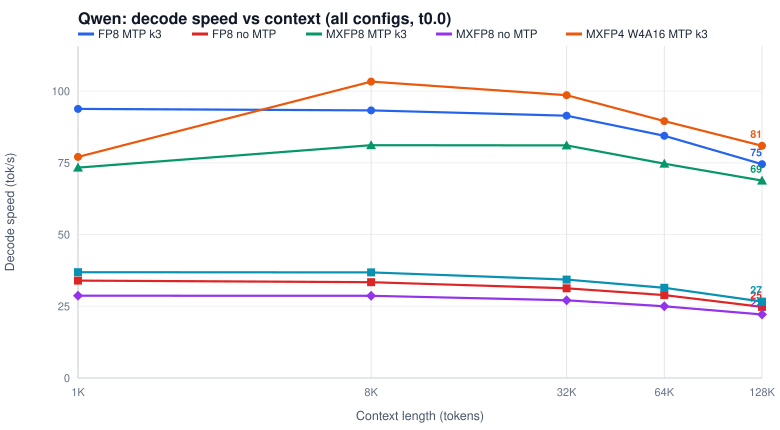
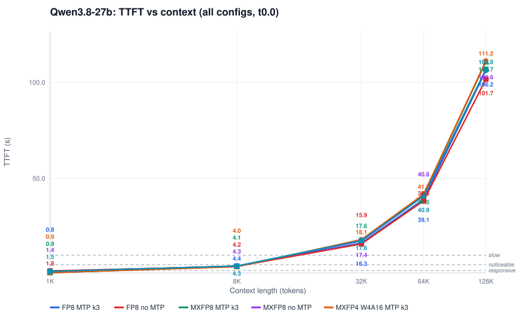
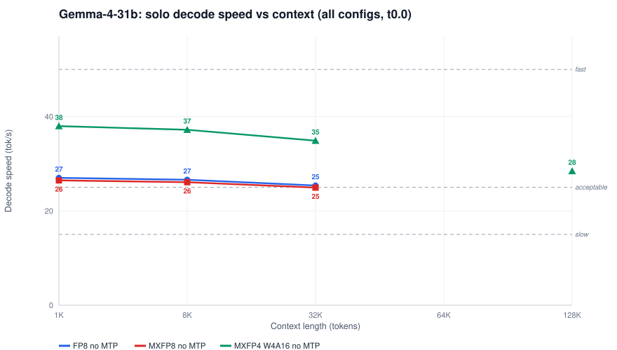
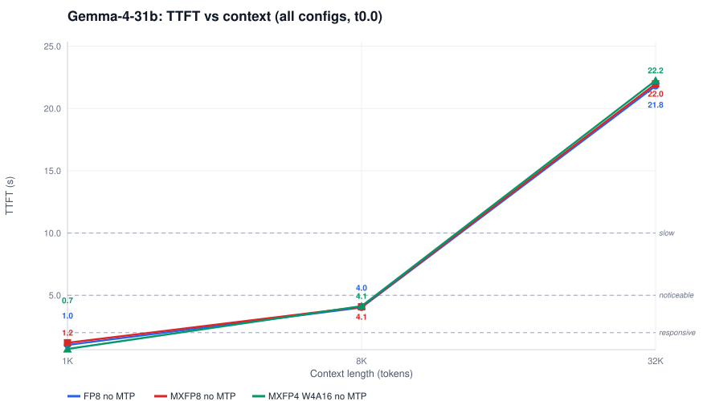

# Performance reports — 2x Intel Arc Pro B70 (vllm-arc cert23)

Individual close-out reports per model x quantization x MTP posture, each with the full copyable configuration, all decode/TTFT/prefill/ITL data, and line charts. Generated 2026-11-10 from the r138 bank (`results/2026-11-10-p637-reports/`).

## Qwen3.8-27B (dense hybrid-GDN, MTP k3 and no-MTP)

| Report | Precision | MTP | Peak decode | Outcome |
|---|---|---|---|---|
| [qwen3.8-27b-fp8-k3](qwen3.8-27b-fp8-k3.md) | FP8 (fp8 checkpoint, compressed-tensors) | MTP k3 | 93.8 tok/s @ 1K | FACES_OK |
| [qwen3.8-27b-fp8-k0](qwen3.8-27b-fp8-k0.md) | FP8 (fp8 checkpoint, compressed-tensors) | no MTP | 34.0 tok/s @ 1K | FACES_OK |
| [qwen3.8-27b-mxfp8-k3](qwen3.8-27b-mxfp8-k3.md) | MXFP8 (online, bf16 base checkpoint) | MTP k3 | 81.1 tok/s @ 8K | FACES_OK |
| [qwen3.8-27b-mxfp8-k0](qwen3.8-27b-mxfp8-k0.md) | MXFP8 (online, bf16 base checkpoint) | no MTP | 28.7 tok/s @ 1K | FACES_OK |
| [qwen3.8-27b-mxfp4-k3](qwen3.8-27b-mxfp4-k3.md) | MXFP4 W4A16 (online, bf16 base checkpoint) | MTP k3 | 103.3 tok/s @ 8K | FACES_OK |
| [qwen3.8-27b-mxfp4-k0](qwen3.8-27b-mxfp4-k0.md) | MXFP4 W4A16 (online, bf16 base checkpoint) | no MTP | 36.9 tok/s @ 1K | FACES_OK |

## Gemma-4-31B (dense hybrid, no MTP head)

| Report | Precision | MTP | Peak decode | Outcome |
|---|---|---|---|---|
| [gemma-4-31b-fp8](gemma-4-31b-fp8.md) | FP8 (online, bf16 base checkpoint) | no MTP | 27.0 tok/s @ 1K | FACES_OK |
| [gemma-4-31b-mxfp8](gemma-4-31b-mxfp8.md) | MXFP8 (online, bf16 base checkpoint) | no MTP | 26.5 tok/s @ 1K | FACES_OK |
| [gemma-4-31b-mxfp4](gemma-4-31b-mxfp4.md) | MXFP4 W4A16 (online, bf16 base checkpoint) | no MTP | 38.0 tok/s @ 1K | FACES_OK |

## Cross-cutting

- [Qwen FP8 + MTP k3 — KV-cache dtype comparison](qwen3.8-27b-fp8-kv-cache-dtype.md)

<i>qwen all decode</i>

<i>qwen all ttft</i>

<i>gemma all decode</i>

<i>gemma all ttft</i>

## Reading the numbers

- **Decode speed**: < 15 tok/s slow · 15–25 acceptable · 25–50 fast · > 50 very fast (streaming UX).
- **TTFT**: < 0.5 s instant · 0.5–2 s responsive · 2–5 s noticeable · 5–10 s slow · > 10 s frustrating.
- All cells: concurrency 1, 600 output tokens, temperature 0.0 unless the chart/table says otherwise; unique per-face prompts (cold prefill).
- Hardware: 2x Arc Pro B70 (32 GB each), host 64 GB RAM; close-out F defaults (--shm-size 16g, 16 GB LMCache CPU tier).
