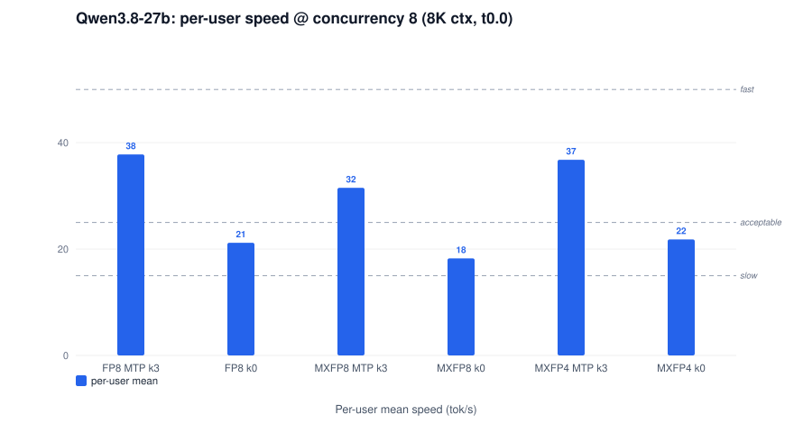
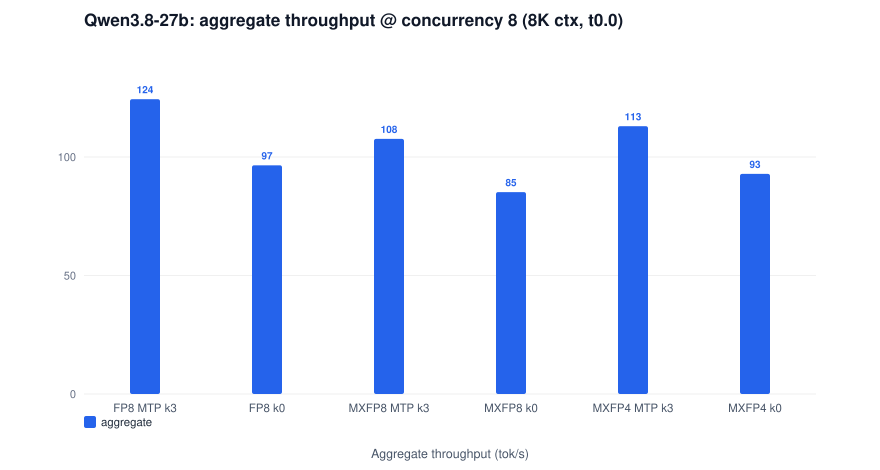
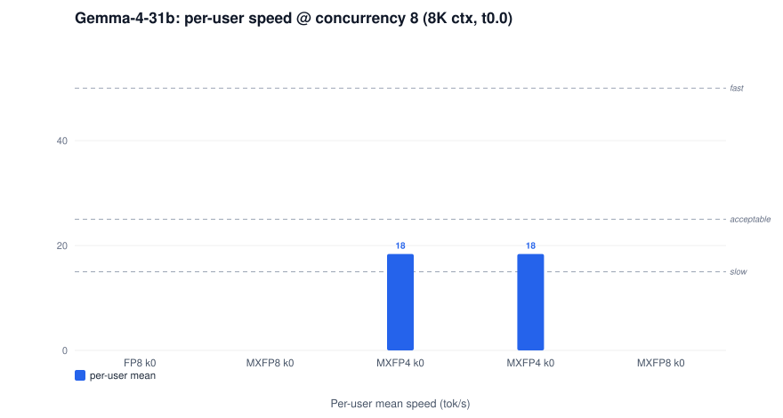
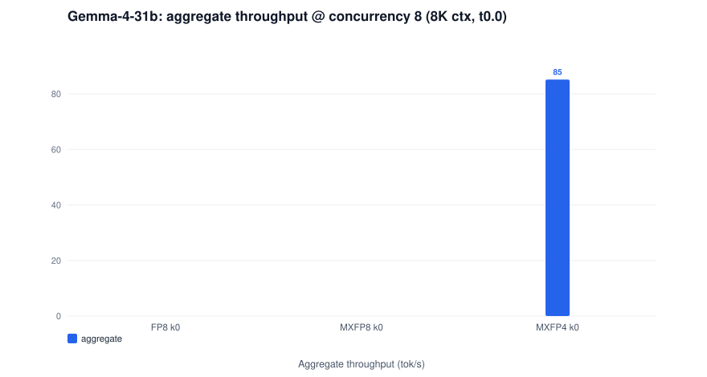

# Performance reports — 2x Intel Arc Pro B70 (vllm-arc cert23)

World-class close-out reports per model x quantization x MTP posture: executive summary and key findings, use-case guidance with capacity verdicts, system throughput, UX-banded speed and TTFT, capacity analysis, technical analysis (queue decomposition, prefill, ITL, scaling efficiency), concurrency sweeps {1,2,3,4,8}, temperature analysis, the full copyable configuration, and charts. Generated 2026-11-11 from the r138 bank (`results/2026-11-10-p637-reports/`) + r139 bank (`results/2026-11-11-p637b-conc/`) + gemma 128K annex (`results/2026-11-11-r140-gemma128k/`).

Metric definitions, UX bands and thresholds: [METHODOLOGY.md](METHODOLOGY.md).

## Qwen3.8-27B (dense hybrid-GDN, MTP k3 and no-MTP)

| Report | Precision | MTP | Peak decode (solo) | Per-user @ c8, 8K | Agg @ c8, 8K | Tokens/hr @ c8 | TTFT max @ c8 (s) | Chat capacity (8K) | Outcome |
|---|---|---|---|---|---|---|---|---|---|
| [qwen3.8-27b-fp8-k3](qwen3.8-27b-fp8-k3.md) | FP8 (fp8 checkpoint, compressed-tensors) | MTP k3 | 93.8 tok/s @ 1K | 37.8 | 124 | 447K | 29.0 | ~2 concurrent requests | FACES_OK |
| [qwen3.8-27b-fp8-k0](qwen3.8-27b-fp8-k0.md) | FP8 (fp8 checkpoint, compressed-tensors) | no MTP | 34.0 tok/s @ 1K | 21.2 | 97 | 347K | 28.3 | ~2 concurrent requests | FACES_OK |
| [qwen3.8-27b-mxfp8-k3](qwen3.8-27b-mxfp8-k3.md) | MXFP8 (online, bf16 base checkpoint) | MTP k3 | 81.1 tok/s @ 8K | 31.5 | 108 | 387K | 32.1 | ~2 concurrent requests | FACES_OK |
| [qwen3.8-27b-mxfp8-k0](qwen3.8-27b-mxfp8-k0.md) | MXFP8 (online, bf16 base checkpoint) | no MTP | 28.7 tok/s @ 1K | 18.2 | 85 | 306K | 31.1 | ~2 concurrent requests | FACES_OK |
| [qwen3.8-27b-mxfp4-k3](qwen3.8-27b-mxfp4-k3.md) | MXFP4 W4A16 (online, bf16 base checkpoint) | MTP k3 | 103.3 tok/s @ 8K | 36.8 | 113 | 406K | 32.5 | ~2 concurrent requests | FACES_OK |
| [qwen3.8-27b-mxfp4-k0](qwen3.8-27b-mxfp4-k0.md) | MXFP4 W4A16 (online, bf16 base checkpoint) | no MTP | 36.9 tok/s @ 1K | 21.8 | 93 | 334K | 31.6 | ~2 concurrent requests | FACES_OK |

## Gemma-4-31B (dense hybrid, no MTP head; 128K annex on MXFP4)

| Report | Precision | MTP | Peak decode (solo) | Per-user @ c8, 8K | Agg @ c8, 8K | Tokens/hr @ c8 | TTFT max @ c8 (s) | Chat capacity (8K) | Outcome |
|---|---|---|---|---|---|---|---|---|---|
| [gemma-4-31b-fp8](gemma-4-31b-fp8.md) | FP8 (online, bf16 base checkpoint) | no MTP | 27.0 tok/s @ 1K | - | - | - | - | ~2 concurrent requests | FACES_OK |
| [gemma-4-31b-mxfp8](gemma-4-31b-mxfp8.md) | MXFP8 (online, bf16 base checkpoint) | no MTP | 26.5 tok/s @ 1K | - | - | - | - | ~2 concurrent requests | FACES_OK |
| [gemma-4-31b-mxfp4](gemma-4-31b-mxfp4.md) | MXFP4 W4A16 (online, bf16 base checkpoint) | no MTP | 38.0 tok/s @ 1K | 18.4 | 85 | 306K | 32.8 | ~2 concurrent requests | FACES_OK |
| [gemma-4-31b-mxfp4-128k](gemma-4-31b-mxfp4-128k.md) | MXFP4 W4A16 (online, bf16 base checkpoint) | no MTP | 38.0 tok/s @ 1K | 18.4 | 85 | 306K | 32.7 | ~2 concurrent requests | CONC_OK |
| [gemma-4-31b-mxfp8-128k](gemma-4-31b-mxfp8-128k.md) | MXFP8 (online, bf16 base checkpoint) | no MTP | - | - | - | - | - | - | BOOT_FAIL |

## Cross-cutting

- [KV-cache dtype comparison — both models + TurboQuant + capacity cliffs](qwen3.8-27b-fp8-kv-cache-dtype.md)
- [Benchmark methodology](METHODOLOGY.md)

<i>Qwen: solo decode speed vs context (all configs)</i>

<i>Qwen: TTFT vs context (all configs)</i>

<i>Gemma: solo decode speed vs context (all configs)</i>

<i>Gemma: TTFT vs context (all configs)</i>

<i>Qwen: per-user speed @ c8 (8K ctx)</i>

<i>Qwen: aggregate throughput @ c8 (8K ctx)</i>

<i>Gemma: per-user speed @ c8 (8K ctx)</i>

<i>Gemma: aggregate throughput @ c8 (8K ctx)</i>

## Reading the numbers

- **Per-user speed (streaming UX)**: < 15 tok/s slow · 15–25 acceptable · 25–50 fast · ≥ 50 very fast.
- **TTFT**: < 0.5 s instant · 0.5–2 s responsive · 2–5 s noticeable · 5–10 s slow · > 10 s frustrating.
- **Concurrency**: r139 barrier-starts N simultaneous requests, each a full cold prefill + 600 streamed tokens — the worst-case burst; sustained interactive user counts run well below request concurrency.
- Solo faces (r138): concurrency 1, 600 output tokens, temperature 0.0 unless stated; unique per-face prompts (cold prefill). MTP lanes add the 6-point temperature sweep; r139 adds a t1.0 solo face per context on every config.
- Hardware: 2x Arc Pro B70 (32 GB each, one card per socket, TP2), host 64 GB RAM; close-out F defaults (--shm-size 16g, 16 GB LMCache CPU tier).
