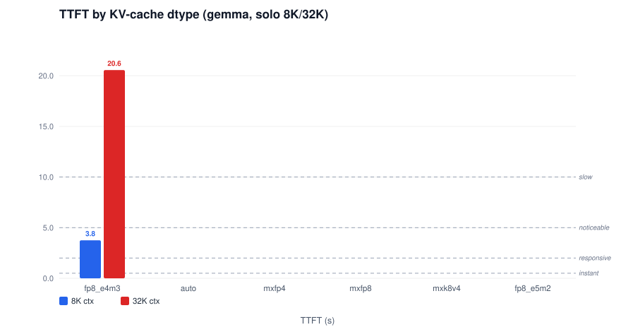
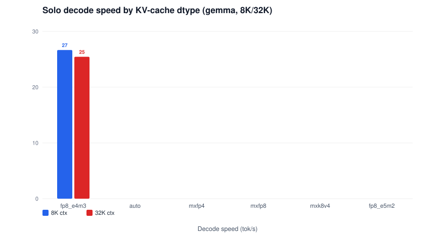
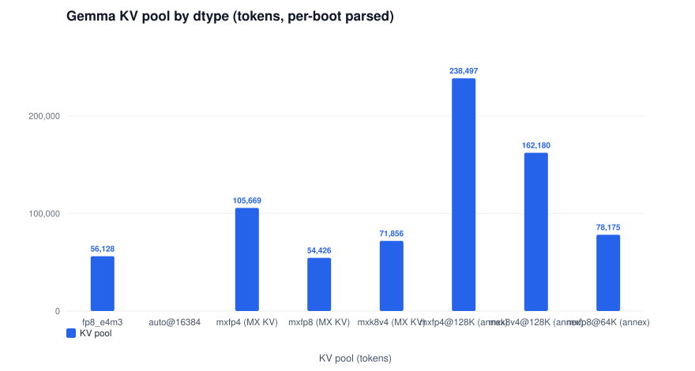

# Gemma-4-31B — KV-cache dtype comparison

| Field | Value |
|---|---|
| Model | Gemma-4-31B (60-layer two-head-size hybrid, no MTP head) |
| Posture | online-fp8 weights — constant across every row of this report — TP2, maxlen 40960, LMC off, graphs on |
| Knob | `ARC_KVDTYPE` in `tools/serve_arc_b70.sh` (default `fp8_e4m3`) → `--kv-cache-dtype` |
| Menu | fp8_e4m3 · auto (fp16 KV, maxlen-capped) · mxfp4 · mxfp8 · mxk8v4 (MX KV, native) · fp8_e5m2 (refusal probe) |
| Faces | r240b: the `gf8` ctrl full ladder {1,2,3,4,5,6,7,8} at 1K/8K/32K + t1.0 (14/14 served); the `gkv_m*` MX lanes banked the {1,2,4,8} grid + t1.0 solos but ZERO faces served (hd512 decode refusal below); r240c annex: `gm4x` (W4A16 weights + fp8 KV at maxlen 131072, 26/26 served) carries the 128K story, `gf8x64`/`gm8x64` close the 64K rung (2/2 each), `gkv_m4x`/`gkv_mkx`/`gkv_m8x64` banked the native MX grids but zero faces served, and `gm8x`/`gkv_m8x131` bank the 8-bit 128K refusals |
| Engine | vLLM v0.30.0 — vllm-arc v0.30.0-b70-cert28, TP2 |
| Date | 2026-11-24 |

The gemma-side answer to the question the qwen report asks ([qwen3.8-27b-fp8-kv-cache-dtype.md](qwen3.8-27b-fp8-kv-cache-dtype.md)): what the KV-cache dtype menu buys on the second model. Gemma's geometry sets the terms — no MTP head (every row is spec-free k0 decode), maxlen 40960, and pools roughly an order below qwen's, so high-ctx concurrency points can bank as KV_CAP rows rather than measurements. **The r240b/r240c outcome sets the headline: the native MX-KV menu does not serve gemma on this image.** Every `gkv_m*` lane boots and banks its pool, but the FIRST decode request fatals — gemma's 10 hd512 full-attention layers sit outside the arc7 compiled instantiations (`mx_paged_decode` covers head_size 128/256 only), so all 85 banked `gkv_m*` faces across r240b + r240c are connection-refused artifacts with zero served requests. On gemma, `fp8_e4m3` is the only servable KV dtype; the packed-capacity story rides the weights lane instead (`gm4x`: W4A16 + fp8 KV serves the full 128K posture). A `-` cell is a banked boot refusal, capacity cliff, or this banked decode refusal — never unmeasured coverage.

| --kv-cache-dtype | Context | TTFT solo (s) | Decode solo (tok/s) | Agg @ c8 (tok/s) | Per-user @ c8 (tok/s) | ITL p50 (ms) | KV pool (tok) | Note |
|---|---|---|---|---|---|---|---|---|
| fp8_e4m3 | 8K | 3.75 | 26.7 | - | - | 37.6 | 56,128 | the gemma incumbent: online-fp8 weights + fp8_e4m3 KV (r240b gf8 cell, full conc ladder) |
| fp8_e4m3 | 32K | 20.6 | 25.4 | - | - | 39.5 | 56,128 | the gemma incumbent: online-fp8 weights + fp8_e4m3 KV (r240b gf8 cell, full conc ladder) |
| auto | 8K | - | - | - | - | - | - | fp16 KV; refuses at max_model_len 40960 (the certified gemma posture), servable at 16384 |
| auto | 32K | - | - | - | - | - | - | fp16 KV; refuses at max_model_len 40960 (the certified gemma posture), servable at 16384 |
| mxfp4 | 8K | - | - | - | - | - | 105,669 | MX KV on gemma: e2m1 data + E8M0 scales; boots + banks the pool, but every decode face fatals on the hd512 layers (D=128/256 instantiations only) -- zero served faces (r240b) |
| mxfp4 | 32K | - | - | - | - | - | 105,669 | MX KV on gemma: e2m1 data + E8M0 scales; boots + banks the pool, but every decode face fatals on the hd512 layers (D=128/256 instantiations only) -- zero served faces (r240b) |
| mxfp8 | 8K | - | - | - | - | - | 54,426 | MX KV on gemma: e4m3 data + E8M0 scales; boots + banks the pool, but every decode face fatals on the hd512 layers (D=128/256 instantiations only) -- zero served faces (r240b) |
| mxfp8 | 32K | - | - | - | - | - | 54,426 | MX KV on gemma: e4m3 data + E8M0 scales; boots + banks the pool, but every decode face fatals on the hd512 layers (D=128/256 instantiations only) -- zero served faces (r240b) |
| mxk8v4 | 8K | - | - | - | - | - | 71,856 | mixed MX KV on gemma: e4m3 K + e2m1 V; boots + banks the pool, but every decode face fatals on the hd512 layers (D=128/256 instantiations only) -- zero served faces (r240b) |
| mxk8v4 | 32K | - | - | - | - | - | 71,856 | mixed MX KV on gemma: e4m3 K + e2m1 V; boots + banks the pool, but every decode face fatals on the hd512 layers (D=128/256 instantiations only) -- zero served faces (r240b) |
| fp8_e5m2 | 8K | - | - | - | - | - | - | refusal probe: the e5m2 law is engine-level (no e5m2 KV dequant path in esimd FA2 on Xe2, banked on qwen kve5m2) |
| fp8_e5m2 | 32K | - | - | - | - | - | - | refusal probe: the e5m2 law is engine-level (no e5m2 KV dequant path in esimd FA2 on Xe2, banked on qwen kve5m2) |

## MX KV lanes — the attempted sweep (r240b, grid {1,2,4,8})

All three native MX lanes were attempted at maxlen 40960 (grid {1,2,4,8} at 1K/8K/32K + t1.0 solos). Zero faces served — every banked face is the same first-decode engine refusal, so the sweep collapses into the refusal-summary table below rather than all-dash concurrency tables. The pools these lanes banked at boot remain real capacity facts (the capacity table below) — the lane is refused at decode, not at boot.

### Lane/ctx pairs with banked faces but zero served requests

| Lane | Context (K) | Banked faces | Outcome |
|---|---|---|---|
| mxfp4 | 1 | 5 | first-decode engine refusal (r240b) |
| mxfp4 | 8 | 5 | first-decode engine refusal (r240b) |
| mxfp4 | 32 | 3 | first-decode engine refusal (r240b) |
| mxfp8 | 1 | 5 | first-decode engine refusal (r240b) |
| mxfp8 | 8 | 4 | first-decode engine refusal (r240b) |
| mxfp8 | 32 | 2 | first-decode engine refusal (r240b) |
| mxk8v4 | 1 | 5 | first-decode engine refusal (r240b) |
| mxk8v4 | 8 | 5 | first-decode engine refusal (r240b) |
| mxk8v4 | 32 | 3 | first-decode engine refusal (r240b) |

Outcome detail: first-decode engine refusal (r240b): the engine fatals on gemma's hd512 full-attention layers the instant the first decode request reaches the native MX path (head_size 512 outside the compiled D=128/256 instantiations) -- every face of this lane banks as a connection-refused artifact.

## The `auto` (fp16 KV) boundary

At the certified gemma posture (maxlen 40960) fp16 KV cannot cover one full 40K session — cell `gkv_auto` banks the boot refusal; `ARC_MAXLEN=16384` buys a servable pool (cell `gkv_auto16`). The MX rows above run at the full certified maxlen 40960 — their packed KV buys per-byte capacity instead (the pools in the capacity table below).

## The 128K annex — what actually buys the capacity fp8 cannot

The r240b gemma cells above run at the certified maxlen 40960. The 64K/128K steps of the ladder need maxlen 131072, where fp8 KV no longer boots on this engine (r239: one 40K session needs 5.83 GiB against a 5.64 GiB pool — est. max 120704 tokens). The native packed-KV lanes boot at the full 131072 (mxfp4-KV pool 238,497 tokens, mxk8v4-KV 162,180) — but both then fatal on the same hd512 first-decode refusal as their r240b counterparts, so every `gkv_m4x`/`gkv_mkx` face banked with zero served requests (the all-dash rows below). The 128K capacity story that SERVES rides the weights lane: **`gm4x` — MXFP4 W4A16 weights + fp8_e4m3 KV at maxlen 131072, pool 288,972 tokens — boots and serves the full 128K posture (26/26 faces: 28.3 tok/s single-stream decode @ c131072, TTFT 175.6 s; 40.1 tok/s @ 1K)**: [gemma-4-31b-mxfp4.md](gemma-4-31b-mxfp4.md).

| Lane | Context (K) | TTFT n1 (s) | Decode n1 (tok/s) | ITL p50 (ms) | max banked n | Agg @ max n (tok/s) |
|---|---|---|---|---|---|---|
| mxfp4 (gkv_m4x) | 1 | - | - | - | - | - |
| mxfp4 (gkv_m4x) | 8 | - | - | - | - | - |
| mxfp4 (gkv_m4x) | 32 | - | - | - | - | - |
| mxfp4 (gkv_m4x) | 64 | - | - | - | - | - |
| mxfp4 (gkv_m4x) | 128 | - | - | - | - | - |
| mxk8v4 (gkv_mkx) | 1 | - | - | - | - | - |
| mxk8v4 (gkv_mkx) | 8 | - | - | - | - | - |
| mxk8v4 (gkv_mkx) | 32 | - | - | - | - | - |
| mxk8v4 (gkv_mkx) | 64 | - | - | - | - | - |
| mxk8v4 (gkv_mkx) | 128 | - | - | - | - | - |

Every `-` row above is the same banked first-decode refusal (hd512 outside the compiled D=128/256 instantiations) — attempted, never served. The weights-side rows that DID serve at 131072, and the mxfp8 controls' refusal that banks the same capacity law from the weights side: [gemma-4-31b-mxfp4.md](gemma-4-31b-mxfp4.md).

### The 64K closure — the 8-bit lanes at maxlen 65536

The 128K annex above is the 4-bit story. The 8-bit lanes close their ladders one rung down: at `ARC_MAXLEN=65536` a single 64K session fits every fp8-class pool, so 64K is a measurement on the serving lanes (`gf8x64` 24.1, `gm8x64` 23.7 tok/s n1) — while 128K on these lanes is the refusal `gkv_m8x131` banks from the KV side (mxfp8 KV = fp8 bytes, the 5.83-vs-5.64 GiB class) and `gm8x` from the weights side. The native mxfp8-KV cell `gkv_m8x64` is in neither class: it boots, banks the 78,175-token pool, and then fatals at the first decode request on the same hd512 layers (both its faces banked with zero served requests — the `-` row below). Only 4-bit budgets buy the 128K pool:

| Lane (cell) | TTFT n1 (s) | Decode n1 (tok/s) | ITL p50 (ms) | Decode n1 t1.0 (tok/s) | outcome |
|---|---|---|---|---|---|
| fp8_e4m3 (gf8x64) | 56.0 | 24.1 | 41.7 | 23.8 | CONC_OK |
| mxfp8 weights (gm8x64) | 56.4 | 23.7 | 42.5 | 23.4 | CONC_OK |
| mxfp8 KV (gkv_m8x64) | decode-refused | - | - | - | CONC_OK (vacuous — 0/2 faces served) |
| mxfp8 KV @128K (gkv_m8x131) | refused | - | - | - | BOOT_FAIL |

`CONC_OK (vacuous — 0/N faces served)` is the r240c gate line re-audited at report time: the gate printed CONC_OK on face-file existence, the audit re-counts served requests from the banked JSONs (VERDICT r240b/r240c). A `decode-refused` row carries no measurements.

## Capacity (gemma pools)

Session footprint = ctx + 600 + 64 tokens; pool = per-boot parsed (`posture.txt`):

| dtype (cell) | Pool (tok) | @1K | @8K | @32K | @64K | @128K | pool source |
|---|---|---|---|---|---|---|---|
| fp8_e4m3 | 56,128 | 33 | 6 | 1 | 0 | 0 | r240b posture |
| auto@16384 | - | - | - | - | - | - |  |
| mxfp4 (MX KV) | 105,669 | 62 | 11 | 3 | 1 | 0 | r240b posture |
| mxfp8 (MX KV) | 54,426 | 32 | 6 | 1 | 0 | 0 | r240b posture |
| mxk8v4 (MX KV) | 71,856 | 42 | 8 | 2 | 1 | 0 | r240b posture |
| mxfp4@128K (annex) | 238,497 | 141 | 26 | 7 | 3 | 1 | r240c posture |
| mxk8v4@128K (annex) | 162,180 | 96 | 18 | 4 | 2 | 1 | r240c posture |
| mxfp8@64K (annex) | 78,175 | 46 | 8 | 2 | 1 | 0 | r240c posture |

The @64K/@128K cells are whole-pool arithmetic; for the maxlen-40960 rows the rung is also beyond `max_model_len` — there the boundary, not the number, is the story.

## Configuration (copyable deltas on the certified gemma posture)

| dtype | cell | delta |
|---|---|---|
| fp8_e4m3 | gf8 | (none — incumbent) |
| auto | gkv_auto16 | ARC_KVDTYPE=auto ARC_MAXLEN=16384 |
| auto | gkv_auto | ARC_KVDTYPE=auto — refuses at 40960 |
| mxfp4 | gkv_m4 | ARC_QUANT=fp8 ARC_KVDTYPE=mxfp4 ARC_MXKV_NATIVE=1 |
| mxfp8 | gkv_m8 | ARC_QUANT=fp8 ARC_KVDTYPE=mxfp8 ARC_MXKV_NATIVE=1 |
| mxk8v4 | gkv_mk | ARC_QUANT=fp8 ARC_KVDTYPE=mxk8v4 ARC_MXKV_NATIVE=1 |
| mxfp4@128K | gkv_m4x | ARC_QUANT=fp8 ARC_KVDTYPE=mxfp4 ARC_MXKV_NATIVE=1 ARC_MAXLEN=131072 |
| mxk8v4@128K | gkv_mkx | ARC_QUANT=fp8 ARC_KVDTYPE=mxk8v4 ARC_MXKV_NATIVE=1 ARC_MAXLEN=131072 |
| mxfp8@64K | gkv_m8x64 | ARC_QUANT=fp8 ARC_KVDTYPE=mxfp8 ARC_MXKV_NATIVE=1 ARC_MAXLEN=65536 — the 64K closure |
| mxfp8@128K | gkv_m8x131 | ARC_QUANT=fp8 ARC_KVDTYPE=mxfp8 ARC_MXKV_NATIVE=1 ARC_MAXLEN=131072 — refusal probe |
| fp8_e5m2 | gkv_e5m2 | ARC_KVDTYPE=fp8_e5m2 — refusal probe |

The full gemma fp8 lane invocation: [gemma-4-31b-fp8.md](gemma-4-31b-fp8.md).

<i>TTFT by KV-cache dtype (gemma, solo 8K/32K)</i>
*Interpretation:* a missing bar is a banked boot refusal, KV_CAP point, or the hd512 first-decode refusal — never unmeasured coverage.

<i>Solo decode speed by KV-cache dtype (gemma, 8K/32K)</i>
*Interpretation:* a missing bar is a banked boot refusal, KV_CAP point, or the hd512 first-decode refusal — never unmeasured coverage.

<i>Gemma KV pool by dtype — the dtype menu's real axis</i>

Banks: r240b `results/2026-11-24-p647-r240b-conc/` (the gemma kv cells + the gf8 ladder), r240 `results/2026-11-24-p647-r240-reports/`; knob: `ARC_KVDTYPE` in `tools/serve_arc_b70.sh`. The qwen-side comparison: [qwen3.8-27b-fp8-kv-cache-dtype.md](qwen3.8-27b-fp8-kv-cache-dtype.md).
