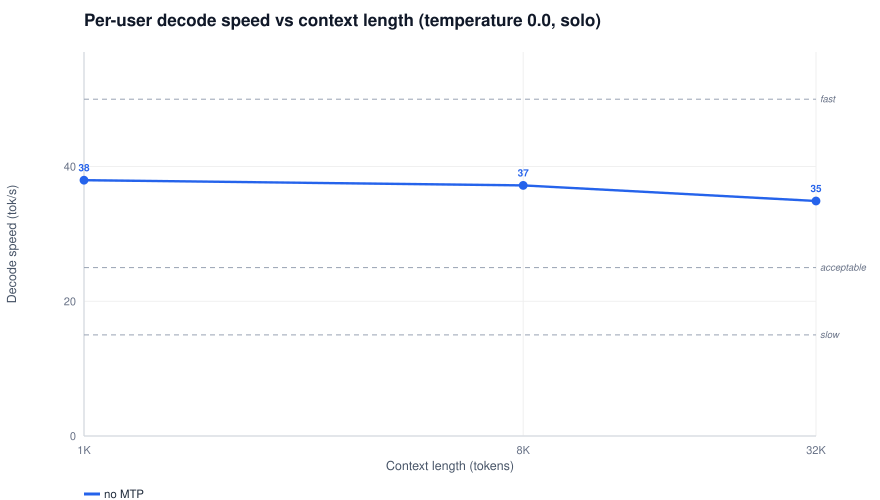
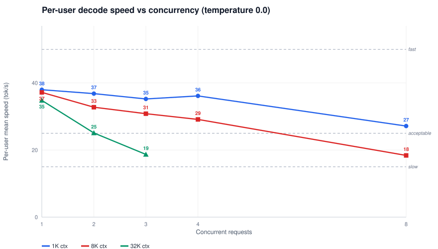
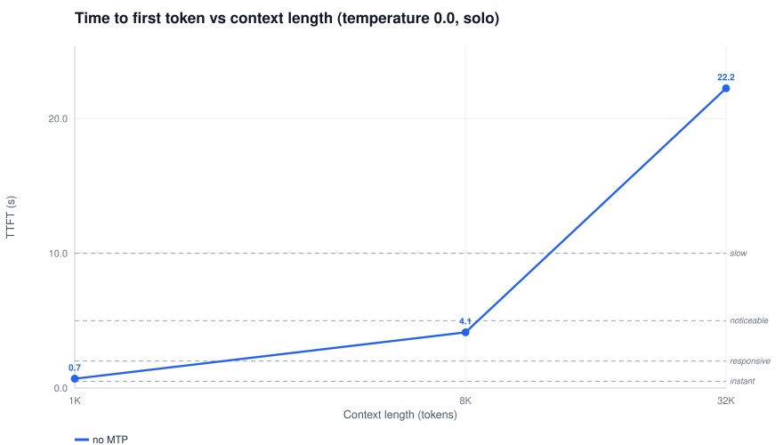
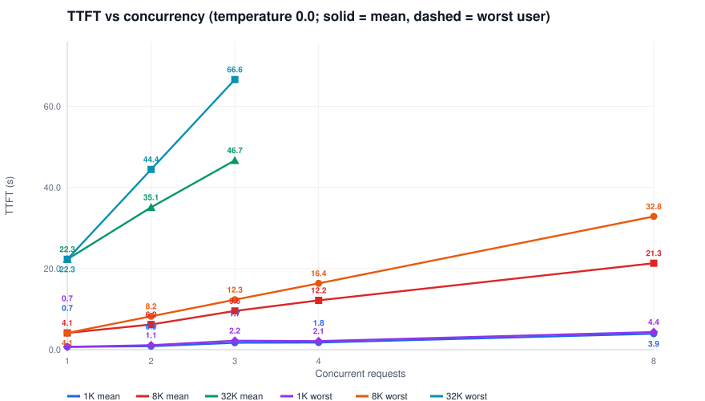
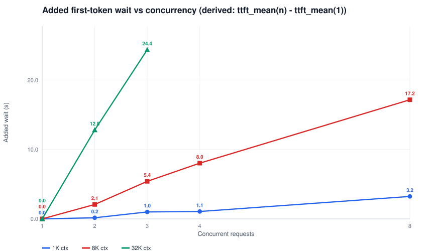
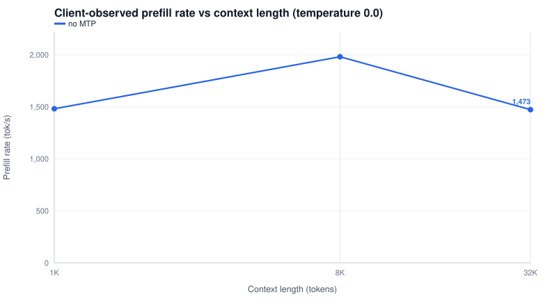
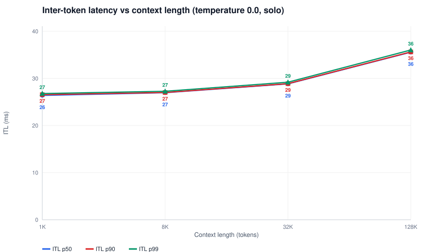
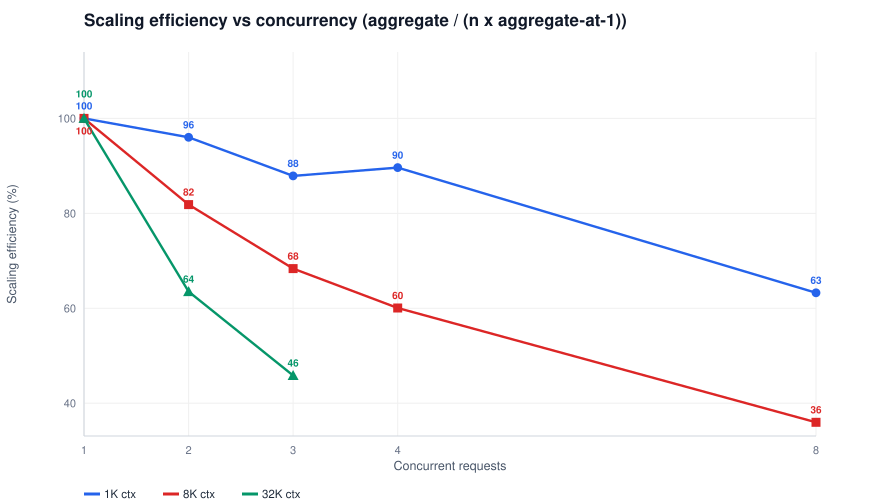
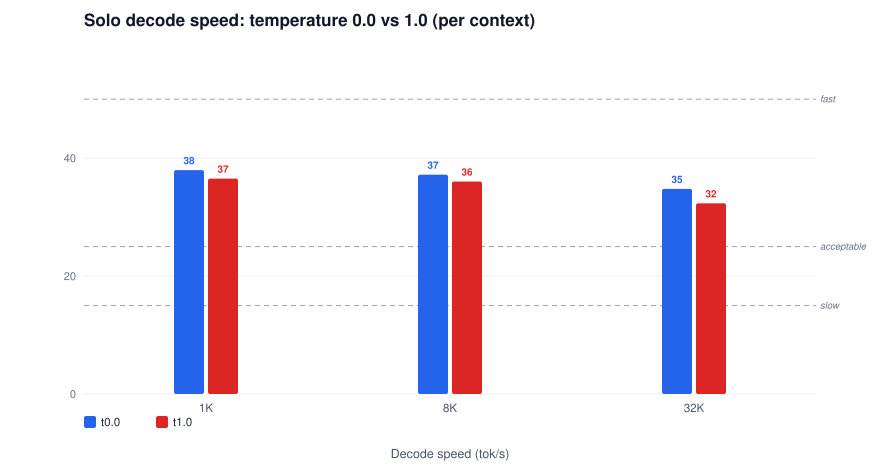

# Gemma-4-31B on 2x Intel Arc Pro B70 — MXFP4 W4A16, no MTP

| Field | Value |
|---|---|
| Organization | Google |
| Parameters | 31B dense hybrid (two-head-size GDN, no MTP head) |
| Precision | MXFP4 W4A16 (online, bf16 base checkpoint) |
| Accelerators | 2x Intel Arc Pro B70 (BMG-G31, 32 GB each, 64 GB total), TP2 |
| Host RAM | 64 GB (close-out F posture: --shm-size 16g, 16 GB LMCache CPU tier) |
| Engine | vLLM v0.30.0 — vllm-arc fork, image v0.30.0-b70-cert23, XPU graphs |
| KV cache dtype | fp8_e4m3 |
| Speculative decoding | disabled |
| Max model len | 40960 |
| KV pool (this boot) | 128,033 tokens (r139 posture) |
| Date | 2026-11-11 |
| Cell outcome | FACES_OK |

## Executive summary

Infrastructure decisions require real performance data. This report measures user-facing performance — how many concurrent requests the configuration supports at a given context length before streaming speed or first-token wait degrade below the user-experience bands.

This benchmark evaluates **Gemma-4-31B** (Google; 31B parameters, dense hybrid) running **MXFP4 W4A16 (online, bf16 base checkpoint)** on **2x Intel Arc Pro B70** (32 GB each, TP2) — the gemma MXFP4 lane.

Test parameters: context lengths 1K–32K tokens; concurrency 1–8; 600 output tokens per request; unique seeded-random prompts (cold prefill, no prefix-cache hits); no speculative decoding; KV cache `fp8_e4m3`; temperature 0.0 with paired 1.0 faces.

| Metric | Result |
|---|---|
| Generation speed, single request | 38.0 tok/s (1K) → 34.9 tok/s (32K) |
| TTFT, single request | 0.69 (1K) → 22.2 (32K) |
| Peak per-user speed (solo) | **38.0 tok/s** @ 1K ctx (fast) |
| Peak system throughput | **184 tok/s** @ 8 concurrent, 1K ctx — ≈ 662.42 K tokens/hour |
| Throughput scaling (1 → 8, 1K ctx) | 5.1x (63% of ideal linear) |
| Interactive chat capacity (8K) | ~2 concurrent requests (estimated between the measured 2 and 3 points) |
| Long-context assistant (RAG) capacity (32K) | thresholds exceeded at concurrency 1 - not recommended |
| Document processing (batch) capacity (32K) | 3 concurrent requests |
| Success rate | **100.0%** across 48 requests (16 faces green) |

> Every concurrent request models one user session holding a full generation (prompt prefill + 600 streamed tokens), barrier-started together — the worst-case burst. Interactive sessions idle between turns, so sustained user counts run well below request concurrency. Full definitions: [METHODOLOGY.md](METHODOLOGY.md).

## Use case guidance

The table maps this configuration to common deployment scenarios. Capacity limits are where TTFT or streaming speed fall below the accepted thresholds for a comfortable user experience (the band edges of the UX classification below).

| Use case | Context | Thresholds | Capacity |
|---|---|---|---|
| Interactive chat | 8K | TTFT < 10s · speed >= 15 tok/s | ~2 concurrent requests (estimated between the measured 2 and 3 points) |
| Long-context assistant (RAG) | 32K | TTFT < 10s · speed >= 15 tok/s | thresholds exceeded at concurrency 1 - not recommended |
| Document processing (batch) | 32K | speed >= 15 tok/s | 3 concurrent requests |

The limits are conservative: past them the system keeps serving with slower response times that may still be acceptable for your workload.

## System throughput

Aggregate token generation across all concurrent requests (output tokens only; prefill excluded). Measured as n × 600 / wall — the wall includes the barrier start and the slowest-user tail, so it is the honest saturated-burst number.

| Condition | Aggregate throughput |
|---|---|
| Peak (1K, 8 req) | 184 tok/s |
| 8K ctx, 4 req | 71 tok/s |
| 8K ctx, 8 req | 85 tok/s |

At the peak point this configuration produces approximately **662.42 K tokens/hour** — the number that matters for batch workloads (document processing, synthetic-data generation, offline analysis).


## Per-user generation speed

The streaming rate each user experiences. As concurrency rises, per-user speed falls because the accelerators are shared; with MTP, multiple accepted tokens ride one stream chunk (spec-aware accounting).

| Context | Solo (tok/s) | class | Best @ conc (tok/s) | @ conc 8 (tok/s) | class |
|---|---|---|---|---|---|
| 1024 (1K) | 38.0 | fast | 38.0 | 27.2 | fast |
| 8192 (8K) | 37.2 | fast | 37.2 | 18.4 | acceptable |
| 32768 (32K) | 34.9 | fast | 34.8 | - | - |

### How fast is this?

| Speed | User experience |
|---|---|
| < 15 tok/s | Slow - may be slower than reading speed |
| 15-25 tok/s | Acceptable - keeps pace with reading |
| 25-50 tok/s | Fast - exceeds reading speed |
| >= 50 tok/s | Very fast - text appears nearly instantly |

Solo speed spans **34.9–38.0 tok/s** (32K to 1K context); at concurrency 8 the floor is 18.4 tok/s (8K ctx).



<i>Per-user decode speed vs context length (solo) — MXFP4 W4A16, no MTP</i>



<i>Per-user decode speed vs concurrency — MXFP4 W4A16, no MTP</i>

## Time to first token

Time from request submission to the first streamed token — the primary responsiveness metric. Client-side on the rig loopback, it decomposes into queue wait (rising with concurrency) and prefill (rising with context); the technical analysis below separates the two.

| Context | Solo (s) | class | @ conc 8 mean (s) | @ conc 8 worst (s) | class |
|---|---|---|---|---|---|
| 1024 (1K) | 0.69 | responsive | 3.93 | 4.36 | noticeable |
| 8192 (8K) | 4.13 | noticeable | 21.3 | 32.8 | frustrating |
| 32768 (32K) | 22.2 | frustrating | - | - | - |

### How responsive is this?

| TTFT | User experience |
|---|---|
| < 0.5 s | Feels instant |
| 0.5-2 s | Feels responsive |
| 2-5 s | Noticeable but still acceptable |
| 5-10 s | Feels slow; acceptable at higher context |
| > 10 s | Can be frustrating; users may retry or abandon |

> **Caching note.** Every face uses a unique seeded-random prompt — a deliberate cold prefill, the worst case. The certified posture runs prefix caching (LMCache): in production, incremental conversations pay TTFT only for new tokens, which is dramatically faster than these numbers.



<i>TTFT vs context length (solo) — MXFP4 W4A16, no MTP</i>



<i>TTFT vs concurrency (mean and worst user) — MXFP4 W4A16, no MTP</i>

## Capacity analysis

### Interactive chat (8K context)

Conversational assistant sessions: system prompt plus a few turns fit 8K. Both first-token wait and streaming speed matter. Thresholds: TTFT < 10s · speed >= 15 tok/s.

| Metric | @ 1 | @ 2 | @ 3 | @ 4 | @ 8 |
|---|---|---|---|---|---|
| TTFT worst user (s) | 4.14 | 8.23 | 12.3 *(exceeded)* | 16.4 *(exceeded)* | 32.8 *(exceeded)* |
| Per-user mean speed (tok/s) | 37.2 | 32.8 | 30.8 | 29.1 | 18.4 |

**Capacity limit: ~2 concurrent requests (estimated between the measured 2 and 3 points)**

### Long-context assistant (RAG) (32K context)

Retrieval-augmented / large-prompt assistants at 32K context. Thresholds: TTFT < 10s · speed >= 15 tok/s.

| Metric | @ 1 | @ 2 | @ 3 |
|---|---|---|---|
| TTFT worst user (s) | 22.3 *(exceeded)* | 44.4 *(exceeded)* | 66.6 *(exceeded)* |
| Per-user mean speed (tok/s) | 34.8 | 25.1 | 18.7 |

**Capacity limit: thresholds exceeded at concurrency 1 - not recommended**

### Document processing (batch) (32K context)

Offline summarization / extraction at the largest measured context. Turnaround matters, not first-token wait: the bar is streaming speed (and total throughput). Thresholds: speed >= 15 tok/s.

| Metric | @ 1 | @ 2 | @ 3 |
|---|---|---|---|
| TTFT worst user (s) | 22.3 | 44.4 | 66.6 |
| Per-user mean speed (tok/s) | 34.8 | 25.1 | 18.7 |

**Capacity limit: 3 concurrent requests**

### KV pool (the whole-pool bound)

This boot exposed a KV pool of **128,033 tokens** (r139 posture). A session occupies ctx + 664 (output + scheduler slack), so the pool holds:

| Context | Pool capacity (sessions) | Measured green @ conc | c8 fully resident? |
|---|---|---|---|
| 1024 (1K) | 75 | 8 (green) | yes |
| 8192 (8K) | 14 | 8 (green) | yes |
| 32768 (32K) | 3 | 3 (green) | no |

*Sessions are the whole-pool bound; `--max-num-seqs 64` bounds the running batch above it. TurboQuant dtypes multiply the pool up to 3.68x: see the [KV-cache dtype report](qwen3.8-27b-fp8-kv-cache-dtype.md).*

## Technical analysis

### Queue + prefill decomposition (derived)

At concurrency 1 the queue is empty, so solo TTFT is pure prefill. Under the barrier burst the added first-token wait — `ttft_mean(n) − ttft_mean(1)` — is the queue+prefill-share stagger the Nth user pays. Derived client-side; engine-internal queueing is not exported by this engine version.

| Context | added wait @ n2 | @ n4 | @ n8 |
|---|---|---|---|
| 1024 (1K) | +0.2 s | +1.1 s | +3.2 s |
| 8192 (8K) | +2.1 s | +8.0 s | +17.2 s |
| 32768 (32K) | +12.8 s | - | - |



<i>Added first-token wait vs concurrency (derived queue+prefill stagger) — MXFP4 W4A16, no MTP</i>

### Per-user prefill speed

Rate at which input context is processed before the first token. Client-observed (ctx / TTFT at queue ~0); the engine-side device rate is higher — the client view includes chunk drain and the decode-transition tail.

| Context | prefill @ n1 (tok/s) | @ n4 | @ n8 |
|---|---|---|---|
| 1024 (1K) | 1467 | 581 | 260 |
| 8192 (8K) | 1979 | 673 | 384 |
| 32768 (32K) | 1470 | - | - |



<i>Client-observed prefill rate vs context length (solo) — MXFP4 W4A16, no MTP</i>

### Inter-token latency

Time between consecutive streamed tokens — the smoothness of streaming. Solo p50 spans **26.4 ms** (1K) to 28.9 ms; the worst observed p99 is **29 ms** (32K). With MTP one chunk can carry multiple accepted tokens, so the perceived stream is smoother than the raw chunk gap.



<i>Inter-token latency vs context length (solo) — MXFP4 W4A16, no MTP</i>

### Scaling efficiency

Percentage of ideal linear scaling achieved as concurrency rises (100% = n× the concurrency-1 throughput with no per-user cost). Real efficiency is always lower — the accelerators are shared; high efficiency at your target concurrency signals headroom.



<i>Scaling efficiency vs concurrency — MXFP4 W4A16, no MTP</i>

### Temperature 0.0 vs 1.0 (per context)



<i>Solo decode speed t0.0 vs t1.0 — MXFP4 W4A16, no MTP</i>

## Results — detail tables

### Context sweep (solo, temperature 0.0)

| Context | TTFT (s) | Prefill (tok/s) | Decode (tok/s) | Tok/step | ITL p50 (ms) | ITL p90 (ms) | ITL p99 (ms) | Decode @ t1.0 (tok/s) |
|---|---|---|---|---|---|---|---|---|
| 1024 (1K) | 0.69 | 1,481 | 38.0 | 1.00 | 26.4 | 26.6 | 26.8 | 36.5 |
| 8192 (8K) | 4.13 | 1,981 | 37.2 | 1.00 | 27.0 | 27.0 | 27.3 | 36.0 |
| 32768 (32K) | 22.25 | 1,473 | 34.9 | 1.00 | 28.8 | 28.9 | 29.2 | 32.3 |

### Concurrency sweep — 1024 (1K) context (temperature 0.0)

| Concurrency | TTFT mean (s) | TTFT max (s) | Per-user mean (tok/s) | Per-user worst (tok/s) | Aggregate (tok/s) | Scaling eff. | ITL p50 med (ms) | ITL p90 max (ms) |
|---|---|---|---|---|---|---|---|---|
| 1 | 0.70 | 0.70 | 38.0 | 38.0 | 36 | 100% | 26.4 | 26.6 |
| 2 | 0.86 | 1.11 | 36.8 | 36.3 | 70 | 96% | 26.8 | 27.0 |
| 3 | 1.69 | 2.22 | 35.2 | 33.2 | 96 | 88% | 27.6 | 27.8 |
| 4 | 1.76 | 2.12 | 36.1 | 34.0 | 130 | 90% | 27.2 | 27.4 |
| 8 | 3.93 | 4.36 | 27.2 | 24.0 | 184 | 63% | 36.3 | 36.7 |

### Concurrency sweep — 8192 (8K) context (temperature 0.0)

| Concurrency | TTFT mean (s) | TTFT max (s) | Per-user mean (tok/s) | Per-user worst (tok/s) | Aggregate (tok/s) | Scaling eff. | ITL p50 med (ms) | ITL p90 max (ms) |
|---|---|---|---|---|---|---|---|---|
| 1 | 4.14 | 4.14 | 37.2 | 37.2 | 30 | 100% | 27.0 | 27.0 |
| 2 | 6.22 | 8.23 | 32.8 | 29.2 | 48 | 82% | 27.6 | 27.7 |
| 3 | 9.55 | 12.3 | 30.8 | 23.7 | 61 | 68% | 29.0 | 29.1 |
| 4 | 12.2 | 16.4 | 29.1 | 20.4 | 71 | 60% | 29.1 | 29.2 |
| 8 | 21.3 | 32.8 | 18.4 | 11.6 | 85 | 36% | 39.5 | 39.6 |

### Concurrency sweep — 32768 (32K) context (temperature 0.0)

| Concurrency | TTFT mean (s) | TTFT max (s) | Per-user mean (tok/s) | Per-user worst (tok/s) | Aggregate (tok/s) | Scaling eff. | ITL p50 med (ms) | ITL p90 max (ms) |
|---|---|---|---|---|---|---|---|---|
| 1 | 22.3 | 22.3 | 34.8 | 34.8 | 15 | 100% | 28.9 | 29.0 |
| 2 | 35.1 | 44.4 | 25.1 | 16.5 | 19 | 64% | 29.9 | 29.9 |
| 3 | 46.7 | 66.6 | 18.7 | 10.0 | 21 | 46% | 33.0 | 33.0 |

*Scaling eff. = aggregate / (n x aggregate-at-1): 100% = perfect linear scaling. ITL p50 med = median of per-request p50s; ITL p90 max = worst user. Aggregate is wall-clock (n x 600 tokens / wall) and includes the slowest-user tail.*

## Configuration (copy & run on your own hardware)

### Validated invocation (what the gate ran, byte-exact)

```bash
# image vllm-arc:v0.30.0-b70-cert23 ; 2026-11-11 ; TP2 on 2x Arc Pro B70
ARC_IMAGE=vllm-arc:v0.30.0-b70-cert23 ARC_NAME=arc-b70 \
  ARC_MODEL=/models/gemma4-31b ARC_SERVED=gemma4-31b ARC_GMU=0.8 ARC_GRAPH=1 ARC_SPEC=0 ARC_LMC=0 ARC_RPC=1200 ARC_MAXLEN=40960 ARC_FP8=0 ARC_QUANT=mxfp4 ARC_MXFP4_MODE=w4a16 \
  bash serve_arc_b70.sh     # tools/serve_arc_b70.sh in this repo
```

The wrapper is the audited source of truth (banked posture echo: `gm4/posture.txt`). What it expands to:

```bash
# 1) container boot layer  [serve_arc_b70.sh:199-210]
docker run -d --name arc-b70 \
  --privileged --network host --ipc host \
  --shm-size 16g \              # close-out F: 64 GB-RAM hosts
  -v /models/gemma4-31b:/models/target:ro \
  -v <chat-template.json>:/root/chat_template.json:ro \
  -v ./neo_cache:/root/.neo_cache -v ./triton_cache:/root/.triton_cache \
  -v ./inductor_cache:/root/.inductor_cache \
  -e VLLM_ALLOW_LONG_MAX_MODEL_LEN=1 -e VLLM_WORKER_MULTIPROC_METHOD=spawn \
  --entrypoint /bin/bash vllm-arc:v0.30.0-b70-cert23 -c 'sleep infinity'

# 2) engine layer (docker exec)  [serve_arc_b70.sh:327-375]
export PYTHONHASHSEED=0 VLLM_EXECUTE_MODEL_TIMEOUT_SECONDS=1200 ZE_AFFINITY_MASK=0,1
export CCL_ENABLE_SYCL_KERNELS=1 CCL_ZE_IPC_EXCHANGE=pidfd CCL_TOPO_P2P_ACCESS=1
export CCL_TOPO_FABRIC_VERTEX_CONNECTION_CHECK=0 CCL_SYCL_ALLGATHERV_SMALL_THRESHOLD=131072
export CCL_SYCL_ALLGATHERV_SCALEOUT_THRESHOLD=1048576 CCL_SYCL_ALLGATHERV_TMP_BUF=0 CCL_SYCL_ALLREDUCE_TMP_BUF=0
export ARC_TRACE_FLIP=1 VLLM_XPU_ENABLE_XPU_GRAPH=1   # decode-only XPU graphs
export ARC_MXFP4_MODE=w4a16                        # weights-only MXFP4 lane
exec vllm serve --model /models/target \
  --served-model-name gemma4-31b --tensor-parallel-size 2 \
  --gpu-memory-utilization 0.8 --max-model-len 40960 \
  --max-num-batched-tokens 8192 --max-num-seqs 64 --block-size 64 \
  --dtype float16 --quantization mxfp4  \
  --kv-cache-dtype fp8_e4m3 \
  --mamba-ssm-cache-dtype float16 --mamba-cache-mode=align \
  --enable-prefix-caching --trust-remote-code \
  --chat-template /root/chat_template.json \   # gemma: no qwen parsers
  --no-disable-hybrid-kv-cache-manager \
  --compilation-config '{"mode":"none","cudagraph_mode":"FULL_DECODE_ONLY","cudagraph_capture_sizes":[1..320]}' \   # 64-size discipline, see wrapper
  --port 8000
```

## Test parameters

- Context lengths: 1K, 8K, 32K tokens (prompt + template). Solo faces: concurrency 1, 600 output tokens, `ignore_eos`.
- Concurrency sweeps: 1/2/3/4/8 at contexts 1K, 8K, 32K — barrier-started simultaneous requests, 600 output tokens each, temperature 0.0, plus one temperature-1.0 solo face per context.
- Prompts: seeded random-token contexts, unique per face and per request slot (`p138_face.py` / `p139_conc.py`, tag-seeded) — every face is a cold prefill (no prompt-cache hits).
- Client-side timing on the rig loopback; TTFT includes the full engine prefill window (at c=1 queue wait ~0; at c=N the TTFT spread IS the queue+prefill stagger).

## Notes

- Per-user speed = output tokens / decode window (spec-decode aware; with MTP one stream chunk carries multiple accepted tokens). Aggregate = n x 600 tokens / wall clock.
- The r139 1K t0.0 face runs first after the boot warmup at a cold spec-verify batch shape — its acceptance (2.8 tok/step) sits below the family norm (3.8 at 8K); the 8K/32K faces are the steady reference. Temperature comparisons are within-harness (r138 sweep vs r139 faces, both reported).
- Prefill rate is the client-observed ctx/TTFT; the engine-side device rate (P6.36 decomposition) is ~2.1–2.9k tok/s at fp8 — the client view includes chunk drain and the decode-transition tail.
- Metric definitions, UX bands, use-case thresholds and the honest-limits statement: [METHODOLOGY.md](METHODOLOGY.md).
- Banks: `results/2026-11-10-p637-reports/` (solo + temperature faces, r138) and `results/2026-11-11-p637b-conc/` (concurrency faces, r139); tools `tools/ar/p138/p138_face.py`, `tools/ar/p139/p139_conc.py`.
