# Gemma-4-31B on 2x Intel Arc Pro B70 — MXFP4 W4A16, no MTP

| Field | Value |
|---|---|
| Organization | Google |
| Parameters | 31B dense hybrid (two-head-size GDN, no MTP head) |
| Precision | MXFP4 W4A16 (online, bf16 base checkpoint) |
| Accelerators | 2x Intel Arc Pro B70 (BMG-G31, 32 GB each, 64 GB total), TP2 |
| Host RAM | 64 GB (close-out F posture: --shm-size 16g, 16 GB LMCache CPU tier) |
| Engine | vLLM v0.30.0 — vllm-arc fork, image v0.30.0-b70-cert28, XPU graphs |
| KV cache dtype | fp8_e4m3 |
| Speculative decoding | disabled |
| Max model len | 40960 |
| KV pool (this boot) | 128,033 tokens (r240b posture) |
| Date | 2026-11-25 |
| Cell outcome | FACES_OK |

## Executive summary

The 64K, 128K points in the tables and charts below come from the **128K annex boot** — same image and quantization posture; the annex section quantifies both boots' agreement at the shared contexts.

Infrastructure decisions require real performance data. This report measures user-facing performance — how many concurrent requests the configuration supports at a given context length before streaming speed or first-token wait degrade below the user-experience bands.

This benchmark evaluates **Gemma-4-31B** (Google; 31B parameters, dense hybrid) running **MXFP4 W4A16 (online, bf16 base checkpoint)** on **2x Intel Arc Pro B70** (32 GB each, TP2) — the gemma MXFP4 lane.

Test parameters: context lengths 1K–128K tokens; concurrency 1–8; 600 output tokens per request; unique seeded-random prompts (cold prefill, no prefix-cache hits); no speculative decoding; KV cache `fp8_e4m3`; temperature 0.0 with paired 1.0 faces.

| Metric | Result |
|---|---|
| Generation speed, single request | 38.0 tok/s (1K) → 28.3 tok/s (128K) |
| TTFT, single request | 0.69 (1K) → 175.6 (128K) |
| Peak per-user speed (solo) | **38.0 tok/s** @ 1K ctx (fast) |
| Peak system throughput | **228 tok/s** @ 8 concurrent, 1K ctx — ≈ 820.86 K tokens/hour |
| Throughput scaling (1 → 8, 1K ctx) | 6.1x (76% of ideal linear) |
| Interactive chat capacity (8K) | ~2 concurrent requests (estimated between the measured 2 and 3 points) |
| Long-context assistant (RAG) capacity (32K) | thresholds exceeded at concurrency 1 - not recommended |
| Document processing (batch) capacity (128K) | 2 concurrent requests |
| Success rate | **100.0%** across 65 requests (24 faces green) |

> Every concurrent request models one user session holding a full generation (prompt prefill + 600 streamed tokens), barrier-started together — the worst-case burst. Interactive sessions idle between turns, so sustained user counts run well below request concurrency. Full definitions: [METHODOLOGY.md](METHODOLOGY.md).

## Use case guidance

The table maps this configuration to common deployment scenarios. Capacity limits are where TTFT or streaming speed fall below the accepted thresholds for a comfortable user experience (the band edges of the UX classification below).

| Use case | Context | Thresholds | Capacity |
|---|---|---|---|
| Interactive chat | 8K | TTFT < 10s · speed >= 15 tok/s | ~2 concurrent requests (estimated between the measured 2 and 3 points) |
| Long-context assistant (RAG) | 32K | TTFT < 10s · speed >= 15 tok/s | thresholds exceeded at concurrency 1 - not recommended |
| Document processing (batch) | 128K | speed >= 15 tok/s | 2 concurrent requests |

The limits are conservative: past them the system keeps serving with slower response times that may still be acceptable for your workload.

## System throughput

Aggregate token generation across all concurrent requests (output tokens only; prefill excluded). Measured as n × 600 / wall — the wall includes the barrier start and the slowest-user tail, so it is the honest saturated-burst number.

| Condition | Aggregate throughput |
|---|---|
| Peak (1K, 8 req) | 228 tok/s |
| 8K ctx, 4 req | 75 tok/s |
| 8K ctx, 8 req | 92 tok/s |

At the peak point this configuration produces approximately **820.86 K tokens/hour** — the number that matters for batch workloads (document processing, synthetic-data generation, offline analysis).

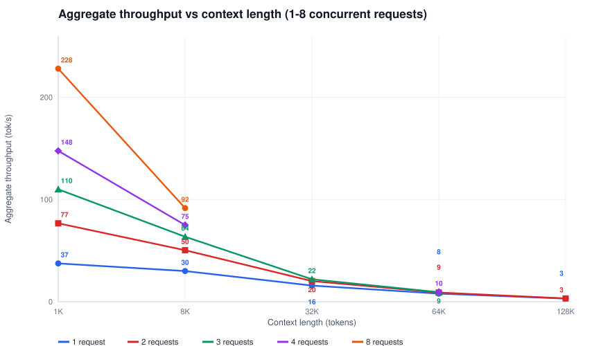

<i>Aggregate throughput vs context length, one line per concurrency — MXFP4 W4A16, no MTP</i>

*Interpretation:* throughput peaks at 228 tok/s (8 requests, 1K); at 128K the heaviest measured load (2 requests) yields 3 tok/s (1% of peak) — long-context KV residency shrinks the resident batch. Batch workloads should batch short and parallel; long-context work is bound by KV residency, not compute.

## Per-user generation speed

The streaming rate each user experiences. As concurrency rises, per-user speed falls because the accelerators are shared; with MTP, multiple accepted tokens ride one stream chunk (spec-aware accounting).

| Context | Solo (tok/s) | class | Best @ conc (tok/s) | @ conc 8 (tok/s) | class |
|---|---|---|---|---|---|
| 1024 (1K) | 38.0 | fast | 40.1 | 30.9 | fast |
| 8192 (8K) | 37.2 | fast | 37.3 | 18.2 | acceptable |
| 32768 (32K) | 34.9 | fast | 35.0 | - | - |
| 65536 (64K) | 32.3 | fast | 32.3 | - | - |
| 131072 (128K) | 28.3 | fast | 28.3 | - | - |

### How fast is this?

| Speed | User experience |
|---|---|
| < 15 tok/s | Slow - may be slower than reading speed |
| 15-25 tok/s | Acceptable - keeps pace with reading |
| 25-50 tok/s | Fast - exceeds reading speed |
| >= 50 tok/s | Very fast - text appears nearly instantly |

Solo speed spans **28.3–38.0 tok/s** (128K to 1K context); at concurrency 8 the floor is 18.2 tok/s (8K ctx).

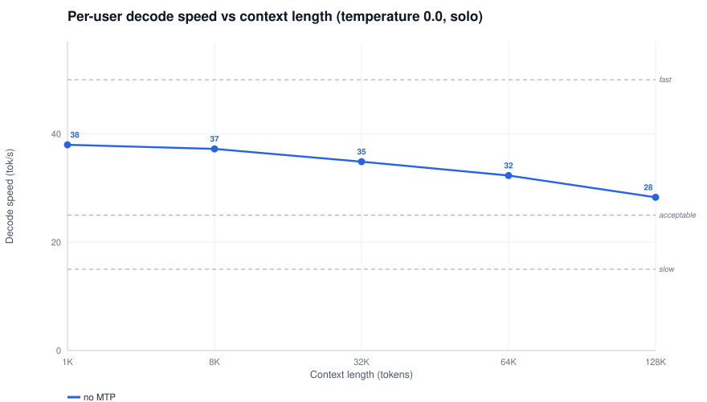

<i>Per-user decode speed vs context length (solo) — MXFP4 W4A16, no MTP</i>

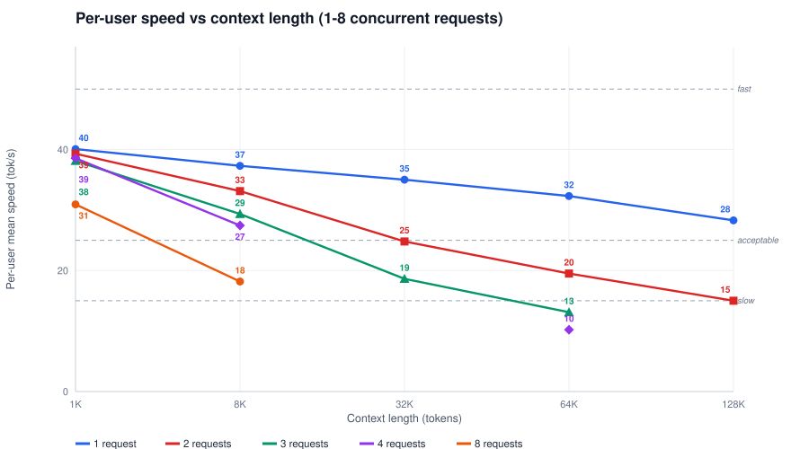

<i>Per-user speed vs context length, one line per concurrency — MXFP4 W4A16, no MTP</i>

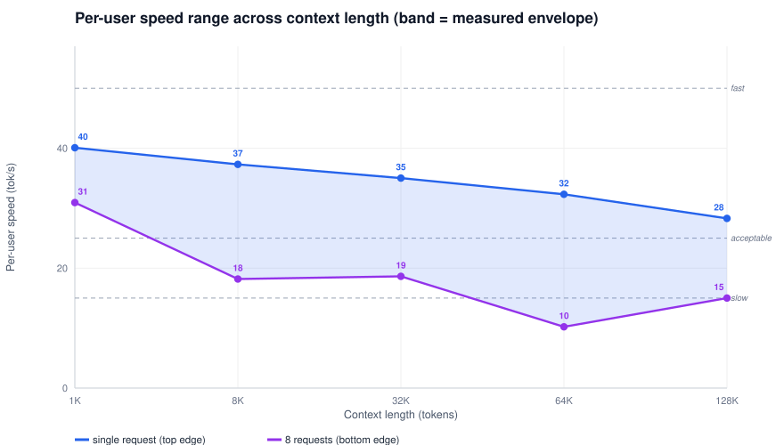

<i>Per-user speed range: the band every deployment concurrency lands in — MXFP4 W4A16, no MTP</i>

*Interpretation:* at 128K a single user streams 28.3 tok/s while 2 requests share down to 15.0 tok/s (53% of solo); at 8K the spread is 18.2-37.3 tok/s — every concurrency you deploy lands between the band edges; the bands below classify the streaming feel.

## Time to first token

Time from request submission to the first streamed token — the primary responsiveness metric. Client-side on the rig loopback, it decomposes into queue wait (rising with concurrency) and prefill (rising with context); the technical analysis below separates the two.

| Context | Solo (s) | class | @ conc 8 mean (s) | @ conc 8 worst (s) | class |
|---|---|---|---|---|---|
| 1024 (1K) | 0.69 | responsive | 1.63 | 1.81 | responsive |
| 8192 (8K) | 4.14 | noticeable | 17.3 | 29.0 | frustrating |
| 32768 (32K) | 22.2 | frustrating | - | - | - |
| 65536 (64K) | 57.2 | frustrating | - | - | - |
| 131072 (128K) | 175.6 | frustrating | - | - | - |

### How responsive is this?

| TTFT | User experience |
|---|---|
| < 0.5 s | Feels instant |
| 0.5-2 s | Feels responsive |
| 2-5 s | Noticeable but still acceptable |
| 5-10 s | Feels slow; acceptable at higher context |
| > 10 s | Can be frustrating; users may retry or abandon |

> **Caching note.** Every face uses a unique seeded-random prompt — a deliberate cold prefill, the worst case. The certified posture runs prefix caching (LMCache): in production, incremental conversations pay TTFT only for new tokens, which is dramatically faster than these numbers.

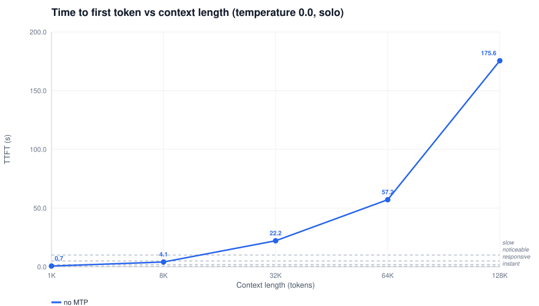

<i>TTFT vs context length (solo) — MXFP4 W4A16, no MTP</i>

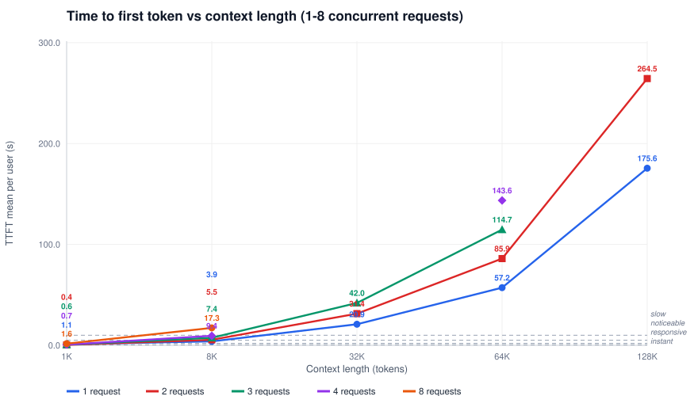

<i>TTFT vs context length, one line per concurrency — MXFP4 W4A16, no MTP</i>

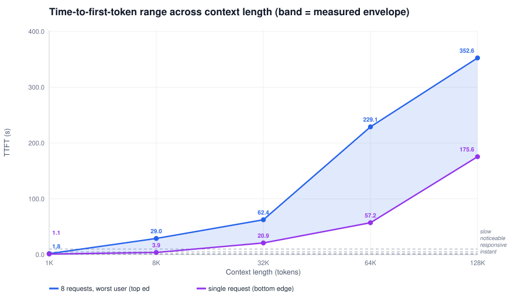

<i>TTFT range: single request (bottom) to worst user at max concurrency (top) — MXFP4 W4A16, no MTP</i>

*Interpretation:* at 128K the first token takes 175.6 solo but up to 352.6 for the worst user under 2 requests — 50% of the loaded wait is queue+prefill stagger, the sharing cost the capacity tables price below.

## Capacity analysis

### Interactive chat (8K context)

Conversational assistant sessions: system prompt plus a few turns fit 8K. Both first-token wait and streaming speed matter. Thresholds: TTFT < 10s · speed >= 15 tok/s.

| Metric | @ 1 | @ 2 | @ 3 | @ 4 | @ 8 |
|---|---|---|---|---|---|
| TTFT worst user (s) | 3.92 | 7.33 | 10.9 *(exceeded)* | 14.6 *(exceeded)* | 29.0 *(exceeded)* |
| Per-user mean speed (tok/s) | 37.3 | 33.1 | 29.3 | 27.4 | 18.2 |

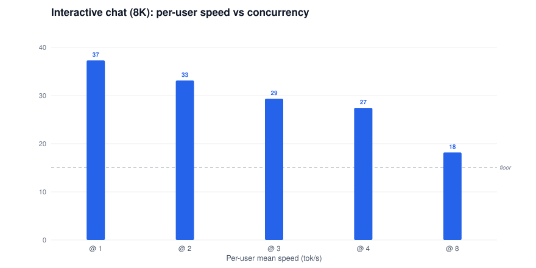

<i>Interactive chat (8K): per-user speed by concurrency; the dashed line marks the 15.0 tok/s use-case floor</i>

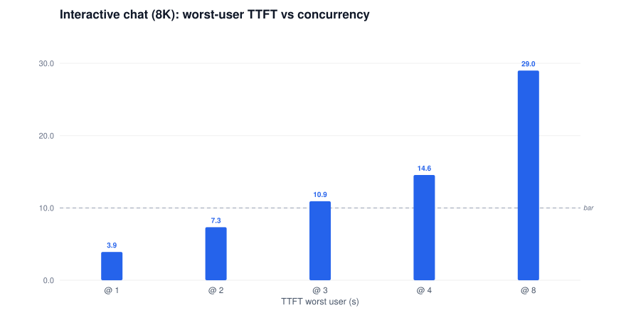

<i>Interactive chat (8K): worst-user TTFT by concurrency; the dashed line marks the 10.0 s use-case bar</i>

**Capacity limit: ~2 concurrent requests (estimated between the measured 2 and 3 points)**

### Long-context assistant (RAG) (32K context)

Retrieval-augmented / large-prompt assistants at 32K context. Thresholds: TTFT < 10s · speed >= 15 tok/s.

| Metric | @ 1 | @ 2 | @ 3 |
|---|---|---|---|
| TTFT worst user (s) | 20.9 *(exceeded)* | 41.7 *(exceeded)* | 62.4 *(exceeded)* |
| Per-user mean speed (tok/s) | 35.0 | 24.8 | 18.6 |

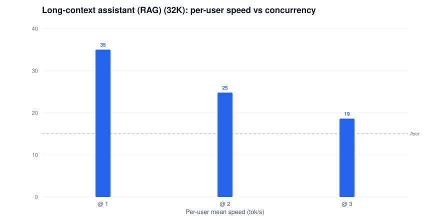

<i>Long-context assistant (RAG) (32K): per-user speed by concurrency; the dashed line marks the 15.0 tok/s use-case floor</i>

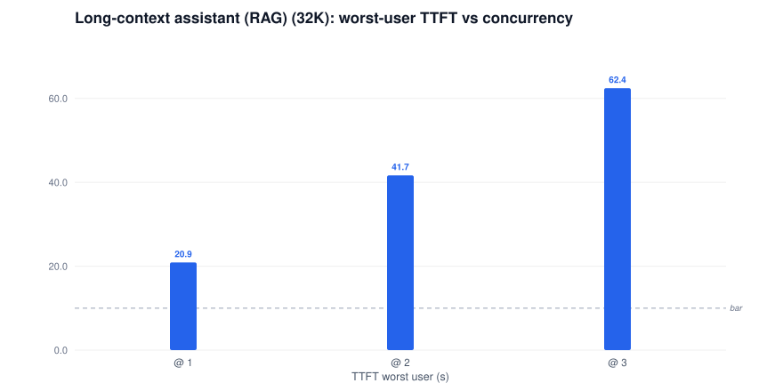

<i>Long-context assistant (RAG) (32K): worst-user TTFT by concurrency; the dashed line marks the 10.0 s use-case bar</i>

**Capacity limit: thresholds exceeded at concurrency 1 - not recommended**

### Document processing (batch) (128K context)

Offline summarization / extraction at the largest measured context. Turnaround matters, not first-token wait: the bar is streaming speed (and total throughput). Thresholds: speed >= 15 tok/s.

| Metric | @ 1 | @ 2 |
|---|---|---|
| TTFT worst user (s) | 175.6 | 352.6 |
| Per-user mean speed (tok/s) | 28.3 | 15.0 |

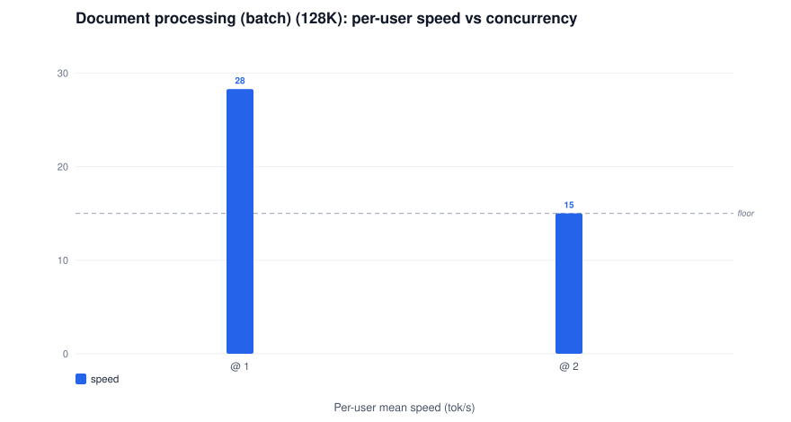

<i>Document processing (batch) (128K): per-user speed by concurrency; the dashed line marks the 15.0 tok/s use-case floor</i>

**Capacity limit: 2 concurrent requests**

### KV pool (the whole-pool bound)

This boot exposed a KV pool of **128,033 tokens** (r240b posture). A session occupies ctx + 664 (output + scheduler slack), so the pool holds:

| Context | Pool capacity (sessions) | Measured green @ conc | c8 fully resident? |
|---|---|---|---|
| 1024 (1K) | 75 | 8 (green) | yes |
| 8192 (8K) | 14 | 8 (green) | yes |
| 32768 (32K) | 3 | 3 (green) | no |
| 65536 (64K) | 4 | 4 (green) | marginal |
| 131072 (128K) | 2 | 2 (green) | no |

*The 64K, 128K row's pool is the annex boot's (288,972 tokens) — the main boot's pool cannot hold that context.*

*Sessions are the whole-pool bound; `--max-num-seqs 64` bounds the running batch above it. TurboQuant dtypes multiply the pool up to 3.68x: see the [KV-cache dtype report](qwen3.8-27b-fp8-kv-cache-dtype.md).*

## Technical analysis

### Queue + prefill decomposition (derived)

At concurrency 1 the queue is empty, so solo TTFT is pure prefill. Under the barrier burst the added first-token wait — `ttft_mean(n) − ttft_mean(1)` — is the queue+prefill-share stagger the Nth user pays. Derived client-side; engine-internal queueing is not exported by this engine version. The x-axis keeps the canonical rung ladder up to the highest measured context — an empty slot marks a rung the concurrency measurements skip (64K: only the solo face measured it on qwen; unmeasured entirely on the gemma boots); no stagger exists there.

| Context | added wait @ n2 | @ n4 | @ n8 |
|---|---|---|---|
| 1024 (1K) | +-0.7 s | +-0.4 s | +0.6 s |
| 8192 (8K) | +1.6 s | +5.5 s | +13.3 s |
| 32768 (32K) | +10.5 s | - | - |
| 65536 (64K) | +28.7 s | +86.4 s | - |
| 131072 (128K) | +88.9 s | - | - |

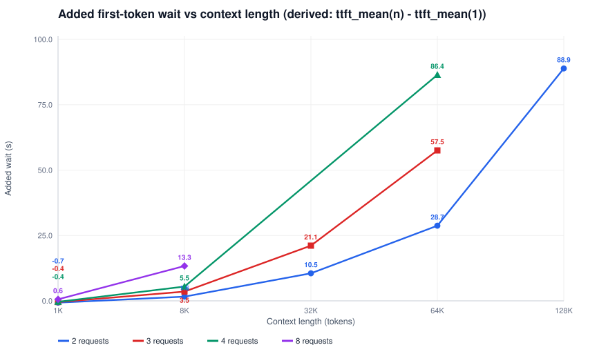

<i>Added first-token wait vs context length, one line per concurrency (derived queue+prefill stagger) — MXFP4 W4A16, no MTP</i>

*Interpretation:* the loaded-request stagger grows from +0.6 s at 1K to +13.3 s at 8K (8 requests) — the context-carrying requests serialize behind each other's prefill.

### Per-user prefill speed

Rate at which input context is processed before the first token. Client-observed (ctx / TTFT at queue ~0); the engine-side device rate is higher — the client view includes chunk drain and the decode-transition tail. The single-request line spans **every measured context** (sweep plus solo faces — the sweep skipped 64K); loaded lines cover the contexts the concurrency sweep measured.

| Context | prefill @ n1 (tok/s) | @ n4 | @ n8 |
|---|---|---|---|
| 1024 (1K) | 972 | 1489 | 627 |
| 8192 (8K) | 2091 | 873 | 475 |
| 32768 (32K) | 1568 | - | - |
| 65536 (64K) | 1146 | 456 | - |
| 131072 (128K) | 747 | - | - |

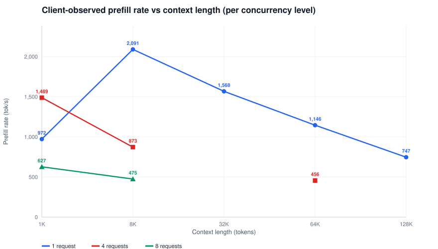

<i>Client-observed prefill rate vs context length, one line per concurrency — MXFP4 W4A16, no MTP</i>

*Interpretation:* prefill peaks at 2,091 tok/s (8K) and eases as context grows — chunked prefill batches more work per pass at length, trading first-token wait for decode-window protection.

### Inter-token latency

Time between consecutive streamed tokens — the smoothness of streaming. Solo p50 spans **25.0 ms** (1K) to 35.8 ms; the worst observed p99 is **36 ms** (128K). With MTP one chunk can carry multiple accepted tokens, so the perceived stream is smoother than the raw chunk gap.

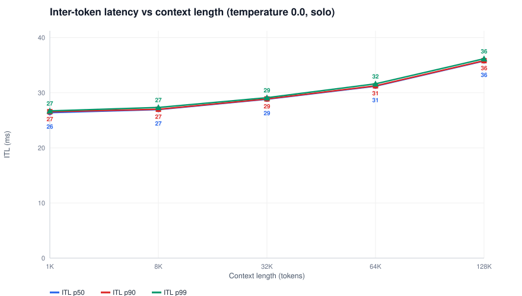

<i>Inter-token latency vs context length (solo) — MXFP4 W4A16, no MTP</i>

### Scaling efficiency

Percentage of ideal linear scaling achieved as concurrency rises (100% = n× the concurrency-1 throughput with no per-user cost). Real efficiency is always lower — the accelerators are shared; high efficiency at your target concurrency signals headroom. The x-axis keeps the canonical rung ladder up to the highest measured context — an empty slot marks a rung the concurrency measurements skip (64K: only the solo face measured it on qwen; unmeasured entirely on the gemma boots).

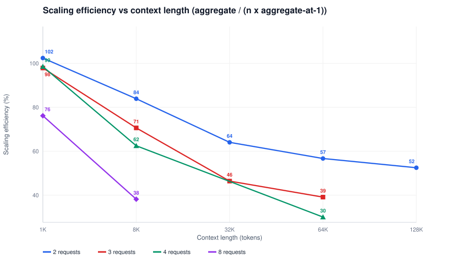

<i>Scaling efficiency vs context length, one line per concurrency — MXFP4 W4A16, no MTP</i>

*Interpretation:* efficiency holds at 76% at 1K but falls to 38% at 8K under 8 requests — high efficiency signals headroom; a sharp drop signals the accelerators are already saturated.

### Temperature 0.0 vs 1.0 (per context)

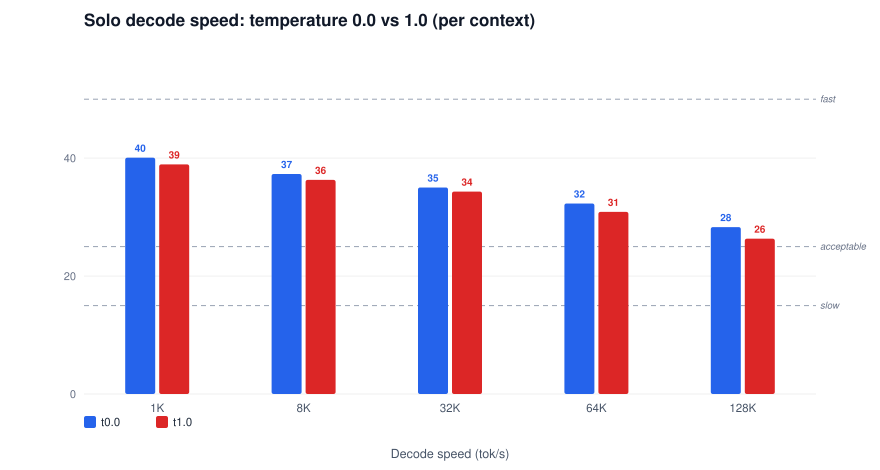

<i>Solo decode speed t0.0 vs t1.0 — MXFP4 W4A16, no MTP</i>

## Results — detail tables

### Context sweep (solo, temperature 0.0)

| Context | TTFT (s) | Prefill (tok/s) | Decode (tok/s) | Tok/step | ITL p50 (ms) | ITL p90 (ms) | ITL p99 (ms) | Decode @ t1.0 (tok/s) |
|---|---|---|---|---|---|---|---|---|
| 1024 (1K) | 0.69 | 1,486 | 38.0 | 1.00 | 26.4 | 26.6 | 26.7 | 38.9 |
| 8192 (8K) | 4.14 | 1,980 | 37.2 | 1.00 | 26.9 | 27.0 | 27.3 | 36.3 |
| 32768 (32K) | 22.19 | 1,477 | 34.9 | 1.00 | 28.8 | 28.9 | 29.1 | 34.3 |
| 65536 (64K) | 57.20 | 1,146 | 32.3 | - | 31.2 | 31.2 | 31.6 | 30.9 |
| 131072 (128K) | 175.57 | 747 | 28.3 | - | 35.8 | 35.8 | 36.2 | 26.3 |

*Rows sourced from the r240b/r240c concurrency-1 faces where no r240 solo face exists (same cold-prefill measurement).*

### Concurrency sweep — 1024 (1K) context (temperature 0.0)

| Concurrency | TTFT mean (s) | TTFT max (s) | Per-user mean (tok/s) | Per-user worst (tok/s) | Aggregate (tok/s) | Scaling eff. | ITL p50 med (ms) | ITL p90 max (ms) |
|---|---|---|---|---|---|---|---|---|
| 1 | 1.05 | 1.05 | 40.1 | 40.1 | 37 | 100% | 25.0 | 25.7 |
| 2 | 0.36 | 0.45 | 39.3 | 39.1 | 77 | 102% | 25.4 | 26.1 |
| 3 | 0.61 | 0.76 | 38.1 | 37.5 | 110 | 98% | 26.1 | 26.9 |
| 4 | 0.69 | 0.81 | 38.6 | 37.8 | 148 | 99% | 25.8 | 26.6 |
| 8 | 1.63 | 1.81 | 30.9 | 29.2 | 228 | 76% | 32.3 | 34.2 |

### Concurrency sweep — 8192 (8K) context (temperature 0.0)

| Concurrency | TTFT mean (s) | TTFT max (s) | Per-user mean (tok/s) | Per-user worst (tok/s) | Aggregate (tok/s) | Scaling eff. | ITL p50 med (ms) | ITL p90 max (ms) |
|---|---|---|---|---|---|---|---|---|
| 1 | 3.92 | 3.92 | 37.3 | 37.3 | 30 | 100% | 26.9 | 26.9 |
| 2 | 5.53 | 7.33 | 33.1 | 29.9 | 50 | 84% | 27.6 | 27.7 |
| 3 | 7.45 | 10.9 | 29.3 | 24.5 | 64 | 71% | 29.1 | 29.2 |
| 4 | 9.39 | 14.6 | 27.4 | 21.4 | 75 | 62% | 29.2 | 29.3 |
| 8 | 17.3 | 29.0 | 18.2 | 12.5 | 92 | 38% | 39.3 | 39.4 |

### Concurrency sweep — 32768 (32K) context (temperature 0.0)

| Concurrency | TTFT mean (s) | TTFT max (s) | Per-user mean (tok/s) | Per-user worst (tok/s) | Aggregate (tok/s) | Scaling eff. | ITL p50 med (ms) | ITL p90 max (ms) |
|---|---|---|---|---|---|---|---|---|
| 1 | 20.9 | 20.9 | 35.0 | 35.0 | 16 | 100% | 28.7 | 28.8 |
| 2 | 31.4 | 41.7 | 24.8 | 15.8 | 20 | 64% | 29.7 | 29.8 |
| 3 | 42.0 | 62.4 | 18.6 | 9.9 | 22 | 46% | 32.7 | 32.8 |

### Concurrency sweep — 65536 (64K) context (temperature 0.0)

| Concurrency | TTFT mean (s) | TTFT max (s) | Per-user mean (tok/s) | Per-user worst (tok/s) | Aggregate (tok/s) | Scaling eff. | ITL p50 med (ms) | ITL p90 max (ms) |
|---|---|---|---|---|---|---|---|---|
| 1 | 57.2 | 57.2 | 32.3 | 32.3 | 8 | 100% | 31.2 | 31.2 |
| 2 | 85.9 | 114.4 | 19.5 | 7.9 | 9 | 57% | 32.4 | 32.5 |
| 3 | 114.7 | 171.6 | 13.1 | 4.4 | 9 | 39% | 37.1 | 37.2 |
| 4 | 143.6 | 229.1 | 10.2 | 3.1 | 10 | 30% | 39.2 | 39.3 |

### Concurrency sweep — 131072 (128K) context (temperature 0.0)

| Concurrency | TTFT mean (s) | TTFT max (s) | Per-user mean (tok/s) | Per-user worst (tok/s) | Aggregate (tok/s) | Scaling eff. | ITL p50 med (ms) | ITL p90 max (ms) |
|---|---|---|---|---|---|---|---|---|
| 1 | 175.6 | 175.6 | 28.3 | 28.3 | 3 | 100% | 35.8 | 35.8 |
| 2 | 264.5 | 352.6 | 15.0 | 3.0 | 3 | 52% | 37.5 | 37.6 |

*Scaling eff. = aggregate / (n x aggregate-at-1): 100% = perfect linear scaling. ITL p50 med = median of per-request p50s; ITL p90 max = worst user. Aggregate is wall-clock (n x 600 tokens / wall) and includes the slowest-user tail.*

## 128K annex — max_model_len 131072

Raising the certified gemma maxlen (40960) to 131072 is a KV-headroom question. MXFP4 weight savings buy the KV headroom for max_model_len 131072 — the boot below is its own cell (`gm4x`, outcome `CONC_OK`). Its measurements are merged into the tables and charts above (the executive summary notes the provenance); the same-contexts table below quantifies both boots' agreement, and the pools differ — this section holds the boot record.

The 8-bit control (`gm8x`) ran the 128K posture at 8-bit weights and refused (outcome `BOOT_FAIL`, pool not parseable) — the refusal is banked with its serve log and is the capacity boundary itself; only the 4-bit weight budget buys the 128K pool.

| Field | Value |
|---|---|
| Posture | this lane + `ARC_MAXLEN=131072` |
| KV pool (annex boot) | 288,972 tokens (r240c posture) |
| Contexts measured | 1K, 8K, 32K, 64K, 128K |
| Cell outcome | CONC_OK |

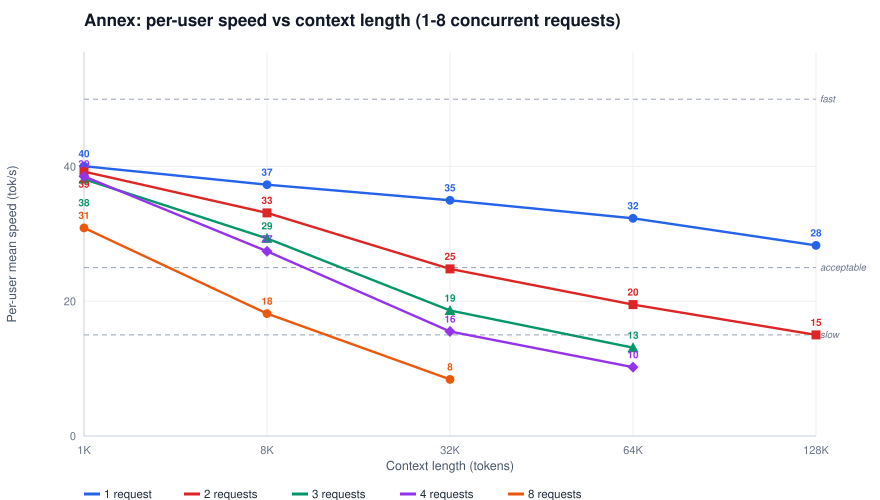

<i>Annex per-user speed vs context length, one line per concurrency — MXFP4 W4A16</i>

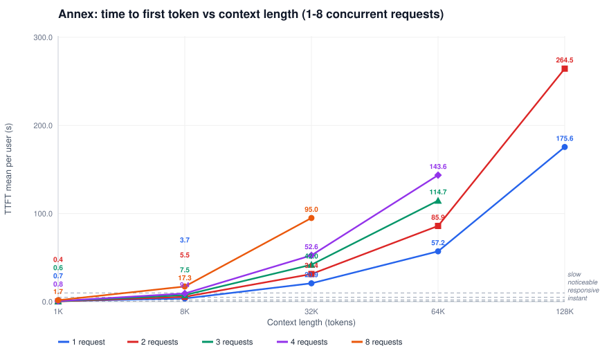

<i>Annex TTFT vs context length, one line per concurrency — MXFP4 W4A16</i>

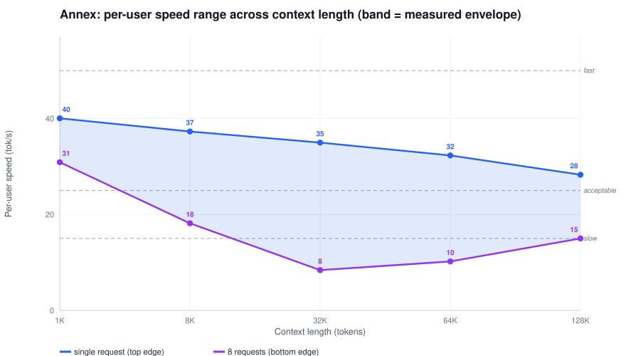

<i>Annex per-user speed range — the band every deployment concurrency lands in (MXFP4 W4A16)</i>

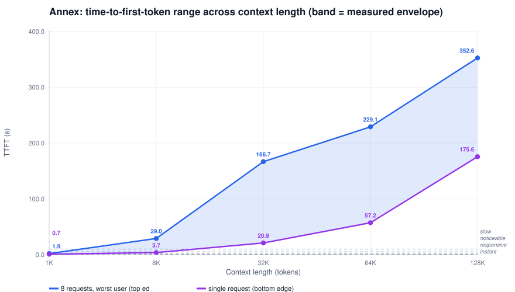

<i>Annex TTFT range: single request (bottom) to worst user at max concurrency (top) — MXFP4 W4A16</i>

### The 131072-token point

| Face (131K) | TTFT mean (s) | Per-user (tok/s) | Aggregate (tok/s) |
|---|---|---|---|
| 1 request | 175.6 | 28.3 | 3 |
| 2 requests | 264.5 | 15.0 | 3 |
| 1 request (t1.0) | 176.1 | 26.3 | 3 |

A full-length session occupies ctx + 664 tokens, so this boot holds **2 full-length sessions (pool 288,972 // 131072 + 664)**; the sweep measured 1 request and 2 requests at 131072 — higher concurrencies exceed the pool by design and are banked as `KV_CAP` rows, not failures.

*Interpretation:* a single 128K request streams 28.3 tok/s with a 175.6 first-token wait — 81% of the 32K figure; the cost of 128K is KV residency and prefill, not decode — cold prefill of the whole prompt dominates; interactive turns on cached prefixes pay only the new tokens.

### Same contexts, both boots

| Context | solo speed, maxlen 40960 | solo speed, 131072 | TTFT, 40960 | TTFT, 131072 | @8 speed, 40960 | @8 speed, 131072 |
|---|---|---|---|---|---|---|
| 1024 (1K) | 40.1 | 40.1 | 1.05 | 0.70 | 30.9 | 30.9 |
| 8192 (8K) | 37.3 | 37.3 | 3.92 | 3.71 | 18.2 | 18.2 |
| 32768 (32K) | 35.0 | 35.0 | 20.9 | 20.9 | - | 8.4 |
| 65536 (64K) | 32.3 | 32.3 | 57.2 | 57.2 | - | - |
| 131072 (128K) | 28.3 | 28.3 | 175.6 | 175.6 | - | - |

Two boots, one lane: the shared contexts agree within 0% on solo speed (worst relative delta) — the maxlen change costs nothing at short context; what it buys is the 128K point above.

> **Prompt-budget rule (banked).** The API server enforces prompt + max_tokens <= max_model_len — the completion budget counts — and gemma's tokenizer round-trip inflates decoded text ~1.026x. The annex faces size the server-side prompt budget as ctx - max_tokens - 64 (`p139_conc.py` v2, verify-and-trim); the boundary probes are banked in the r240c bank (`p140_probe_gm4x_probe_b131000.json` = the server stating the rule verbatim).

### Annex invocation (byte-exact)

### Validated invocation (what the gate ran, byte-exact)

```bash
# image vllm-arc:v0.30.0-b70-cert28 ; 2026-11-25 ; TP2 on 2x Arc Pro B70
ARC_IMAGE=vllm-arc:v0.30.0-b70-cert28 ARC_NAME=arc-b70 \
  ARC_MODEL=/models/gemma4-31b ARC_SERVED=gemma4-31b ARC_GMU=0.8 ARC_GRAPH=1 ARC_SPEC=0 ARC_LMC=0 ARC_RPC=1200 ARC_MAXLEN=131072 ARC_FP8=0 ARC_QUANT=mxfp4 ARC_MXFP4_MODE=w4a16 \
  bash serve_arc_b70.sh     # tools/serve_arc_b70.sh in this repo
```

The wrapper is the audited source of truth (banked posture echo: `gm4x/posture.txt`). What it expands to:

```bash
# 1) container boot layer  [serve_arc_b70.sh:199-210]
docker run -d --name arc-b70 \
  --privileged --network host --ipc host \
  --shm-size 16g \              # close-out F: 64 GB-RAM hosts
  -v /models/gemma4-31b:/models/target:ro \
  -v /root/v127_stage/chat_template_qwen38_high.jinja:/root/chat_template_qwen38_high.jinja:ro \
  -v ./neo_cache:/root/.neo_cache -v ./triton_cache:/root/.triton_cache \
  -v ./inductor_cache:/root/.inductor_cache \
  -e VLLM_ALLOW_LONG_MAX_MODEL_LEN=1 -e VLLM_WORKER_MULTIPROC_METHOD=spawn \
  --entrypoint /bin/bash vllm-arc:v0.30.0-b70-cert28 -c 'sleep infinity'

# 2) engine layer (docker exec)  [serve_arc_b70.sh:327-375]
export PYTHONHASHSEED=0 VLLM_EXECUTE_MODEL_TIMEOUT_SECONDS=1200 ZE_AFFINITY_MASK=0,1
export CCL_ENABLE_SYCL_KERNELS=1 CCL_ZE_IPC_EXCHANGE=pidfd CCL_TOPO_P2P_ACCESS=1
export CCL_TOPO_FABRIC_VERTEX_CONNECTION_CHECK=0 CCL_SYCL_ALLGATHERV_SMALL_THRESHOLD=131072
export CCL_SYCL_ALLGATHERV_SCALEOUT_THRESHOLD=1048576 CCL_SYCL_ALLGATHERV_TMP_BUF=0 CCL_SYCL_ALLREDUCE_TMP_BUF=0
export ARC_TRACE_FLIP=1 VLLM_XPU_ENABLE_XPU_GRAPH=1   # decode-only XPU graphs
export ARC_MXFP4_MODE=w4a16                        # weights-only MXFP4 lane
exec vllm serve --model /models/target \
  --served-model-name gemma4-31b --tensor-parallel-size 2 \
  --gpu-memory-utilization 0.8 --max-model-len 131072 \
  --max-num-batched-tokens 8192 --max-num-seqs 64 --block-size 64 \
  --dtype float16 --quantization mxfp4  \
  --kv-cache-dtype fp8_e4m3 \
  --mamba-ssm-cache-dtype float16 --mamba-cache-mode=align \
  --enable-prefix-caching --trust-remote-code \
  --chat-template /root/chat_template_qwen38_high.jinja # banked posture: the qwen skin (tmpl=__qwen_default__ rp=<qwen3>); the gemma-skin lane is r266+, NOT this run\n  --no-disable-hybrid-kv-cache-manager \
  --compilation-config '{"mode":"none","cudagraph_mode":"FULL_DECODE_ONLY","cudagraph_capture_sizes":[1..320]}' \   # 64-size discipline, see wrapper
  --port 8000
```

## Configuration (copy & run on your own hardware)

### Validated invocation (what the gate ran, byte-exact)

```bash
# image vllm-arc:v0.30.0-b70-cert28 ; 2026-11-25 ; TP2 on 2x Arc Pro B70
ARC_IMAGE=vllm-arc:v0.30.0-b70-cert28 ARC_NAME=arc-b70 \
  ARC_MODEL=/models/gemma4-31b ARC_SERVED=gemma4-31b ARC_GMU=0.8 ARC_GRAPH=1 ARC_SPEC=0 ARC_LMC=0 ARC_RPC=1200 ARC_MAXLEN=40960 ARC_FP8=0 ARC_QUANT=mxfp4 ARC_MXFP4_MODE=w4a16 \
  bash serve_arc_b70.sh     # tools/serve_arc_b70.sh in this repo
```

The wrapper is the audited source of truth (banked posture echo: `gm4/posture.txt`). What it expands to:

```bash
# 1) container boot layer  [serve_arc_b70.sh:199-210]
docker run -d --name arc-b70 \
  --privileged --network host --ipc host \
  --shm-size 16g \              # close-out F: 64 GB-RAM hosts
  -v /models/gemma4-31b:/models/target:ro \
  -v /root/v127_stage/chat_template_qwen38_high.jinja:/root/chat_template_qwen38_high.jinja:ro \
  -v ./neo_cache:/root/.neo_cache -v ./triton_cache:/root/.triton_cache \
  -v ./inductor_cache:/root/.inductor_cache \
  -e VLLM_ALLOW_LONG_MAX_MODEL_LEN=1 -e VLLM_WORKER_MULTIPROC_METHOD=spawn \
  --entrypoint /bin/bash vllm-arc:v0.30.0-b70-cert28 -c 'sleep infinity'

# 2) engine layer (docker exec)  [serve_arc_b70.sh:327-375]
export PYTHONHASHSEED=0 VLLM_EXECUTE_MODEL_TIMEOUT_SECONDS=1200 ZE_AFFINITY_MASK=0,1
export CCL_ENABLE_SYCL_KERNELS=1 CCL_ZE_IPC_EXCHANGE=pidfd CCL_TOPO_P2P_ACCESS=1
export CCL_TOPO_FABRIC_VERTEX_CONNECTION_CHECK=0 CCL_SYCL_ALLGATHERV_SMALL_THRESHOLD=131072
export CCL_SYCL_ALLGATHERV_SCALEOUT_THRESHOLD=1048576 CCL_SYCL_ALLGATHERV_TMP_BUF=0 CCL_SYCL_ALLREDUCE_TMP_BUF=0
export ARC_TRACE_FLIP=1 VLLM_XPU_ENABLE_XPU_GRAPH=1   # decode-only XPU graphs
export ARC_MXFP4_MODE=w4a16                        # weights-only MXFP4 lane
exec vllm serve --model /models/target \
  --served-model-name gemma4-31b --tensor-parallel-size 2 \
  --gpu-memory-utilization 0.8 --max-model-len 40960 \
  --max-num-batched-tokens 8192 --max-num-seqs 64 --block-size 64 \
  --dtype float16 --quantization mxfp4  \
  --kv-cache-dtype fp8_e4m3 \
  --mamba-ssm-cache-dtype float16 --mamba-cache-mode=align \
  --enable-prefix-caching --trust-remote-code \
  --chat-template /root/chat_template_qwen38_high.jinja # banked posture: the qwen skin (tmpl=__qwen_default__ rp=<qwen3>); the gemma-skin lane is r266+, NOT this run\n  --no-disable-hybrid-kv-cache-manager \
  --compilation-config '{"mode":"none","cudagraph_mode":"FULL_DECODE_ONLY","cudagraph_capture_sizes":[1..320]}' \   # 64-size discipline, see wrapper
  --port 8000
```

## Test parameters

- Context lengths: 1K, 8K, 32K, 64K, 128K tokens (prompt + template) — the full ladder this report covers, annex rungs included. Solo faces: concurrency 1, 600 output tokens, `ignore_eos`.
- Concurrency sweeps: 1/2/3/4/8 at contexts 1K, 8K, 32K, 64K, 128K — barrier-started simultaneous requests, 600 output tokens each, temperature 0.0, plus one temperature-1.0 solo face per context.
- Prompts: seeded random-token contexts, unique per face and per request slot (`p138_face.py` / `p139_conc.py`, tag-seeded) — every face is a cold prefill (no prompt-cache hits).
- Client-side timing on the rig loopback; TTFT includes the full engine prefill window (at c=1 queue wait ~0; at c=N the TTFT spread IS the queue+prefill stagger).

## Notes

- Per-user speed = output tokens / decode window (spec-decode aware; with MTP one stream chunk carries multiple accepted tokens). Aggregate = n x 600 tokens / wall clock.
- The r240b 1K t0.0 face runs first after the boot warmup at a cold spec-verify batch shape — its acceptance (2.8 tok/step) sits below the family norm (3.8 at 8K); the 8K/32K faces are the steady reference. Temperature comparisons are within-harness (r240 sweep vs r240b faces, both reported).
- Prefill rate is the client-observed ctx/TTFT; the engine-side device rate (P6.36 decomposition) is ~2.1–2.9k tok/s at fp8 — the client view includes chunk drain and the decode-transition tail.
- Metric definitions, UX bands, use-case thresholds and the honest-limits statement: [METHODOLOGY.md](METHODOLOGY.md).
- Banks: `results/2026-11-24-p647-r240-reports/` (solo + temperature faces, r240) and `results/2026-11-24-p647-r240b-conc/` (concurrency faces, r240b) and `results/2026-11-24-p647-r240c-gemma128k/` (128K annex); tools `tools/ar/p138/p138_face.py`, `tools/ar/p139/p139_conc.py`.
