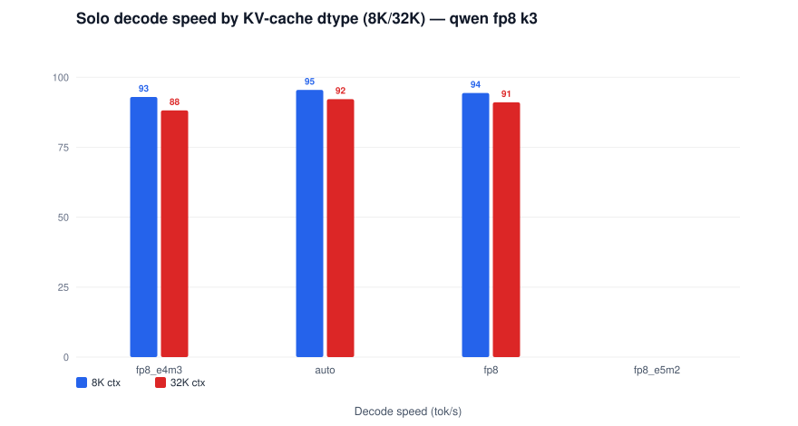
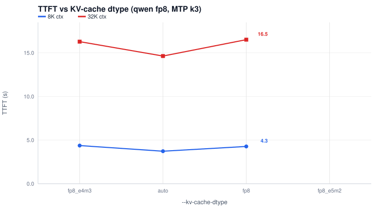
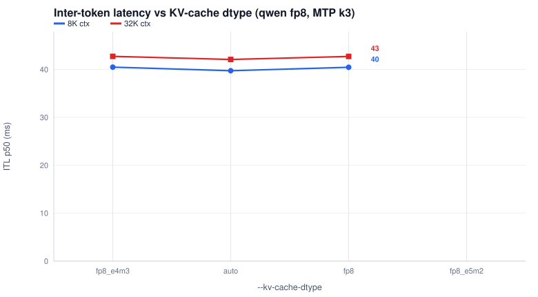

# Qwen3.8-27B FP8 + MTP k3 — KV-cache dtype comparison (close-out G)

| Field | Value |
|---|---|
| Model | Qwen3.8-27B FP8 checkpoint, MTP k3 (certified posture) |
| Sweep | --kv-cache-dtype in {fp8_e4m3, auto, fp8, fp8_e5m2} |
| Contexts | 8K, 32K (600 out tokens, temperature 0.0) |
| Engine | vLLM v0.30.0 — vllm-arc v0.30.0-b70-cert23, TP2 |
| Date | 2026-11-10 |

`fp8_e4m3` is the certified incumbent (cells `qf3`); the other dtypes are cells `kvfp8` / `kve5m2` via the `ARC_KVDTYPE` knob. A dtype that refuses to boot is a valid outcome and is banked as such. `auto` (fp16 KV — 2 bytes/elem) is exactly that case at the certified posture: serving one max-len request needs 8.73 GiB of KV cache against 6.78 GiB available at GMU 0.8 / TP2, so `--kv-cache-dtype auto` raises at boot (vLLM estimates max_model_len 202048 would fit; cell `kvauto` holds the refusal log). Its row below is measured at `max_model_len=131072` (cell `kvauto131`), which still covers the full 1K-128K report sweep. `fp8_e5m2` is the second refusal and a hard engine boundary, not a capacity one: `NotImplementedError: FlashAttention does not support fp8_e5m2 kv-cache on this device` (cell `kve5m2`) — the esimd FA2 attention backend ships no e5m2 KV dequant path on Xe2.

| --kv-cache-dtype | Context | TTFT (s) | Decode (tok/s) | ITL p50 (ms) | Note |
|---|---|---|---|---|---|
| fp8_e4m3 | 8K | 4.37 | 93.3 | 40.5 | the certified incumbent |
| fp8_e4m3 | 32K | 16.28 | 91.4 | 42.7 | the certified incumbent |
| auto | 8K | 3.73 | 95.5 | 39.7 | fp16 KV; refuses at max_model_len 262144, measured at 131072 |
| auto | 32K | 14.63 | 92.2 | 42.1 | fp16 KV; refuses at max_model_len 262144, measured at 131072 |
| fp8 | 8K | 4.27 | 94.4 | 40.5 |  |
| fp8 | 32K | 16.51 | 91.1 | 42.7 |  |
| fp8_e5m2 | 8K | BOOT_FAIL/— | — | — | refuses to boot — FA2 has no e5m2 KV path on Xe2 |
| fp8_e5m2 | 32K | BOOT_FAIL/— | — | — | refuses to boot — FA2 has no e5m2 KV path on Xe2 |

## Configuration (copyable deltas on the certified posture)

Base = the Qwen3.8-27B FP8 + MTP k3 block from [qwen-fp8-mtp-k3.md](qwen-fp8-mtp-k3.md); each cell changes only:

| dtype | cell | delta | max_model_len |
|---|---|---|---|
| fp8_e4m3 | qf3 | (none — incumbent) | 262144 |
| auto | kvauto131 | ARC_KVDTYPE=auto | 131072 |
| fp8 | kvfp8 | ARC_KVDTYPE=fp8 | 262144 |
| fp8_e5m2 | kve5m2 | ARC_KVDTYPE=fp8_e5m2 — refuses | — |

`ARC_MAXLEN=131072` is what makes `auto` servable — the 262144 refusal (cell `kvauto`) is the fp16-KV capacity cliff itself. `fp8_e5m2` has no working configuration on this engine (attention-kernel boundary, not memory).

<i>Decode speed vs KV-cache dtype — qwen fp8 k3</i>

<i>TTFT vs KV-cache dtype — qwen fp8 k3</i>

<i>Inter-token latency vs KV-cache dtype — qwen fp8 k3</i>

Bank: `results/2026-11-10-p637-reports/` (cells qf3, kvauto=refusal, kvauto131, kvfp8, kve5m2); knob: `ARC_KVDTYPE` in `tools/serve_arc_b70.sh`.

## The `turboquant_*` presets (banked cert8/cert9 matrix)

The wheel's four TurboQuant KV dtypes remain servable via the same flag. Their full performance matrix was banked at the cert8/cert9 gates (P6.14/P6.15 campaigns — unchanged on cert23, so cited here, not re-run):

| dtype | KV pool × | t0 solo decode (tok/s) | t1.0 agg8 (tok/s) | U32k/U64k TTFT (s) |
|---|---|---|---|---|
| turboquant_k8v4 | 1.98× | 88.5 / 88.6 | 172.95 | 15.29 / 33.03 |
| turboquant_4bit_nc | 2.86× | 86.2 / 86.0 | 134.42 | 15.91 / 34.02 |
| turboquant_k3v4_nc | 3.22× | 80.8 / 80.5 | 137.11 | 15.48 / 33.78 |
| turboquant_3bit_nc | 3.68× | 85.8 / 85.6 | 171.32 | 16.02 / 35.74 |

Presets trade aggregate speed for KV capacity (up to 3.68× pool); the identity records and per-preset guidance: CONFIGURATION-arc "KV-cache dtype"; evidence: `results/2026-11-04-p619-tqverify/`.
