# Qwen3.8-27B on 2x Intel Arc Pro B70 — FP8, no MTP

| Field | Value |
|---|---|
| Organization | Qwen (Alibaba) |
| Parameters | 27B dense hybrid-GDN (+MTP head) |
| Precision | FP8 (fp8 checkpoint, compressed-tensors) |
| Accelerators | 2x Intel Arc Pro B70 (BMG-G31, 32 GB each, 64 GB total), TP2 |
| Host RAM | 64 GB (close-out F posture: --shm-size 16g, 16 GB LMCache CPU tier) |
| Engine | vLLM v0.30.0 — vllm-arc fork, image v0.30.0-b70-cert28, XPU graphs |
| KV cache dtype | fp8_e4m3 |
| Speculative decoding | disabled |
| Max model len | 262144 |
| KV pool (this boot) | 494,979 tokens (r240b posture) |
| Date | 2026-11-24 |
| Cell outcome | FACES_OK |

## Executive summary

Infrastructure decisions require real performance data. This report measures user-facing performance — how many concurrent requests the configuration supports at a given context length before streaming speed or first-token wait degrade below the user-experience bands.

This benchmark evaluates **Qwen3.8-27B** (Qwen (Alibaba); 27B parameters, dense hybrid-GDN) running **FP8 (fp8 checkpoint, compressed-tensors)** on **2x Intel Arc Pro B70** (32 GB each, TP2) — the MTP-off ablation of the incumbent.

Test parameters: context lengths 1K–128K tokens; concurrency 1–8; 600 output tokens per request; unique seeded-random prompts (cold prefill, no prefix-cache hits); no speculative decoding; KV cache `fp8_e4m3`; temperature 0.0 with paired 1.0 faces.

| Metric | Result |
|---|---|
| Generation speed, single request | 34.0 tok/s (1K) → 24.8 tok/s (128K) |
| TTFT, single request | 1.78 (1K) → 101.5 (128K) |
| Peak per-user speed (solo) | **34.0 tok/s** @ 1K ctx (fast) |
| Peak system throughput | **207 tok/s** @ 8 concurrent, 1K ctx — ≈ 744.73 K tokens/hour |
| Throughput scaling (1 → 8, 1K ctx) | 6.3x (79% of ideal linear) |
| Interactive chat capacity (8K) | ~3 concurrent requests (estimated between the measured 3 and 4 points) |
| Long-context assistant (RAG) capacity (32K) | thresholds exceeded at concurrency 1 - not recommended |
| Document processing (batch) capacity (128K) | ~1 concurrent requests (estimated between the measured 1 and 2 points) |
| Success rate | **100.0%** across 87 requests (28 faces green) |

> Every concurrent request models one user session holding a full generation (prompt prefill + 600 streamed tokens), barrier-started together — the worst-case burst. Interactive sessions idle between turns, so sustained user counts run well below request concurrency. Full definitions: [METHODOLOGY.md](METHODOLOGY.md).

## Use case guidance

The table maps this configuration to common deployment scenarios. Capacity limits are where TTFT or streaming speed fall below the accepted thresholds for a comfortable user experience (the band edges of the UX classification below).

| Use case | Context | Thresholds | Capacity |
|---|---|---|---|
| Interactive chat | 8K | TTFT < 10s · speed >= 15 tok/s | ~3 concurrent requests (estimated between the measured 3 and 4 points) |
| Long-context assistant (RAG) | 32K | TTFT < 10s · speed >= 15 tok/s | thresholds exceeded at concurrency 1 - not recommended |
| Document processing (batch) | 128K | speed >= 15 tok/s | ~1 concurrent requests (estimated between the measured 1 and 2 points) |

The limits are conservative: past them the system keeps serving with slower response times that may still be acceptable for your workload.

## System throughput

Aggregate token generation across all concurrent requests (output tokens only; prefill excluded). Measured as n × 600 / wall — the wall includes the barrier start and the slowest-user tail, so it is the honest saturated-burst number.

| Condition | Aggregate throughput |
|---|---|
| Peak (1K, 8 req) | 207 tok/s |
| 8K ctx, 4 req | 77 tok/s |
| 8K ctx, 8 req | 107 tok/s |
| 32K ctx, 4 req | 30 tok/s |
| 32K ctx, 8 req | 34 tok/s |

At the peak point this configuration produces approximately **744.73 K tokens/hour** — the number that matters for batch workloads (document processing, synthetic-data generation, offline analysis).

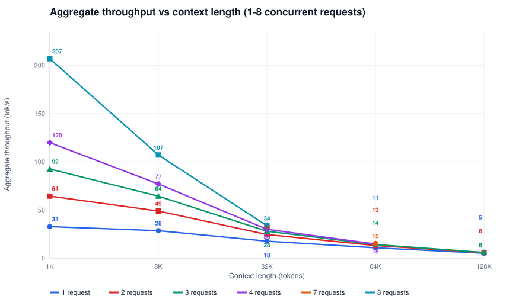

<i>Aggregate throughput vs context length, one line per concurrency — FP8, no MTP</i>

*Interpretation:* throughput peaks at 207 tok/s (8 requests, 1K); at 128K the heaviest measured load (3 requests) yields 6 tok/s (3% of peak) — long-context KV residency shrinks the resident batch. Batch workloads should batch short and parallel; long-context work is bound by KV residency, not compute.

## Per-user generation speed

The streaming rate each user experiences. As concurrency rises, per-user speed falls because the accelerators are shared; with MTP, multiple accepted tokens ride one stream chunk (spec-aware accounting).

| Context | Solo (tok/s) | class | Best @ conc (tok/s) | @ conc 8 (tok/s) | class |
|---|---|---|---|---|---|
| 1024 (1K) | 34.0 | fast | 34.1 | 28.0 | fast |
| 8192 (8K) | 33.4 | fast | 33.4 | 21.5 | acceptable |
| 32768 (32K) | 31.3 | fast | 31.0 | 10.5 | slow |
| 65536 (64K) | 28.9 | fast | 28.7 | - | - |
| 131072 (128K) | 24.8 | acceptable | 25.1 | - | - |

### How fast is this?

| Speed | User experience |
|---|---|
| < 15 tok/s | Slow - may be slower than reading speed |
| 15-25 tok/s | Acceptable - keeps pace with reading |
| 25-50 tok/s | Fast - exceeds reading speed |
| >= 50 tok/s | Very fast - text appears nearly instantly |

Solo speed spans **24.8–34.0 tok/s** (128K to 1K context); at concurrency 8 the floor is 10.5 tok/s (32K ctx).

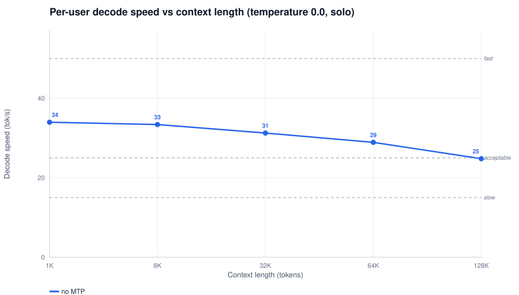

<i>Per-user decode speed vs context length (solo) — FP8, no MTP</i>

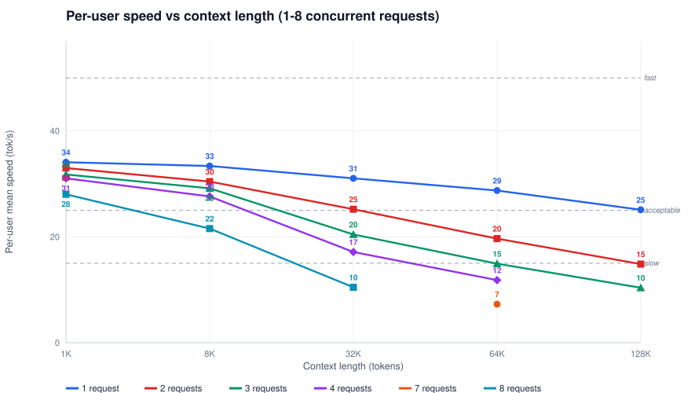

<i>Per-user speed vs context length, one line per concurrency — FP8, no MTP</i>

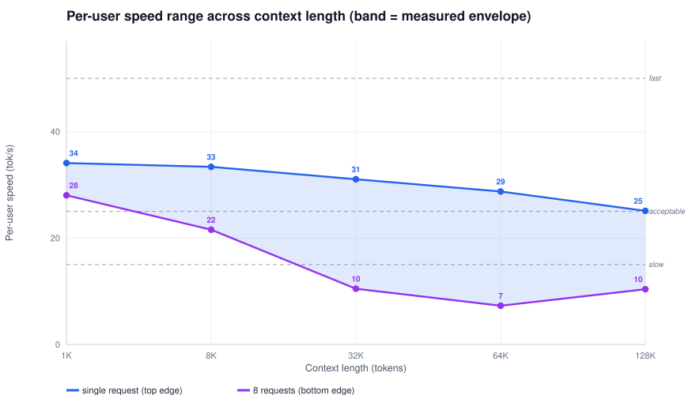

<i>Per-user speed range: the band every deployment concurrency lands in — FP8, no MTP</i>

*Interpretation:* at 128K a single user streams 25.1 tok/s while 3 requests share down to 10.4 tok/s (41% of solo); at 8K the spread is 21.5-33.4 tok/s — every concurrency you deploy lands between the band edges; the bands below classify the streaming feel.

## Time to first token

Time from request submission to the first streamed token — the primary responsiveness metric. Client-side on the rig loopback, it decomposes into queue wait (rising with concurrency) and prefill (rising with context); the technical analysis below separates the two.

| Context | Solo (s) | class | @ conc 8 mean (s) | @ conc 8 worst (s) | class |
|---|---|---|---|---|---|
| 1024 (1K) | 1.78 | responsive | 1.78 | 1.95 | responsive |
| 8192 (8K) | 4.20 | noticeable | 15.5 | 23.7 | frustrating |
| 32768 (32K) | 15.8 | frustrating | 69.3 | 116.3 | frustrating |
| 65536 (64K) | 38.2 | frustrating | - | - | - |
| 131072 (128K) | 101.5 | frustrating | - | - | - |

### How responsive is this?

| TTFT | User experience |
|---|---|
| < 0.5 s | Feels instant |
| 0.5-2 s | Feels responsive |
| 2-5 s | Noticeable but still acceptable |
| 5-10 s | Feels slow; acceptable at higher context |
| > 10 s | Can be frustrating; users may retry or abandon |

> **Caching note.** Every face uses a unique seeded-random prompt — a deliberate cold prefill, the worst case. The certified posture runs prefix caching (LMCache): in production, incremental conversations pay TTFT only for new tokens, which is dramatically faster than these numbers.

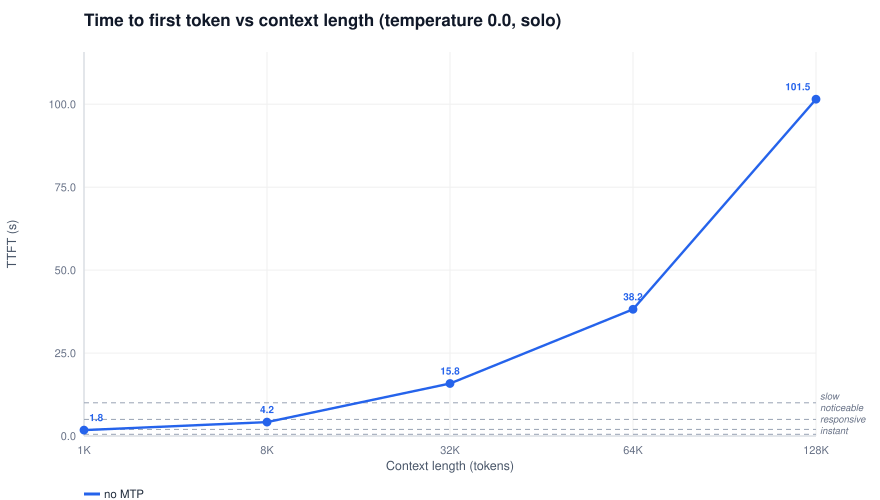

<i>TTFT vs context length (solo) — FP8, no MTP</i>

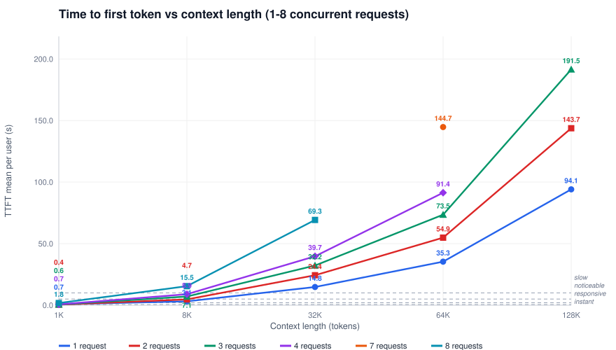

<i>TTFT vs context length, one line per concurrency — FP8, no MTP</i>

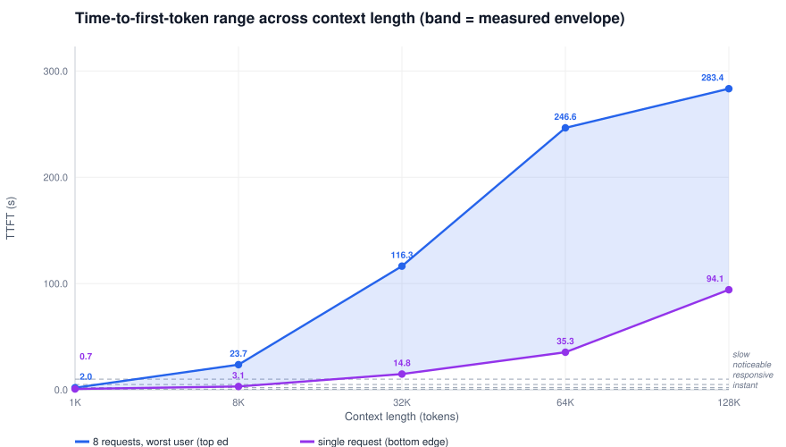

<i>TTFT range: single request (bottom) to worst user at max concurrency (top) — FP8, no MTP</i>

*Interpretation:* at 128K the first token takes 94.1 solo but up to 283.4 for the worst user under 3 requests — 67% of the loaded wait is queue+prefill stagger, the sharing cost the capacity tables price below.

## Capacity analysis

### Interactive chat (8K context)

Conversational assistant sessions: system prompt plus a few turns fit 8K. Both first-token wait and streaming speed matter. Thresholds: TTFT < 10s · speed >= 15 tok/s.

| Metric | @ 1 | @ 2 | @ 3 | @ 4 | @ 8 |
|---|---|---|---|---|---|
| TTFT worst user (s) | 3.13 | 6.24 | 9.18 | 12.0 *(exceeded)* | 23.7 *(exceeded)* |
| Per-user mean speed (tok/s) | 33.4 | 30.4 | 29.2 | 27.6 | 21.5 |

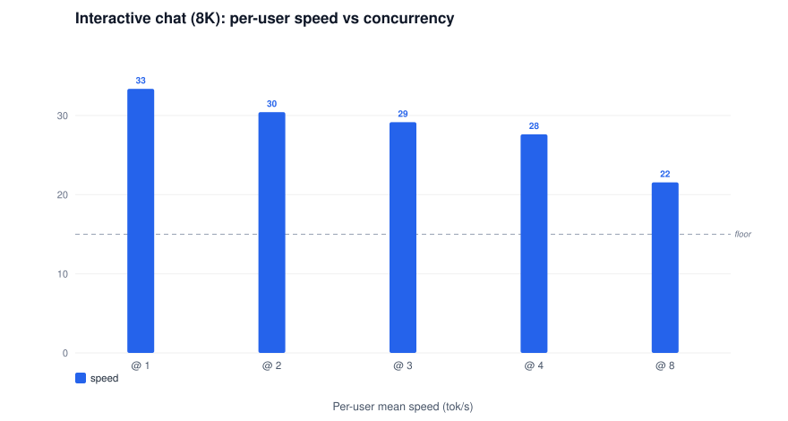

<i>Interactive chat (8K): per-user speed by concurrency; the dashed line marks the 15.0 tok/s use-case floor</i>

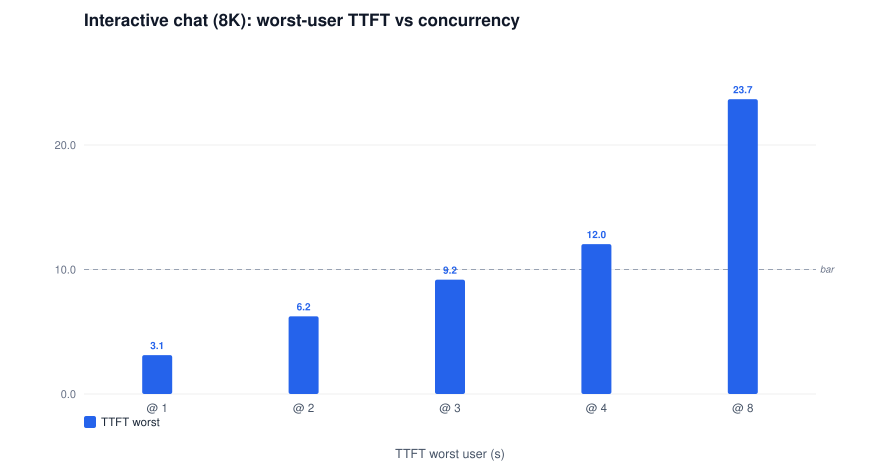

<i>Interactive chat (8K): worst-user TTFT by concurrency; the dashed line marks the 10.0 s use-case bar</i>

**Capacity limit: ~3 concurrent requests (estimated between the measured 3 and 4 points)**

### Long-context assistant (RAG) (32K context)

Retrieval-augmented / large-prompt assistants at 32K context. Thresholds: TTFT < 10s · speed >= 15 tok/s.

| Metric | @ 1 | @ 2 | @ 3 | @ 4 | @ 8 |
|---|---|---|---|---|---|
| TTFT worst user (s) | 14.8 *(exceeded)* | 29.1 *(exceeded)* | 43.6 *(exceeded)* | 58.2 *(exceeded)* | 116.3 *(exceeded)* |
| Per-user mean speed (tok/s) | 31.0 | 25.2 | 20.4 | 17.1 | 10.5 *(below)* |

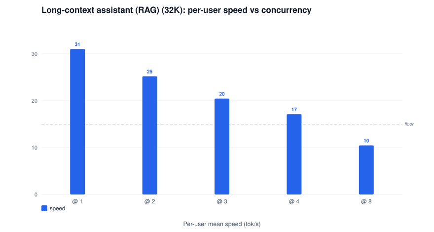

<i>Long-context assistant (RAG) (32K): per-user speed by concurrency; the dashed line marks the 15.0 tok/s use-case floor</i>

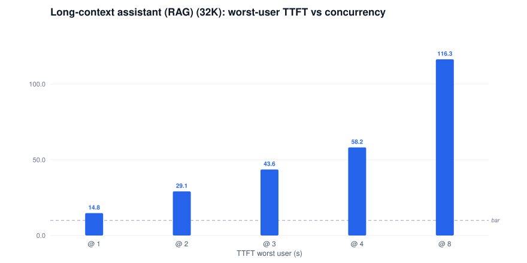

<i>Long-context assistant (RAG) (32K): worst-user TTFT by concurrency; the dashed line marks the 10.0 s use-case bar</i>

**Capacity limit: thresholds exceeded at concurrency 1 - not recommended**

### Document processing (batch) (128K context)

Offline summarization / extraction at the largest measured context. Turnaround matters, not first-token wait: the bar is streaming speed (and total throughput). Thresholds: speed >= 15 tok/s.

| Metric | @ 1 | @ 2 | @ 3 |
|---|---|---|---|
| TTFT worst user (s) | 94.1 | 188.8 | 283.4 |
| Per-user mean speed (tok/s) | 25.1 | 14.8 *(below)* | 10.4 *(below)* |

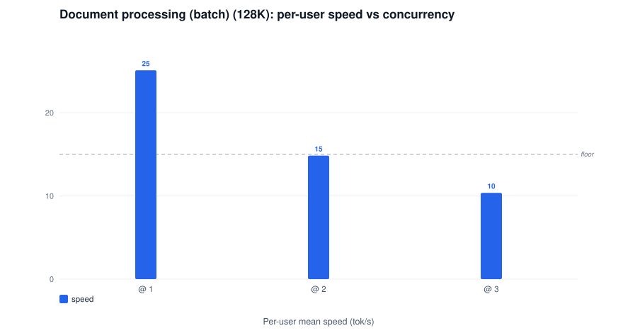

<i>Document processing (batch) (128K): per-user speed by concurrency; the dashed line marks the 15.0 tok/s use-case floor</i>

**Capacity limit: ~1 concurrent requests (estimated between the measured 1 and 2 points)**

### KV pool (the whole-pool bound)

This boot exposed a KV pool of **494,979 tokens** (r240b posture). A session occupies ctx + 664 (output + scheduler slack), so the pool holds:

| Context | Pool capacity (sessions) | Measured green @ conc | c8 fully resident? |
|---|---|---|---|
| 1024 (1K) | 293 | 8 (green) | yes |
| 8192 (8K) | 55 | 8 (green) | yes |
| 32768 (32K) | 14 | 8 (green) | yes |
| 65536 (64K) | 7 | 7 (green) | marginal |
| 131072 (128K) | 3 | 3 (green) | no |

*Sessions are the whole-pool bound; `--max-num-seqs 64` bounds the running batch above it. TurboQuant dtypes multiply the pool up to 3.68x: see the [KV-cache dtype report](qwen3.8-27b-fp8-kv-cache-dtype.md).*

## Technical analysis

### Queue + prefill decomposition (derived)

At concurrency 1 the queue is empty, so solo TTFT is pure prefill. Under the barrier burst the added first-token wait — `ttft_mean(n) − ttft_mean(1)` — is the queue+prefill-share stagger the Nth user pays. Derived client-side; engine-internal queueing is not exported by this engine version. The x-axis keeps the canonical rung ladder up to the highest measured context — an empty slot marks a rung the concurrency measurements skip (64K: only the solo face measured it on qwen; unmeasured entirely on the gemma boots); no stagger exists there.

| Context | added wait @ n2 | @ n4 | @ n8 |
|---|---|---|---|
| 1024 (1K) | +-0.3 s | +-0.1 s | +1.0 s |
| 8192 (8K) | +1.6 s | +5.8 s | +12.3 s |
| 32768 (32K) | +9.6 s | +24.9 s | +54.5 s |
| 65536 (64K) | +19.5 s | +56.1 s | - |
| 131072 (128K) | +49.6 s | - | - |

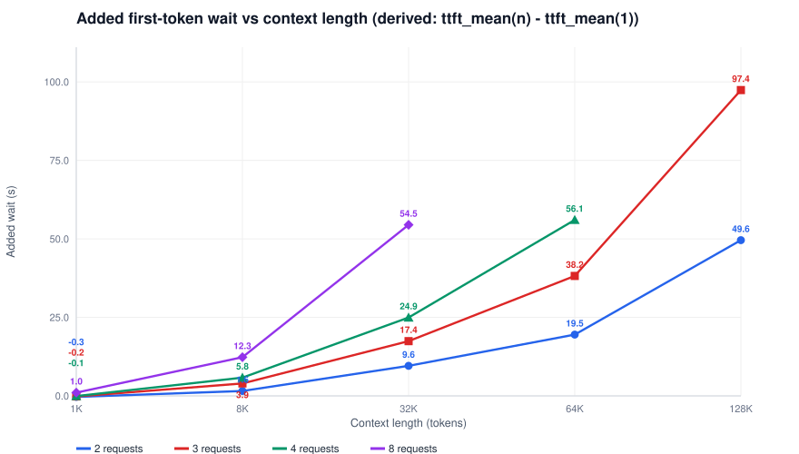

<i>Added first-token wait vs context length, one line per concurrency (derived queue+prefill stagger) — FP8, no MTP</i>

*Interpretation:* the loaded-request stagger grows from +1.0 s at 1K to +54.5 s at 32K (8 requests) — the context-carrying requests serialize behind each other's prefill.

### Per-user prefill speed

Rate at which input context is processed before the first token. Client-observed (ctx / TTFT at queue ~0); the engine-side device rate is higher — the client view includes chunk drain and the decode-transition tail. The single-request line spans **every measured context** (sweep plus solo faces — the sweep skipped 64K); loaded lines cover the contexts the concurrency sweep measured.

| Context | prefill @ n1 (tok/s) | @ n4 | @ n8 |
|---|---|---|---|
| 1024 (1K) | 1376 | 1482 | 575 |
| 8192 (8K) | 2619 | 916 | 530 |
| 32768 (32K) | 2214 | 824 | 473 |
| 65536 (64K) | 1854 | 717 | - |
| 131072 (128K) | 1393 | - | - |

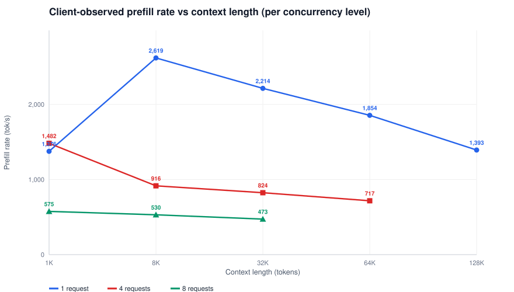

<i>Client-observed prefill rate vs context length, one line per concurrency — FP8, no MTP</i>

*Interpretation:* prefill peaks at 2,619 tok/s (8K) and eases as context grows — chunked prefill batches more work per pass at length, trading first-token wait for decode-window protection.

### Inter-token latency

Time between consecutive streamed tokens — the smoothness of streaming. Solo p50 spans **28.9 ms** (1K) to 39.6 ms; the worst observed p99 is **40 ms** (128K). With MTP one chunk can carry multiple accepted tokens, so the perceived stream is smoother than the raw chunk gap.

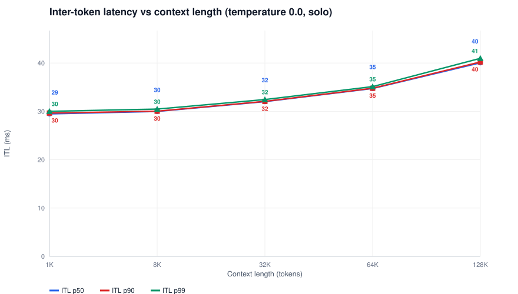

<i>Inter-token latency vs context length (solo) — FP8, no MTP</i>

### Scaling efficiency

Percentage of ideal linear scaling achieved as concurrency rises (100% = n× the concurrency-1 throughput with no per-user cost). Real efficiency is always lower — the accelerators are shared; high efficiency at your target concurrency signals headroom. The x-axis keeps the canonical rung ladder up to the highest measured context — an empty slot marks a rung the concurrency measurements skip (64K: only the solo face measured it on qwen; unmeasured entirely on the gemma boots).

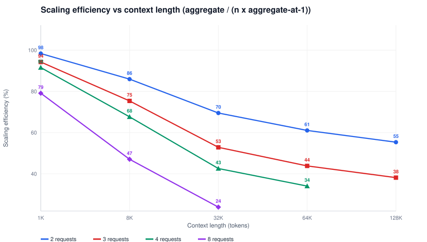

<i>Scaling efficiency vs context length, one line per concurrency — FP8, no MTP</i>

*Interpretation:* efficiency holds at 79% at 1K but falls to 24% at 32K under 8 requests — high efficiency signals headroom; a sharp drop signals the accelerators are already saturated.

### Temperature 0.0 vs 1.0 (per context)

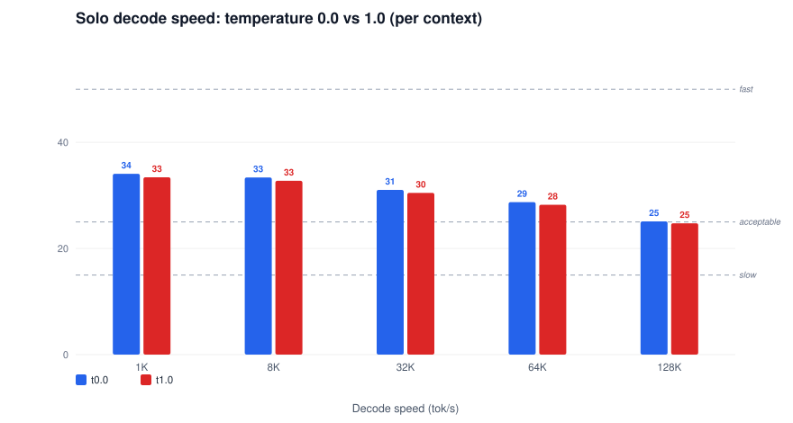

<i>Solo decode speed t0.0 vs t1.0 — FP8, no MTP</i>

## Results — detail tables

### Context sweep (solo, temperature 0.0)

| Context | TTFT (s) | Prefill (tok/s) | Decode (tok/s) | Tok/step | ITL p50 (ms) | ITL p90 (ms) | ITL p99 (ms) | Decode @ t1.0 (tok/s) |
|---|---|---|---|---|---|---|---|---|
| 1024 (1K) | 1.78 | 576 | 34.0 | 1.00 | 29.5 | 29.7 | 30.0 | 33.4 |
| 8192 (8K) | 4.20 | 1,952 | 33.4 | 1.00 | 30.0 | 30.0 | 30.5 | 32.7 |
| 32768 (32K) | 15.83 | 2,070 | 31.3 | 1.00 | 32.0 | 32.1 | 32.4 | 30.5 |
| 65536 (64K) | 38.19 | 1,716 | 28.9 | 1.00 | 34.7 | 34.8 | 35.1 | 28.2 |
| 131072 (128K) | 101.53 | 1,291 | 24.8 | 1.00 | 40.0 | 40.2 | 41.0 | 24.7 |

### Concurrency sweep — 1024 (1K) context (temperature 0.0)

| Concurrency | TTFT mean (s) | TTFT max (s) | Per-user mean (tok/s) | Per-user worst (tok/s) | Aggregate (tok/s) | Scaling eff. | ITL p50 med (ms) | ITL p90 max (ms) |
|---|---|---|---|---|---|---|---|---|
| 1 | 0.74 | 0.74 | 34.1 | 34.1 | 33 | 100% | 28.9 | 29.1 |
| 2 | 0.44 | 0.54 | 33.0 | 32.8 | 64 | 98% | 29.3 | 29.5 |
| 3 | 0.56 | 0.67 | 31.8 | 31.5 | 92 | 94% | 30.1 | 30.3 |
| 4 | 0.69 | 0.79 | 31.0 | 30.6 | 120 | 92% | 30.4 | 30.6 |
| 8 | 1.78 | 1.95 | 28.0 | 26.6 | 207 | 79% | 32.1 | 32.3 |

### Concurrency sweep — 8192 (8K) context (temperature 0.0)

| Concurrency | TTFT mean (s) | TTFT max (s) | Per-user mean (tok/s) | Per-user worst (tok/s) | Aggregate (tok/s) | Scaling eff. | ITL p50 med (ms) | ITL p90 max (ms) |
|---|---|---|---|---|---|---|---|---|
| 1 | 3.13 | 3.13 | 33.4 | 33.4 | 28 | 100% | 29.9 | 29.9 |
| 2 | 4.70 | 6.24 | 30.4 | 28.1 | 49 | 86% | 30.4 | 30.5 |
| 3 | 7.08 | 9.18 | 29.2 | 24.3 | 64 | 75% | 31.3 | 31.4 |
| 4 | 8.94 | 12.0 | 27.6 | 21.6 | 77 | 68% | 31.9 | 31.9 |
| 8 | 15.5 | 23.7 | 21.5 | 14.5 | 107 | 47% | 35.3 | 35.4 |

### Concurrency sweep — 32768 (32K) context (temperature 0.0)

| Concurrency | TTFT mean (s) | TTFT max (s) | Per-user mean (tok/s) | Per-user worst (tok/s) | Aggregate (tok/s) | Scaling eff. | ITL p50 med (ms) | ITL p90 max (ms) |
|---|---|---|---|---|---|---|---|---|
| 1 | 14.8 | 14.8 | 31.0 | 31.0 | 18 | 100% | 31.8 | 31.9 |
| 2 | 24.4 | 29.1 | 25.2 | 20.4 | 24 | 70% | 32.5 | 32.5 |
| 3 | 32.2 | 43.6 | 20.4 | 13.4 | 28 | 53% | 33.6 | 33.7 |
| 4 | 39.7 | 58.2 | 17.1 | 10.0 | 30 | 43% | 34.8 | 34.9 |
| 8 | 69.3 | 116.3 | 10.5 | 4.9 | 34 | 24% | 41.2 | 42.0 |

### Concurrency sweep — 65536 (64K) context (temperature 0.0)

| Concurrency | TTFT mean (s) | TTFT max (s) | Per-user mean (tok/s) | Per-user worst (tok/s) | Aggregate (tok/s) | Scaling eff. | ITL p50 med (ms) | ITL p90 max (ms) |
|---|---|---|---|---|---|---|---|---|
| 1 | 35.3 | 35.3 | 28.7 | 28.7 | 11 | 100% | 34.4 | 34.4 |
| 2 | 54.9 | 70.6 | 19.7 | 11.4 | 13 | 61% | 35.0 | 35.1 |
| 3 | 73.5 | 105.6 | 14.9 | 6.8 | 14 | 44% | 36.5 | 36.6 |
| 4 | 91.4 | 141.1 | 11.8 | 4.8 | 15 | 34% | 38.6 | 38.9 |
| 7 | 144.7 | 246.6 | 7.3 | 2.6 | 15 | 20% | 45.8 | 60.1 |

### Concurrency sweep — 131072 (128K) context (temperature 0.0)

| Concurrency | TTFT mean (s) | TTFT max (s) | Per-user mean (tok/s) | Per-user worst (tok/s) | Aggregate (tok/s) | Scaling eff. | ITL p50 med (ms) | ITL p90 max (ms) |
|---|---|---|---|---|---|---|---|---|
| 1 | 94.1 | 94.1 | 25.1 | 25.1 | 5 | 100% | 39.6 | 39.6 |
| 2 | 143.7 | 188.8 | 14.8 | 5.3 | 6 | 55% | 40.2 | 40.3 |
| 3 | 191.5 | 283.4 | 10.4 | 2.9 | 6 | 38% | 42.2 | 42.4 |

*Scaling eff. = aggregate / (n x aggregate-at-1): 100% = perfect linear scaling. ITL p50 med = median of per-request p50s; ITL p90 max = worst user. Aggregate is wall-clock (n x 600 tokens / wall) and includes the slowest-user tail.*

## Configuration (copy & run on your own hardware)

### Validated invocation (what the gate ran, byte-exact)

```bash
# image vllm-arc:v0.30.0-b70-cert28 ; 2026-11-24 ; TP2 on 2x Arc Pro B70
ARC_IMAGE=vllm-arc:v0.30.0-b70-cert28 ARC_NAME=arc-b70 \
  ARC_MODEL=/models/qwen3.8-27b-fp8 ARC_SERVED=qwen3.8-27b-fp8 ARC_GRAPH=1 ARC_LMC=1 ARC_FP8=1 ARC_SPEC=0 \
  bash serve_arc_b70.sh     # tools/serve_arc_b70.sh in this repo
```

The wrapper is the audited source of truth (banked posture echo: `qf0/posture.txt`). What it expands to:

```bash
# 1) container boot layer  [serve_arc_b70.sh:199-210]
docker run -d --name arc-b70 \
  --privileged --network host --ipc host \
  --shm-size 16g \              # close-out F: 64 GB-RAM hosts
  -v /models/qwen3.8-27b-fp8:/models/target:ro \
  -v ./neo_cache:/root/.neo_cache -v ./triton_cache:/root/.triton_cache \
  -v ./inductor_cache:/root/.inductor_cache \
  -e VLLM_ALLOW_LONG_MAX_MODEL_LEN=1 -e VLLM_WORKER_MULTIPROC_METHOD=spawn \
  --entrypoint /bin/bash vllm-arc:v0.30.0-b70-cert28 -c 'sleep infinity'

# 2) engine layer (docker exec)  [serve_arc_b70.sh:327-375]
export PYTHONHASHSEED=0 VLLM_EXECUTE_MODEL_TIMEOUT_SECONDS=300 ZE_AFFINITY_MASK=0,1
export CCL_ENABLE_SYCL_KERNELS=1 CCL_ZE_IPC_EXCHANGE=pidfd CCL_TOPO_P2P_ACCESS=1
export CCL_TOPO_FABRIC_VERTEX_CONNECTION_CHECK=0 CCL_SYCL_ALLGATHERV_SMALL_THRESHOLD=131072
export CCL_SYCL_ALLGATHERV_SCALEOUT_THRESHOLD=1048576 CCL_SYCL_ALLGATHERV_TMP_BUF=0 CCL_SYCL_ALLREDUCE_TMP_BUF=0
export ARC_TRACE_FLIP=1 VLLM_XPU_ENABLE_XPU_GRAPH=1   # decode-only XPU graphs
export CCL_SYCL_ALLREDUCE_FP8=1                    # cert10 AR overlay
export LMCACHE_USE_EXPERIMENTAL_API=True LMCACHE_MAX_LOCAL_CPU_SIZE=16 LMCACHE_LOCAL_CPU=True
export LMCACHE_EVICT_POLICY=lr_u LMCACHE_CHUNK_SIZE=1024 LMCACHE_SAVE_DECODE_CACHE=True
export LMCACHE_MIN_RETRIEVE_TOKENS=1024 LMCACHE_LOG_LEVEL=INFO LMCACHE_DISABLE_PINNED_MEMORY=1
export LMCACHE_TRACK_USAGE=false                   # close-out F: 16 GB CPU tier
exec vllm serve --model /models/target \
  --served-model-name qwen3.8-27b-fp8 --tensor-parallel-size 2 \
  --gpu-memory-utilization 0.8 --max-model-len 262144 \
  --max-num-batched-tokens 8192 --max-num-seqs 64 --block-size 64 \
  --dtype float16   \
  --kv-cache-dtype fp8_e4m3 \
  --mamba-ssm-cache-dtype float16 --mamba-cache-mode=align \
  --enable-prefix-caching --trust-remote-code \
  --reasoning-parser qwen3 --tool-call-parser qwen3_coder --enable-auto-tool-choice \
  --no-disable-hybrid-kv-cache-manager \
  --kv-transfer-config '{"kv_connector":"LMCacheConnectorV1","kv_role":"kv_both","kv_connector_extra_config":{"use_native":true,"lmcache.extra_config":{"mamba_pool_ratio":2}},"engine_id":"arc-p40"}' \
  --compilation-config '{"mode":"none","cudagraph_mode":"FULL_DECODE_ONLY","cudagraph_capture_sizes":[1..320]}' \   # 64-size discipline, see wrapper
  --port 8000
```

## Test parameters

- Context lengths: 1K, 8K, 32K, 64K, 128K tokens (prompt + template) — the full ladder this report covers, annex rungs included. Solo faces: concurrency 1, 600 output tokens, `ignore_eos`.
- Concurrency sweeps: 1/2/3/4/8 at contexts 1K, 8K, 32K, 64K, 128K — barrier-started simultaneous requests, 600 output tokens each, temperature 0.0, plus one temperature-1.0 solo face per context.
- Prompts: seeded random-token contexts, unique per face and per request slot (`p138_face.py` / `p139_conc.py`, tag-seeded) — every face is a cold prefill (no prompt-cache hits).
- Client-side timing on the rig loopback; TTFT includes the full engine prefill window (at c=1 queue wait ~0; at c=N the TTFT spread IS the queue+prefill stagger).

## Notes

- Per-user speed = output tokens / decode window (spec-decode aware; with MTP one stream chunk carries multiple accepted tokens). Aggregate = n x 600 tokens / wall clock.
- The r240b 1K t0.0 face runs first after the boot warmup at a cold spec-verify batch shape — its acceptance (2.8 tok/step) sits below the family norm (3.8 at 8K); the 8K/32K faces are the steady reference. Temperature comparisons are within-harness (r240 sweep vs r240b faces, both reported).
- Prefill rate is the client-observed ctx/TTFT; the engine-side device rate (P6.36 decomposition) is ~2.1–2.9k tok/s at fp8 — the client view includes chunk drain and the decode-transition tail.
- Metric definitions, UX bands, use-case thresholds and the honest-limits statement: [METHODOLOGY.md](METHODOLOGY.md).
- Banks: `results/2026-11-24-p647-r240-reports/` (solo + temperature faces, r240) and `results/2026-11-24-p647-r240b-conc/` (concurrency faces, r240b); tools `tools/ar/p138/p138_face.py`, `tools/ar/p139/p139_conc.py`.
