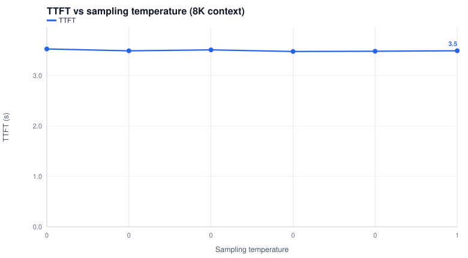

# Qwen3.8-27B on 2x Intel Arc Pro B70 — FP8, MTP k3

| Field | Value |
|---|---|
| Organization | Qwen (Alibaba) |
| Parameters | 27B dense hybrid-GDN (+MTP head) |
| Precision | FP8 (fp8 checkpoint, compressed-tensors) |
| Accelerators | 2x Intel Arc Pro B70 (BMG-G31, 32 GB each, 64 GB total), TP2 |
| Host RAM | 64 GB (close-out F posture: --shm-size 16g, 16 GB LMCache CPU tier) |
| Engine | vLLM v0.30.0 — vllm-arc fork, image v0.30.0-b70-cert23, XPU graphs |
| KV cache dtype | fp8_e4m3 |
| Speculative decoding | MTP k3, probabilistic drafting |
| Date | 2026-11-10 |
| Cell outcome | FACES_OK |

## Executive summary

Qwen3.8-27B — the certified incumbent posture — measured on the shipping cert23 image, solo streaming, seeded-random unique prompts (no cache hits), `ignore_eos`.

| Metric | Result |
|---|---|
| TTFT @ 1K ctx | 0.84 s |
| TTFT @ 128K ctx | 106.2 s |
| Peak decode speed | 93.8 tok/s @ 1K ctx |
| Decode @ largest ctx | 74.5 tok/s |
| Prefill rate (client, ctx/TTFT) | 1,212 (min) … 2,013 tok/s (max) |
| Temperature effect on decode (8K ctx) | 94.4 tok/s @ t0.0 → 72.5 tok/s @ t1.0 (-23%) |
| Success rate | 11/11 faces (ctx sweep + temp sweep) |

## Test parameters

- Context lengths: 1K, 8K, 32K, 64K, 128K tokens (prompt + template). Concurrency 1, 600 output tokens per request, `ignore_eos`.
- Temperature sweep (MTP acceptance): 0.0, 0.2, 0.4, 0.6, 0.8, 1.0 at 8K context.
- Prompts: seeded random-token contexts, unique per face (`p138_face.py`, tag-seeded) — every face is a cold prefill (no prompt-cache hits).
- Client-side timing on the rig loopback; TTFT includes the full engine prefill window (queue ~0 at concurrency 1).

## Configuration (copy & run on your own hardware)

#### Validated invocation (what the r138 gate ran, byte-exact)

```bash
# image vllm-arc:v0.30.0-b70-cert23 ; 2026-11-10 ; TP2 on 2x Arc Pro B70
ARC_IMAGE=vllm-arc:v0.30.0-b70-cert23 ARC_NAME=arc-b70 \
  ARC_MODEL=/models/qwen3.8-27b-fp8 ARC_SERVED=qwen3.8-27b-fp8 ARC_GRAPH=1 ARC_LMC=1 ARC_FP8=1 ARC_SPEC=3 \
  bash serve_arc_b70.sh     # tools/serve_arc_b70.sh in this repo
```

The wrapper is the audited source of truth (banked posture echo: `qf3/posture.txt`). What it expands to:

```bash
# 1) container boot layer  [serve_arc_b70.sh:199-210]
docker run -d --name arc-b70 \
  --privileged --network host --ipc host \
  --shm-size 16g \              # close-out F: 64 GB-RAM hosts
  -v /models/qwen3.8-27b-fp8:/models/target:ro \
  -v ./neo_cache:/root/.neo_cache -v ./triton_cache:/root/.triton_cache \
  -v ./inductor_cache:/root/.inductor_cache \
  -e VLLM_ALLOW_LONG_MAX_MODEL_LEN=1 -e VLLM_WORKER_MULTIPROC_METHOD=spawn \
  --entrypoint /bin/bash vllm-arc:v0.30.0-b70-cert23 -c 'sleep infinity'

# 2) engine layer (docker exec)  [serve_arc_b70.sh:327-375]
export PYTHONHASHSEED=0 VLLM_EXECUTE_MODEL_TIMEOUT_SECONDS=300 ZE_AFFINITY_MASK=0,1
export CCL_ENABLE_SYCL_KERNELS=1 CCL_ZE_IPC_EXCHANGE=pidfd CCL_TOPO_P2P_ACCESS=1
export CCL_TOPO_FABRIC_VERTEX_CONNECTION_CHECK=0 CCL_SYCL_ALLGATHERV_SMALL_THRESHOLD=131072
export CCL_SYCL_ALLGATHERV_SCALEOUT_THRESHOLD=1048576 CCL_SYCL_ALLGATHERV_TMP_BUF=0 CCL_SYCL_ALLREDUCE_TMP_BUF=0
export ARC_TRACE_FLIP=1 VLLM_XPU_ENABLE_XPU_GRAPH=1   # decode-only XPU graphs
export CCL_SYCL_ALLREDUCE_FP8=1                    # cert10 AR overlay
export LMCACHE_USE_EXPERIMENTAL_API=True LMCACHE_MAX_LOCAL_CPU_SIZE=16 LMCACHE_LOCAL_CPU=True
export LMCACHE_EVICT_POLICY=lr_u LMCACHE_CHUNK_SIZE=1024 LMCACHE_SAVE_DECODE_CACHE=True
export LMCACHE_MIN_RETRIEVE_TOKENS=1024 LMCACHE_LOG_LEVEL=INFO LMCACHE_DISABLE_PINNED_MEMORY=1
export LMCACHE_TRACK_USAGE=false                   # close-out F: 16 GB CPU tier
exec vllm serve --model /models/target \
  --served-model-name qwen3.8-27b-fp8 --tensor-parallel-size 2 \
  --gpu-memory-utilization 0.8 --max-model-len 262144 \
  --max-num-batched-tokens 8192 --max-num-seqs 64 --block-size 64 \
  --dtype float16   \
  --kv-cache-dtype fp8_e4m3 \
  --mamba-ssm-cache-dtype float16 --mamba-cache-mode=align \
  --enable-prefix-caching --trust-remote-code \
  --reasoning-parser qwen3 --tool-call-parser qwen3_coder --enable-auto-tool-choice \
  --no-disable-hybrid-kv-cache-manager \
  --kv-transfer-config '{"kv_connector":"LMCacheConnectorV1","kv_role":"kv_both","kv_connector_extra_config":{"use_native":true,"lmcache.extra_config":{"mamba_pool_ratio":2}},"engine_id":"arc-p40"}' \
  --compilation-config '{"mode":"none","cudagraph_mode":"FULL_DECODE_ONLY","cudagraph_capture_sizes":[1..320]}' \   # 64-size discipline, see wrapper
  --speculative-config '{"method":"mtp","num_speculative_tokens":3,"draft_sample_method":"probabilistic"}' \
  --port 8000
```

## Results — context sweep (temperature 0.0)

| Context | TTFT (s) | Prefill (tok/s) | Decode (tok/s) | Tok/step | ITL p50 (ms) | ITL p90 (ms) | ITL p99 (ms) |
|---|---|---|---|---|---|---|---|
| 1024 (1K) | 0.84 | 1,212 | 93.8 | 3.87 | 39.7 | 39.9 | 63.1 |
| 8192 (8K) | 4.37 | 1,873 | 93.3 | 3.80 | 40.5 | 40.6 | 42.9 |
| 32768 (32K) | 16.28 | 2,013 | 91.4 | 3.90 | 42.7 | 42.8 | 52.9 |
| 65536 (64K) | 39.12 | 1,675 | 84.4 | 3.85 | 45.7 | 45.8 | 46.4 |
| 131072 (128K) | 106.22 | 1,234 | 74.5 | 3.80 | 51.5 | 51.6 | 64.9 |

## Results — temperature sweep (8K context, MTP k3)

| Temp | TTFT (s) | Decode (tok/s) | Tok/step | ITL p50 (ms) | ITL p90 (ms) |
|---|---|---|---|---|---|
| 0.0 | 3.53 | 94.4 | 3.85 | 40.5 | 40.6 |
| 0.2 | 3.49 | 95.4 | 3.95 | 41.1 | 41.2 |
| 0.4 | 3.51 | 92.5 | 3.85 | 41.1 | 41.3 |
| 0.6 | 3.48 | 75.2 | 3.11 | 41.1 | 41.3 |
| 0.8 | 3.48 | 92.3 | 3.82 | 41.1 | 41.2 |
| 1.0 | 3.49 | 72.5 | 3.00 | 41.1 | 41.2 |

Higher temperature lowers draft acceptance (tok/step falls), so decode speed drops as sampling sharpness rises — the certified probabilistic drafting keeps the target distribution correct at every temperature.

## Charts


<i>TTFT vs context length — FP8, MTP k3</i>


<i>Decode speed vs context length — FP8, MTP k3</i>


<i>Prefill rate vs context length — FP8, MTP k3</i>


<i>Inter-token latency vs context length — FP8, MTP k3</i>


<i>Decode speed vs sampling temperature — MTP k3</i>



<i>TTFT vs sampling temperature — MTP k3</i>

## Notes

- Decode speed = output tokens / decode window (spec-decode aware; with MTP one stream chunk carries multiple accepted tokens — Tok/step is the acceptance view).
- Prefill rate is the client-observed ctx/TTFT; the engine-side device rate (P6.36 decomposition) is ~2.1–2.9k tok/s at fp8 — the client view includes chunk drain and the decode-transition tail.
- Bank: `results/2026-11-10-p637-reports/` (faces, postures, serve logs); face tool: `tools/ar/p138/p138_face.py`.
