# Qwen3.8-27B on 2x Intel Arc Pro B70 — FP8, MTP k3

| Field | Value |
|---|---|
| Organization | Qwen (Alibaba) |
| Parameters | 27B dense hybrid-GDN (+MTP head) |
| Precision | FP8 (fp8 checkpoint, compressed-tensors) |
| Accelerators | 2x Intel Arc Pro B70 (BMG-G31, 32 GB each, 64 GB total), TP2 |
| Host RAM | 64 GB (close-out F posture: --shm-size 16g, 16 GB LMCache CPU tier) |
| Engine | vLLM v0.30.0 — vllm-arc fork, image v0.30.0-b70-cert23, XPU graphs |
| KV cache dtype | fp8_e4m3 |
| Speculative decoding | MTP k3, probabilistic drafting |
| Max model len | 262144 |
| KV pool (this boot) | 398,363 tokens (r139 posture) |
| Date | 2026-11-11 |
| Cell outcome | FACES_OK |

## Executive summary

Infrastructure decisions require real performance data. This report measures user-facing performance — how many concurrent requests the configuration supports at a given context length before streaming speed or first-token wait degrade below the user-experience bands.

This benchmark evaluates **Qwen3.8-27B** (Qwen (Alibaba); 27B parameters, dense hybrid-GDN) running **FP8 (fp8 checkpoint, compressed-tensors)** on **2x Intel Arc Pro B70** (32 GB each, TP2) — the certified incumbent posture.

Test parameters: context lengths 1K–128K tokens; concurrency 1–8; 600 output tokens per request; unique seeded-random prompts (cold prefill, no prefix-cache hits); MTP k3 (probabilistic drafting); KV cache `fp8_e4m3`; temperature 0.0 with paired 1.0 faces.

| Metric | Result |
|---|---|
| Generation speed, single request | 93.8 tok/s (1K) → 74.5 tok/s (128K) |
| TTFT, single request | 0.84 (1K) → 106.2 (128K) |
| Peak per-user speed (solo) | **93.8 tok/s** @ 1K ctx (**very fast**) |
| Peak system throughput | **287 tok/s** @ 8 concurrent, 1K ctx — ≈ 1.03 M tokens/hour |
| Throughput scaling (1 → 8, 1K ctx) | 4.4x (55% of ideal linear) |
| Interactive chat capacity (8K) | ~2 concurrent requests (estimated between the measured 2 and 3 points) |
| Long-context assistant (RAG) capacity (32K) | thresholds exceeded at concurrency 1 - not recommended |
| Document processing (batch) capacity (128K) | 3 concurrent requests |
| Success rate | **100.0%** across 75 requests (29 faces green) |

> Every concurrent request models one user session holding a full generation (prompt prefill + 600 streamed tokens), barrier-started together — the worst-case burst. Interactive sessions idle between turns, so sustained user counts run well below request concurrency. Full definitions: [METHODOLOGY.md](METHODOLOGY.md).

## Use case guidance

The table maps this configuration to common deployment scenarios. Capacity limits are where TTFT or streaming speed fall below the accepted thresholds for a comfortable user experience (the band edges of the UX classification below).

| Use case | Context | Thresholds | Capacity |
|---|---|---|---|
| Interactive chat | 8K | TTFT < 10s · speed >= 15 tok/s | ~2 concurrent requests (estimated between the measured 2 and 3 points) |
| Long-context assistant (RAG) | 32K | TTFT < 10s · speed >= 15 tok/s | thresholds exceeded at concurrency 1 - not recommended |
| Document processing (batch) | 128K | speed >= 15 tok/s | 3 concurrent requests |

The limits are conservative: past them the system keeps serving with slower response times that may still be acceptable for your workload.

## System throughput

Aggregate token generation across all concurrent requests (output tokens only; prefill excluded). Measured as n × 600 / wall — the wall includes the barrier start and the slowest-user tail, so it is the honest saturated-burst number.

| Condition | Aggregate throughput |
|---|---|
| Peak (1K, 8 req) | 287 tok/s |
| 8K ctx, 4 req | 98 tok/s |
| 8K ctx, 8 req | 124 tok/s |
| 32K ctx, 4 req | 32 tok/s |
| 32K ctx, 8 req | 33 tok/s |

At the peak point this configuration produces approximately **1.03 M tokens/hour** — the number that matters for batch workloads (document processing, synthetic-data generation, offline analysis).

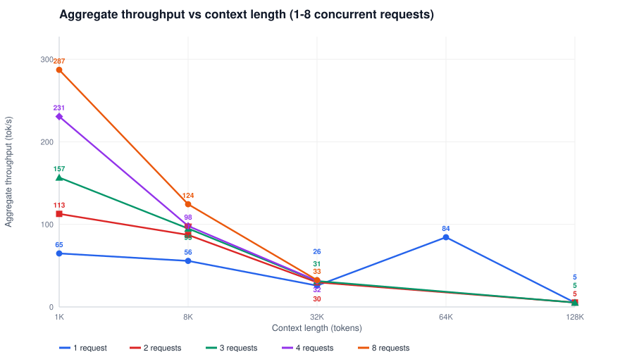

<i>Aggregate throughput vs context length, one line per concurrency — FP8, MTP k3</i>

*Interpretation:* throughput peaks at 287 tok/s (8 requests, 1K); at 128K the heaviest measured load (3 requests) yields 5 tok/s (2% of peak) — long-context KV residency shrinks the resident batch. Batch workloads should batch short and parallel; long-context work is bound by KV residency, not compute.

## Per-user generation speed

The streaming rate each user experiences. As concurrency rises, per-user speed falls because the accelerators are shared; with MTP, multiple accepted tokens ride one stream chunk (spec-aware accounting).

| Context | Solo (tok/s) | class | Best @ conc (tok/s) | @ conc 8 (tok/s) | class |
|---|---|---|---|---|---|
| 1024 (1K) | 93.8 | **very fast** | 78.6 | 60.2 | **very fast** |
| 8192 (8K) | 93.3 | **very fast** | 93.0 | 37.8 | fast |
| 32768 (32K) | 91.4 | **very fast** | 88.2 | 15.2 | acceptable |
| 65536 (64K) | 84.4 | **very fast** | - | - | - |
| 131072 (128K) | 74.5 | **very fast** | 73.0 | - | - |

### How fast is this?

| Speed | User experience |
|---|---|
| < 15 tok/s | Slow - may be slower than reading speed |
| 15-25 tok/s | Acceptable - keeps pace with reading |
| 25-50 tok/s | Fast - exceeds reading speed |
| >= 50 tok/s | Very fast - text appears nearly instantly |

Solo speed spans **74.5–93.8 tok/s** (128K to 1K context); at concurrency 8 the floor is 15.2 tok/s (32K ctx).

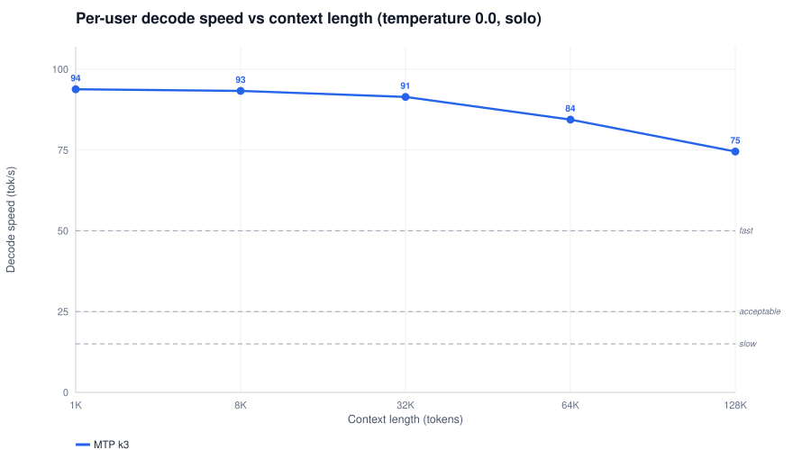

<i>Per-user decode speed vs context length (solo) — FP8, MTP k3</i>

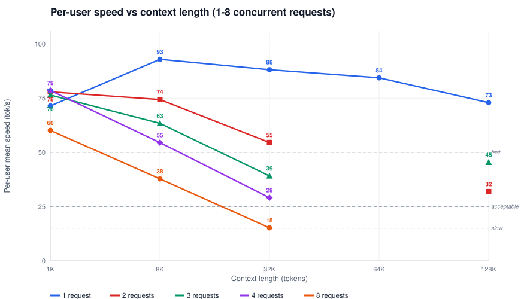

<i>Per-user speed vs context length, one line per concurrency — FP8, MTP k3</i>

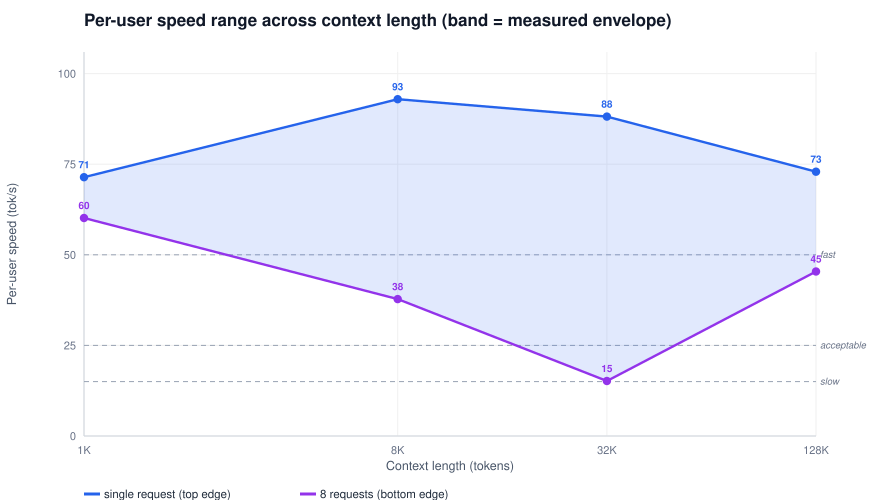

<i>Per-user speed range: the band every deployment concurrency lands in — FP8, MTP k3</i>

*Interpretation:* at 128K a single user streams 73.0 tok/s while 3 requests share down to 45.4 tok/s (62% of solo); at 8K the spread is 37.8-93.0 tok/s — every concurrency you deploy lands between the band edges; the bands below classify the streaming feel.

## Time to first token

Time from request submission to the first streamed token — the primary responsiveness metric. Client-side on the rig loopback, it decomposes into queue wait (rising with concurrency) and prefill (rising with context); the technical analysis below separates the two.

| Context | Solo (s) | class | @ conc 8 mean (s) | @ conc 8 worst (s) | class |
|---|---|---|---|---|---|
| 1024 (1K) | 0.84 | responsive | 4.92 | 5.47 | slow |
| 8192 (8K) | 4.37 | noticeable | 19.2 | 29.0 | frustrating |
| 32768 (32K) | 16.3 | frustrating | 78.4 | 135.5 | frustrating |
| 65536 (64K) | 39.1 | frustrating | - | - | - |
| 131072 (128K) | 106.2 | frustrating | - | - | - |

### How responsive is this?

| TTFT | User experience |
|---|---|
| < 0.5 s | Feels instant |
| 0.5-2 s | Feels responsive |
| 2-5 s | Noticeable but still acceptable |
| 5-10 s | Feels slow; acceptable at higher context |
| > 10 s | Can be frustrating; users may retry or abandon |

> **Caching note.** Every face uses a unique seeded-random prompt — a deliberate cold prefill, the worst case. The certified posture runs prefix caching (LMCache): in production, incremental conversations pay TTFT only for new tokens, which is dramatically faster than these numbers.

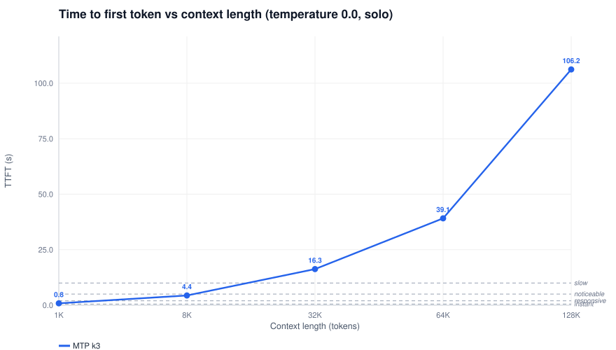

<i>TTFT vs context length (solo) — FP8, MTP k3</i>

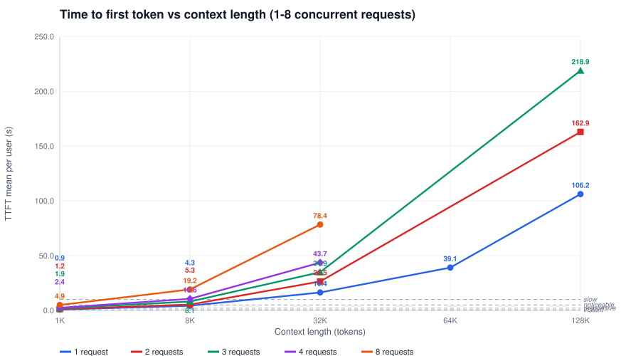

<i>TTFT vs context length, one line per concurrency — FP8, MTP k3</i>

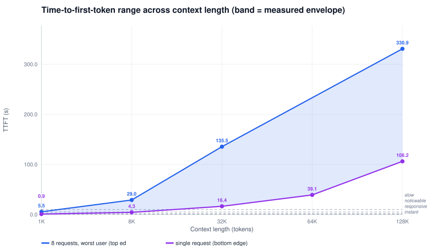

<i>TTFT range: single request (bottom) to worst user at max concurrency (top) — FP8, MTP k3</i>

*Interpretation:* at 128K the first token takes 106.2 solo but up to 330.9 for the worst user under 3 requests — 68% of the loaded wait is queue+prefill stagger, the sharing cost the capacity tables price below.

## Capacity analysis

### Interactive chat (8K context)

Conversational assistant sessions: system prompt plus a few turns fit 8K. Both first-token wait and streaming speed matter. Thresholds: TTFT < 10s · speed >= 15 tok/s.

| Metric | @ 1 | @ 2 | @ 3 | @ 4 | @ 8 |
|---|---|---|---|---|---|
| TTFT worst user (s) | 4.30 | 7.07 | 11.1 *(exceeded)* | 14.8 *(exceeded)* | 29.0 *(exceeded)* |
| Per-user mean speed (tok/s) | 93.0 | 74.4 | 63.4 | 54.5 | 37.8 |

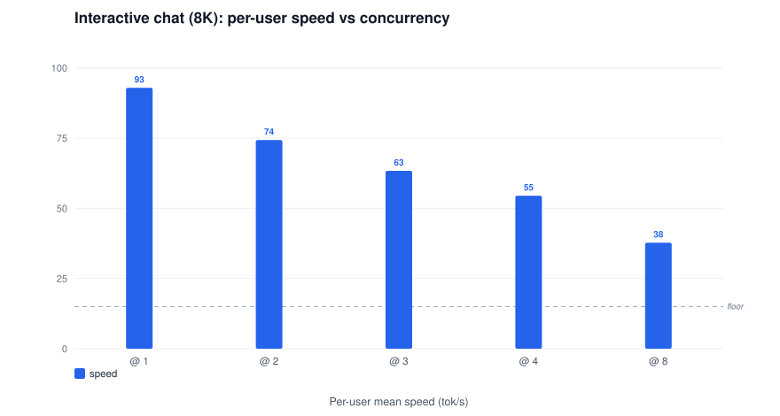

<i>Interactive chat (8K): per-user speed by concurrency; the dashed line marks the 15.0 tok/s use-case floor</i>

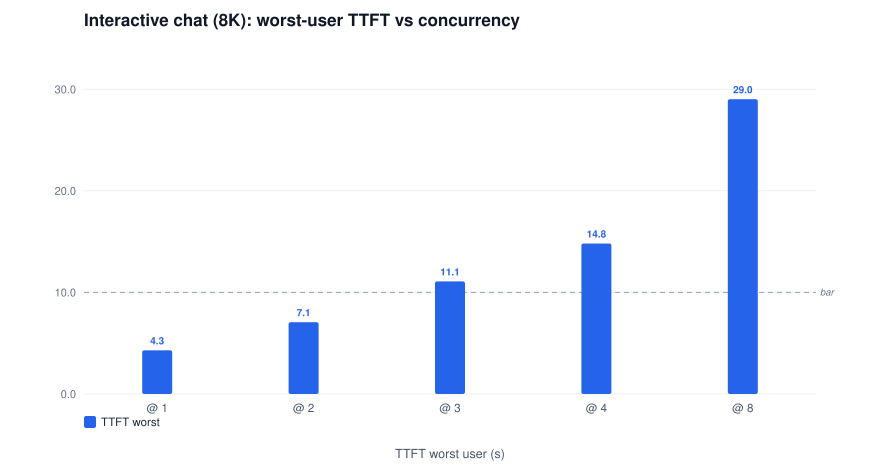

<i>Interactive chat (8K): worst-user TTFT by concurrency; the dashed line marks the 10.0 s use-case bar</i>

**Capacity limit: ~2 concurrent requests (estimated between the measured 2 and 3 points)**

### Long-context assistant (RAG) (32K context)

Retrieval-augmented / large-prompt assistants at 32K context. Thresholds: TTFT < 10s · speed >= 15 tok/s.

| Metric | @ 1 | @ 2 | @ 3 | @ 4 | @ 8 |
|---|---|---|---|---|---|
| TTFT worst user (s) | 16.4 *(exceeded)* | 32.5 *(exceeded)* | 49.3 *(exceeded)* | 66.3 *(exceeded)* | 135.5 *(exceeded)* |
| Per-user mean speed (tok/s) | 88.2 | 54.6 | 39.1 | 29.1 | 15.2 |

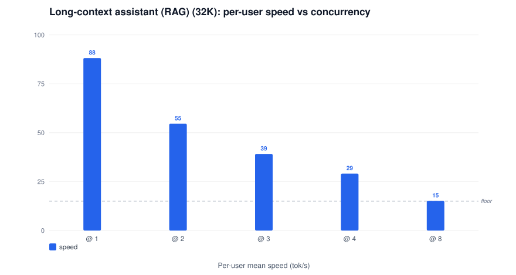

<i>Long-context assistant (RAG) (32K): per-user speed by concurrency; the dashed line marks the 15.0 tok/s use-case floor</i>

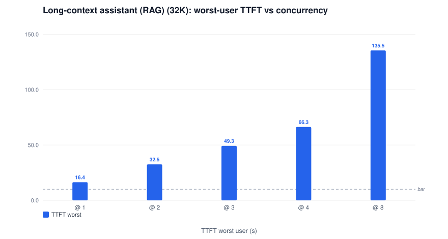

<i>Long-context assistant (RAG) (32K): worst-user TTFT by concurrency; the dashed line marks the 10.0 s use-case bar</i>

**Capacity limit: thresholds exceeded at concurrency 1 - not recommended**

### Document processing (batch) (128K context)

Offline summarization / extraction at the largest measured context. Turnaround matters, not first-token wait: the bar is streaming speed (and total throughput). Thresholds: speed >= 15 tok/s.

| Metric | @ 1 | @ 2 | @ 3 |
|---|---|---|---|
| TTFT worst user (s) | 106.2 | 214.4 | 330.9 |
| Per-user mean speed (tok/s) | 73.0 | 31.9 | 45.4 |

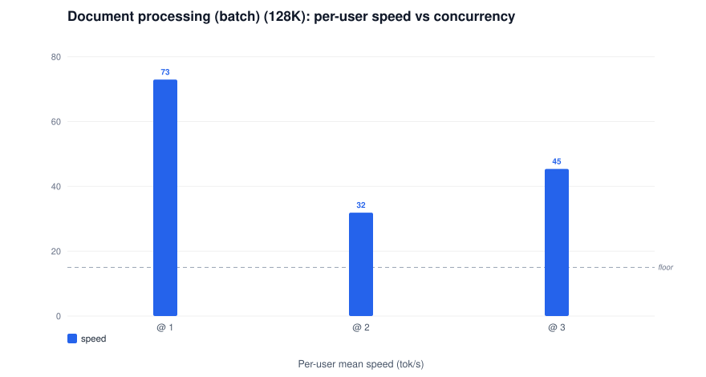

<i>Document processing (batch) (128K): per-user speed by concurrency; the dashed line marks the 15.0 tok/s use-case floor</i>

**Capacity limit: 3 concurrent requests**

### KV pool (the whole-pool bound)

This boot exposed a KV pool of **398,363 tokens** (r139 posture). A session occupies ctx + 664 (output + scheduler slack), so the pool holds:

| Context | Pool capacity (sessions) | Measured green @ conc | c8 fully resident? |
|---|---|---|---|
| 1024 (1K) | 235 | 8 (green) | yes |
| 8192 (8K) | 44 | 8 (green) | yes |
| 32768 (32K) | 11 | 8 (green) | yes |
| 65536 (64K) | 6 | - | marginal |
| 131072 (128K) | 3 | 3 (green) | no |

*Sessions are the whole-pool bound; `--max-num-seqs 64` bounds the running batch above it. TurboQuant dtypes multiply the pool up to 3.68x: see the [KV-cache dtype report](qwen3.8-27b-fp8-kv-cache-dtype.md).*

## Technical analysis

### Queue + prefill decomposition (derived)

At concurrency 1 the queue is empty, so solo TTFT is pure prefill. Under the barrier burst the added first-token wait — `ttft_mean(n) − ttft_mean(1)` — is the queue+prefill-share stagger the Nth user pays. Derived client-side; engine-internal queueing is not exported by this engine version. The x-axis keeps the canonical rung ladder up to the highest measured context — an empty slot marks a rung the concurrency measurements skip (64K: only the solo face measured it on qwen; unmeasured entirely on the gemma boots); no stagger exists there.

| Context | added wait @ n2 | @ n4 | @ n8 |
|---|---|---|---|
| 1024 (1K) | +0.4 s | +1.5 s | +4.1 s |
| 8192 (8K) | +1.0 s | +6.3 s | +14.9 s |
| 32768 (32K) | +10.1 s | +27.3 s | +61.9 s |
| 65536 (64K) | - | - | - |
| 131072 (128K) | +56.7 s | - | - |

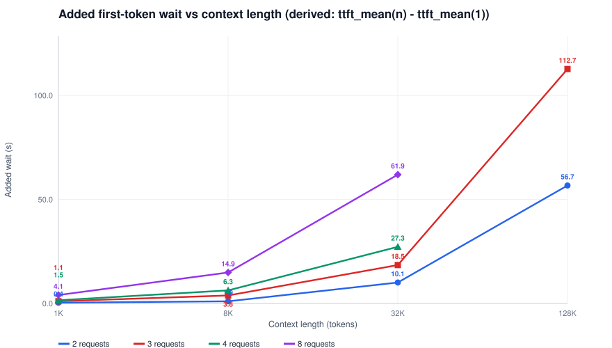

<i>Added first-token wait vs context length, one line per concurrency (derived queue+prefill stagger) — FP8, MTP k3</i>

*Interpretation:* the loaded-request stagger grows from +4.1 s at 1K to +61.9 s at 32K (8 requests) — the context-carrying requests serialize behind each other's prefill.

### Per-user prefill speed

Rate at which input context is processed before the first token. Client-observed (ctx / TTFT at queue ~0); the engine-side device rate is higher — the client view includes chunk drain and the decode-transition tail. The single-request line spans **every measured context** (sweep plus solo faces — the sweep skipped 64K); loaded lines cover the contexts the concurrency sweep measured.

| Context | prefill @ n1 (tok/s) | @ n4 | @ n8 |
|---|---|---|---|
| 1024 (1K) | 1190 | 425 | 208 |
| 8192 (8K) | 1905 | 774 | 427 |
| 32768 (32K) | 1998 | 751 | 418 |
| 65536 (64K) | 1675 | - | - |
| 131072 (128K) | 1235 | - | - |

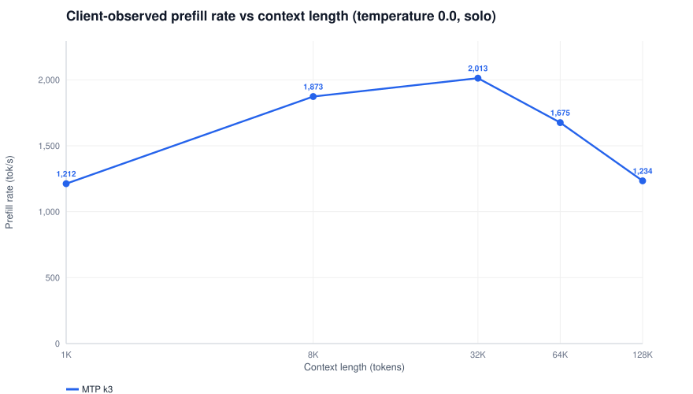

<i>Client-observed prefill rate vs context length, one line per concurrency — FP8, MTP k3</i>

*Interpretation:* prefill peaks at 1,998 tok/s (32K) and eases as context grows — chunked prefill batches more work per pass at length, trading first-token wait for decode-window protection.

### Inter-token latency

Time between consecutive streamed tokens — the smoothness of streaming. Solo p50 spans **39.7 ms** (1K) to 51.5 ms; the worst observed p99 is **65 ms** (128K). With MTP one chunk can carry multiple accepted tokens, so the perceived stream is smoother than the raw chunk gap.

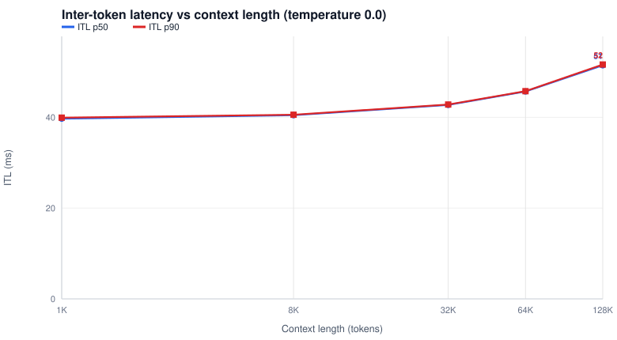

<i>Inter-token latency vs context length (solo) — FP8, MTP k3</i>

### Scaling efficiency

Percentage of ideal linear scaling achieved as concurrency rises (100% = n× the concurrency-1 throughput with no per-user cost). Real efficiency is always lower — the accelerators are shared; high efficiency at your target concurrency signals headroom. The x-axis keeps the canonical rung ladder up to the highest measured context — an empty slot marks a rung the concurrency measurements skip (64K: only the solo face measured it on qwen; unmeasured entirely on the gemma boots).

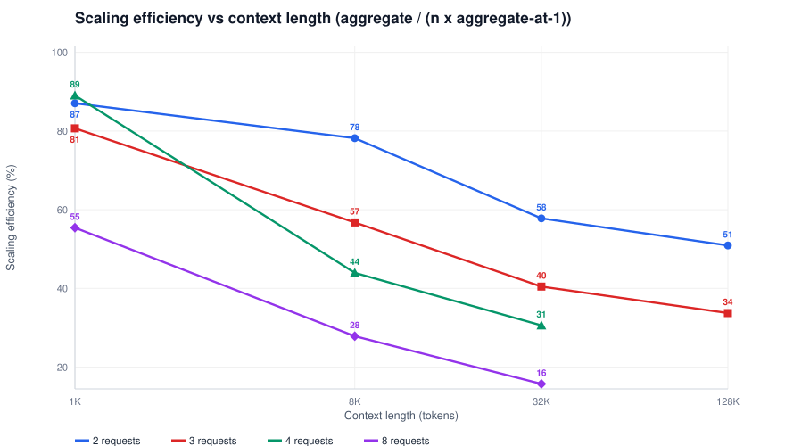

<i>Scaling efficiency vs context length, one line per concurrency — FP8, MTP k3</i>

*Interpretation:* efficiency holds at 55% at 1K but falls to 16% at 32K under 8 requests — high efficiency signals headroom; a sharp drop signals the accelerators are already saturated.

## Temperature analysis (MTP k3)

Higher sampling temperature lowers draft acceptance (tok/step falls), so decode speed drops as sampling sharpens — the certified probabilistic drafting keeps the target distribution correct at every temperature.

| Temp | TTFT (s) | Decode (tok/s) | Tok/step | ITL p50 (ms) | ITL p90 (ms) |
|---|---|---|---|---|---|
| 0.0 | 3.53 | 94.4 | 3.85 | 40.5 | 40.6 |
| 0.2 | 3.49 | 95.4 | 3.95 | 41.1 | 41.2 |
| 0.4 | 3.51 | 92.5 | 3.85 | 41.1 | 41.3 |
| 0.6 | 3.48 | 75.2 | 3.11 | 41.1 | 41.3 |
| 0.8 | 3.48 | 92.3 | 3.82 | 41.1 | 41.2 |
| 1.0 | 3.49 | 72.5 | 3.00 | 41.1 | 41.2 |

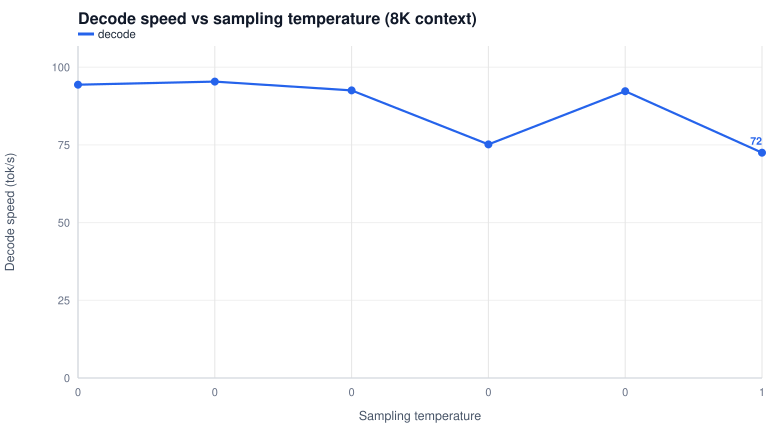

<i>Decode speed by sampling temperature — MTP k3</i>

*Interpretation:* decode falls 23% from t0.0 (94.4 tok/s, 3.85 tok/step) to t1.0 (72.5 tok/s, 3.00 tok/step) — hotter sampling lowers draft acceptance, so fewer speculative tokens ride each step; the target distribution stays exact at every temperature.

### Temperature 0.0 vs 1.0 (per context)

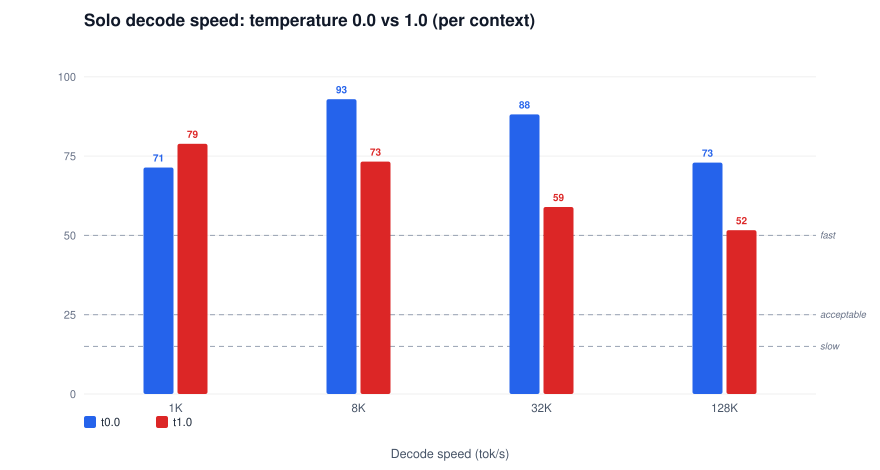

<i>Solo decode speed t0.0 vs t1.0 — FP8, MTP k3</i>

## Results — detail tables

### Context sweep (solo, temperature 0.0)

| Context | TTFT (s) | Prefill (tok/s) | Decode (tok/s) | Tok/step | ITL p50 (ms) | ITL p90 (ms) | ITL p99 (ms) | Decode @ t1.0 (tok/s) |
|---|---|---|---|---|---|---|---|---|
| 1024 (1K) | 0.84 | 1,212 | 93.8 | 3.87 | 39.7 | 39.9 | 63.1 | 78.9 |
| 8192 (8K) | 4.37 | 1,873 | 93.3 | 3.80 | 40.5 | 40.6 | 42.9 | 73.3 |
| 32768 (32K) | 16.28 | 2,013 | 91.4 | 3.90 | 42.7 | 42.8 | 52.9 | 58.9 |
| 65536 (64K) | 39.12 | 1,675 | 84.4 | 3.85 | 45.7 | 45.8 | 46.4 | - |
| 131072 (128K) | 106.22 | 1,234 | 74.5 | 3.80 | 51.5 | 51.6 | 64.9 | 51.6 |

### Concurrency sweep — 1024 (1K) context (temperature 0.0)

| Concurrency | TTFT mean (s) | TTFT max (s) | Per-user mean (tok/s) | Per-user worst (tok/s) | Aggregate (tok/s) | Scaling eff. | ITL p50 med (ms) | ITL p90 max (ms) |
|---|---|---|---|---|---|---|---|---|
| 1 | 0.86 | 0.86 | 71.4 | 71.4 | 65 | 100% | 39.7 | 40.0 |
| 2 | 1.24 | 1.62 | 77.9 | 61.4 | 113 | 87% | 41.7 | 41.9 |
| 3 | 1.95 | 2.47 | 76.4 | 56.7 | 157 | 81% | 43.8 | 44.0 |
| 4 | 2.41 | 2.90 | 78.6 | 63.4 | 231 | 89% | 47.0 | 47.5 |
| 8 | 4.92 | 5.47 | 60.2 | 45.4 | 287 | 55% | 57.9 | 58.5 |

### Concurrency sweep — 8192 (8K) context (temperature 0.0)

| Concurrency | TTFT mean (s) | TTFT max (s) | Per-user mean (tok/s) | Per-user worst (tok/s) | Aggregate (tok/s) | Scaling eff. | ITL p50 med (ms) | ITL p90 max (ms) |
|---|---|---|---|---|---|---|---|---|
| 1 | 4.30 | 4.30 | 93.0 | 93.0 | 56 | 100% | 40.5 | 40.6 |
| 2 | 5.33 | 7.07 | 74.4 | 59.1 | 87 | 78% | 43.4 | 43.6 |
| 3 | 8.14 | 11.1 | 63.4 | 41.9 | 95 | 57% | 46.6 | 46.8 |
| 4 | 10.6 | 14.8 | 54.5 | 28.8 | 98 | 44% | 49.1 | 49.3 |
| 8 | 19.2 | 29.0 | 37.8 | 17.6 | 124 | 28% | 61.7 | 62.2 |

### Concurrency sweep — 32768 (32K) context (temperature 0.0)

| Concurrency | TTFT mean (s) | TTFT max (s) | Per-user mean (tok/s) | Per-user worst (tok/s) | Aggregate (tok/s) | Scaling eff. | ITL p50 med (ms) | ITL p90 max (ms) |
|---|---|---|---|---|---|---|---|---|
| 1 | 16.4 | 16.4 | 88.2 | 88.2 | 26 | 100% | 42.8 | 42.8 |
| 2 | 26.5 | 32.5 | 54.6 | 30.6 | 30 | 58% | 48.0 | 48.1 |
| 3 | 34.9 | 49.3 | 39.1 | 16.4 | 31 | 40% | 53.3 | 53.6 |
| 4 | 43.7 | 66.3 | 29.1 | 11.2 | 32 | 31% | 57.8 | 59.0 |
| 8 | 78.4 | 135.5 | 15.2 | 4.8 | 33 | 16% | 78.5 | 3741.0 |

### Concurrency sweep — 65536 (64K) context (temperature 0.0)

> Not measured at this rung — no concurrency faces were scheduled here on this boot; the slot stays visible between its measured neighbors.

### Concurrency sweep — 131072 (128K) context (temperature 0.0)

| Concurrency | TTFT mean (s) | TTFT max (s) | Per-user mean (tok/s) | Per-user worst (tok/s) | Aggregate (tok/s) | Scaling eff. | ITL p50 med (ms) | ITL p90 max (ms) |
|---|---|---|---|---|---|---|---|---|
| 1 | 106.2 | 106.2 | 73.0 | 73.0 | 5 | 100% | 51.5 | 51.7 |
| 2 | 162.9 | 214.4 | 31.9 | 5.3 | 5 | 51% | 65.2 | 3528.5 |
| 3 | 218.9 | 330.9 | 45.4 | 5.2 | 5 | 34% | 65.2 | 2969.0 |

*Scaling eff. = aggregate / (n x aggregate-at-1): 100% = perfect linear scaling. ITL p50 med = median of per-request p50s; ITL p90 max = worst user. Aggregate is wall-clock (n x 600 tokens / wall) and includes the slowest-user tail.*

## Configuration (copy & run on your own hardware)

### Validated invocation (what the gate ran, byte-exact)

```bash
# image vllm-arc:v0.30.0-b70-cert23 ; 2026-11-11 ; TP2 on 2x Arc Pro B70
ARC_IMAGE=vllm-arc:v0.30.0-b70-cert23 ARC_NAME=arc-b70 \
  ARC_MODEL=/models/qwen3.8-27b-fp8 ARC_SERVED=qwen3.8-27b-fp8 ARC_GRAPH=1 ARC_LMC=1 ARC_FP8=1 ARC_SPEC=3 \
  bash serve_arc_b70.sh     # tools/serve_arc_b70.sh in this repo
```

The wrapper is the audited source of truth (banked posture echo: `qf3/posture.txt`). What it expands to:

```bash
# 1) container boot layer  [serve_arc_b70.sh:199-210]
docker run -d --name arc-b70 \
  --privileged --network host --ipc host \
  --shm-size 16g \              # close-out F: 64 GB-RAM hosts
  -v /models/qwen3.8-27b-fp8:/models/target:ro \
  -v ./neo_cache:/root/.neo_cache -v ./triton_cache:/root/.triton_cache \
  -v ./inductor_cache:/root/.inductor_cache \
  -e VLLM_ALLOW_LONG_MAX_MODEL_LEN=1 -e VLLM_WORKER_MULTIPROC_METHOD=spawn \
  --entrypoint /bin/bash vllm-arc:v0.30.0-b70-cert23 -c 'sleep infinity'

# 2) engine layer (docker exec)  [serve_arc_b70.sh:327-375]
export PYTHONHASHSEED=0 VLLM_EXECUTE_MODEL_TIMEOUT_SECONDS=300 ZE_AFFINITY_MASK=0,1
export CCL_ENABLE_SYCL_KERNELS=1 CCL_ZE_IPC_EXCHANGE=pidfd CCL_TOPO_P2P_ACCESS=1
export CCL_TOPO_FABRIC_VERTEX_CONNECTION_CHECK=0 CCL_SYCL_ALLGATHERV_SMALL_THRESHOLD=131072
export CCL_SYCL_ALLGATHERV_SCALEOUT_THRESHOLD=1048576 CCL_SYCL_ALLGATHERV_TMP_BUF=0 CCL_SYCL_ALLREDUCE_TMP_BUF=0
export ARC_TRACE_FLIP=1 VLLM_XPU_ENABLE_XPU_GRAPH=1   # decode-only XPU graphs
export CCL_SYCL_ALLREDUCE_FP8=1                    # cert10 AR overlay
export LMCACHE_USE_EXPERIMENTAL_API=True LMCACHE_MAX_LOCAL_CPU_SIZE=16 LMCACHE_LOCAL_CPU=True
export LMCACHE_EVICT_POLICY=lr_u LMCACHE_CHUNK_SIZE=1024 LMCACHE_SAVE_DECODE_CACHE=True
export LMCACHE_MIN_RETRIEVE_TOKENS=1024 LMCACHE_LOG_LEVEL=INFO LMCACHE_DISABLE_PINNED_MEMORY=1
export LMCACHE_TRACK_USAGE=false                   # close-out F: 16 GB CPU tier
exec vllm serve --model /models/target \
  --served-model-name qwen3.8-27b-fp8 --tensor-parallel-size 2 \
  --gpu-memory-utilization 0.8 --max-model-len 262144 \
  --max-num-batched-tokens 8192 --max-num-seqs 64 --block-size 64 \
  --dtype float16   \
  --kv-cache-dtype fp8_e4m3 \
  --mamba-ssm-cache-dtype float16 --mamba-cache-mode=align \
  --enable-prefix-caching --trust-remote-code \
  --reasoning-parser qwen3 --tool-call-parser qwen3_coder --enable-auto-tool-choice \
  --no-disable-hybrid-kv-cache-manager \
  --kv-transfer-config '{"kv_connector":"LMCacheConnectorV1","kv_role":"kv_both","kv_connector_extra_config":{"use_native":true,"lmcache.extra_config":{"mamba_pool_ratio":2}},"engine_id":"arc-p40"}' \
  --compilation-config '{"mode":"none","cudagraph_mode":"FULL_DECODE_ONLY","cudagraph_capture_sizes":[1..320]}' \   # 64-size discipline, see wrapper
  --speculative-config '{"method":"mtp","num_speculative_tokens":3,"draft_sample_method":"probabilistic"}' \
  --port 8000
```

## Test parameters

- Context lengths: 1K, 8K, 32K, 64K, 128K tokens (prompt + template). Solo faces: concurrency 1, 600 output tokens, `ignore_eos`.
- Concurrency sweeps: 1/2/3/4/8 at contexts 1K, 8K, 32K, 128K — barrier-started simultaneous requests, 600 output tokens each, temperature 0.0, plus one temperature-1.0 solo face per context.
- Temperature sweep (MTP acceptance): 0.0, 0.2, 0.4, 0.6, 0.8, 1.0 at 8K context.
- Prompts: seeded random-token contexts, unique per face and per request slot (`p138_face.py` / `p139_conc.py`, tag-seeded) — every face is a cold prefill (no prompt-cache hits).
- Client-side timing on the rig loopback; TTFT includes the full engine prefill window (at c=1 queue wait ~0; at c=N the TTFT spread IS the queue+prefill stagger).

## Notes

- Per-user speed = output tokens / decode window (spec-decode aware; with MTP one stream chunk carries multiple accepted tokens). Aggregate = n x 600 tokens / wall clock.
- The r139 1K t0.0 face runs first after the boot warmup at a cold spec-verify batch shape — its acceptance (2.8 tok/step) sits below the family norm (3.8 at 8K); the 8K/32K faces are the steady reference. Temperature comparisons are within-harness (r138 sweep vs r139 faces, both reported).
- Prefill rate is the client-observed ctx/TTFT; the engine-side device rate (P6.36 decomposition) is ~2.1–2.9k tok/s at fp8 — the client view includes chunk drain and the decode-transition tail.
- Metric definitions, UX bands, use-case thresholds and the honest-limits statement: [METHODOLOGY.md](METHODOLOGY.md).
- Banks: `results/2026-11-10-p637-reports/` (solo + temperature faces, r138) and `results/2026-11-11-p637b-conc/` (concurrency faces, r139); tools `tools/ar/p138/p138_face.py`, `tools/ar/p139/p139_conc.py`.
