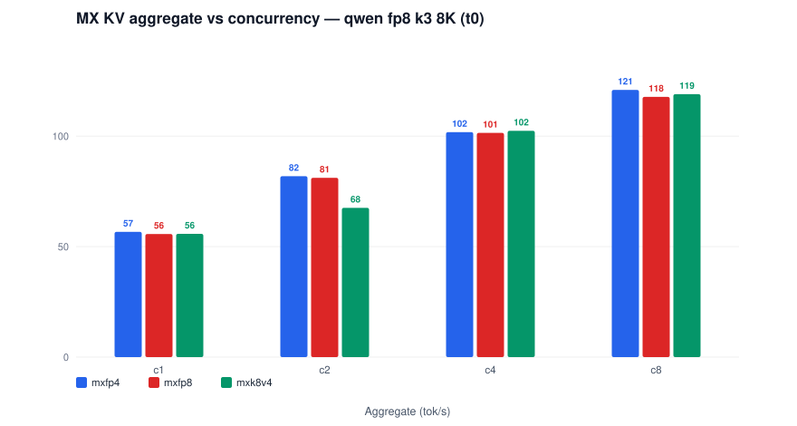
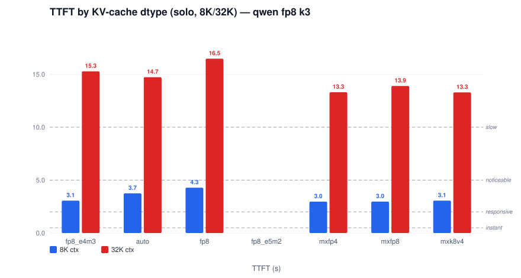
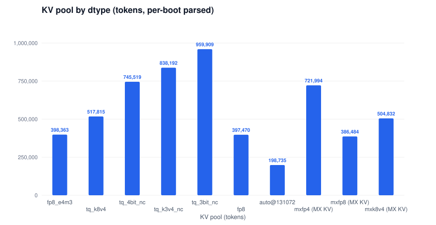
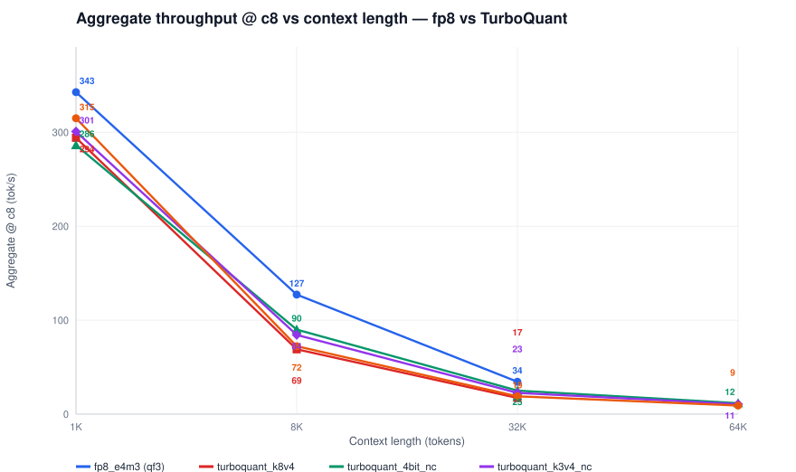
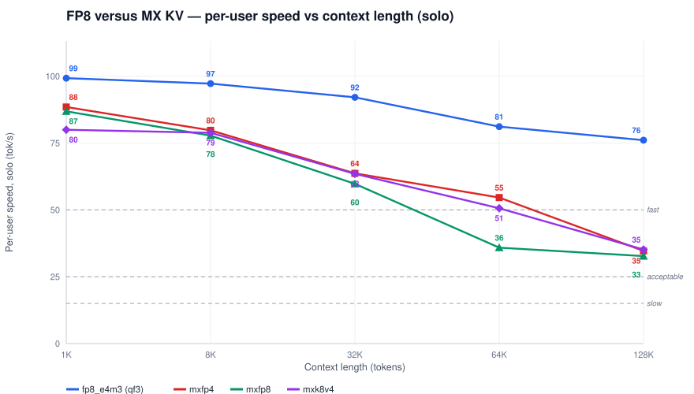
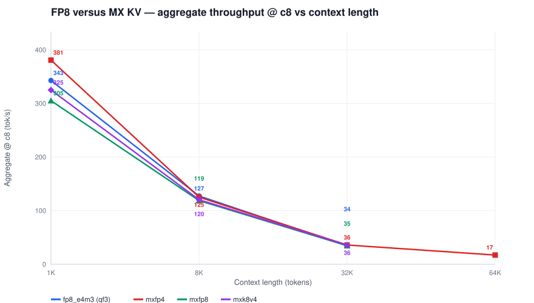
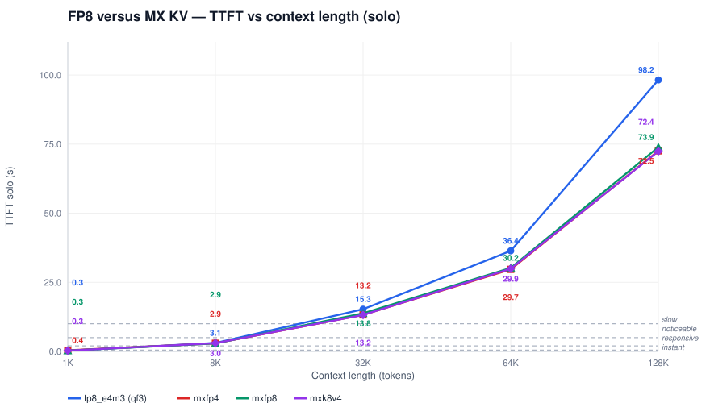

# Qwen3.8-27B FP8 — KV-cache dtype comparison (FP8 versus MX KV and TurboQuant)

| Field | Value |
|---|---|
| Model | Qwen3.8-27B FP8 + MTP k3 (the certified posture) |
| Knob | `ARC_KVDTYPE` in `tools/serve_arc_b70.sh` (default `fp8_e4m3`) → `--kv-cache-dtype` |
| Menu | fp8_e4m3 · fp8 · auto (fp16 KV) · mxfp4 · mxfp8 · mxk8v4 (MX KV, native) · turboquant_k8v4 · turboquant_4bit_nc · turboquant_k3v4_nc · turboquant_3bit_nc |
| Faces | r240b: conc {1,2,3,4,8} at 1K/8K/32K per dtype (MX lanes: the {1,2,4,8} grid at every rung 1K/8K/32K/64K/128K + t1.0 solos; the r241 leg re-measures the MX lanes LMC-free and supersedes r240b on those cells); r240: solo faces for fp8/auto/fp8/e5m2 + the MX lanes (qwen) |
| Engine | vLLM v0.30.0 — vllm-arc v0.30.0-b70-cert28, TP2 |
| Companion report | Gemma-4-31B: [gemma-4-31b-kv-cache-dtype](gemma-4-31b-kv-cache-dtype.md) — the native MX-KV menu does not serve gemma on this image (the hd512 decode gap); gemma capacity rides the W4A16 weights lane |
| Date | 2026-11-25 |

## The dtype menu by category

| Category | dtypes | What it is | Serves on qwen (this image) |
|---|---|---|---|
| Byte-exact FP8 family | fp8_e4m3 (incumbent), fp8, auto (fp16 KV) | 1- or 2-byte/elem KV with no lossy step; `auto` is fp16 KV and pays the 2-byte law — exactly half the pool | fp8_e4m3, fp8; `auto` refuses at maxlen 262144 (8.73 > 6.78 GiB), serves at 131072 |
| MX microscaling KV | mxfp4, mxfp8, mxk8v4 | OCP-MX format KV — e2m1/e4m3 data + E8M0 group scales, decoded by the native `mx_paged_decode` path (`ARC_MXKV_NATIVE=1`); trades a slice of decode speed for KV-token capacity per byte | all three, native-certified since cert27 (LMC-off posture) |
| TurboQuant presets | turboquant_k8v4, turboquant_4bit_nc, turboquant_k3v4_nc, turboquant_3bit_nc | Wheel-side lossy KV presets on the same knob (`VLLM_ARC_TQ_SPEC_FIX=1` posture) | all four |
| Hard refusal | fp8_e5m2 | No e5m2 KV dequant path in esimd FA2 on Xe2 — an engine-level kernel boundary, not a capacity one | refuses at boot |

A dtype that refuses to boot is a valid outcome and is banked as such — two of the boundaries below are refusals. Every FP8-versus comparison in this report holds the weights lane constant (checkpoint-fp8 + MTP k3) and varies only the KV dtype.

## Qwen3.8-27B FP8 + MTP k3

`auto` (fp16 KV — 2 bytes/elem) refuses at the certified `max_model_len 262144`: one max-len request needs 8.73 GiB of KV against 6.78 GiB available at GMU 0.8 / TP2, so the engine raises at boot (cell `kvauto` holds the refusal log). Its rows below are measured at `max_model_len=131072` (cell `kvauto131`) — still covering the full 1K–128K report sweep; its pool (198,735) is **exactly half** the fp8 pool — the fp16 byte-doubling law made measurable. `fp8_e5m2` is the second refusal and a hard engine boundary, not a capacity one: `NotImplementedError: FlashAttention does not support fp8_e5m2 kv-cache on this device` (cell `kve5m2`) — the esimd FA2 backend ships no e5m2 KV dequant path on Xe2.

The three `mxfp4`/`mxfp8`/`mxk8v4` rows are the P6.47 MX KV lane, native-certified on this image (`ARC_MXKV_NATIVE=1`; the MX postures auto-off LMC by the e2m1-V law): microscaling KV with E8M0 group scales, decoded by the native `mx_paged_decode` path. They trade a slice of decode speed for KV-token capacity per byte — the capacity table below carries the measured pools. Full lane documentation: `docs/PATCHES-arc.md` (the mx_kv family), the P6.47 record in `docs/PERFORMANCE-arc.md`.

| --kv-cache-dtype | Context | TTFT solo (s) | Decode solo (tok/s) | Agg @ c8 (tok/s) | Per-user @ c8 (tok/s) | ITL p50 (ms) | KV pool (tok) | Note |
|---|---|---|---|---|---|---|---|---|
| fp8_e4m3 | 8K | 3.06 | 97.2 | 127 | 36.5 | 40.4 | 398,363 | the certified incumbent |
| fp8_e4m3 | 32K | 15.3 | 92.1 | 34 | 14.7 | 42.5 | 398,363 | the certified incumbent |
| auto | 8K | 3.75 | 95.6 | - | - | 39.7 | 198,735 | fp16 KV (2 bytes/elem); refuses at max_model_len 262144 (8.73 > 6.78 GiB), measured at 131072 |
| auto | 32K | 14.7 | 92.3 | - | - | 42.1 | 198,735 | fp16 KV (2 bytes/elem); refuses at max_model_len 262144 (8.73 > 6.78 GiB), measured at 131072 |
| fp8 | 8K | 4.29 | 94.4 | - | - | 40.5 | 397,470 |  |
| fp8 | 32K | 16.5 | 91.1 | - | - | 42.7 | 397,470 |  |
| fp8_e5m2 | 8K | - | - | - | - | - | - | refuses to boot - FA2 has no e5m2 KV path on Xe2 |
| fp8_e5m2 | 32K | - | - | - | - | - | - | refuses to boot - FA2 has no e5m2 KV path on Xe2 |
| mxfp4 | 8K | 2.93 | 79.7 | 125 | 29.6 | 48.3 | 721,994 | MX KV: e2m1 data + E8M0 group scales; native decode, LMC off; r240b death at c32768_n4 was posture-confounded (the gate script forced ARC_LMC=1 over the lane -- LMCache storing in the death window, the r168 e2m1-V class); re-classified 2026-11-25, re-measured LMC-free in r241 |
| mxfp4 | 32K | 13.2 | 63.7 | 36 | 11.5 | 57.9 | 721,994 | MX KV: e2m1 data + E8M0 group scales; native decode, LMC off; r240b death at c32768_n4 was posture-confounded (the gate script forced ARC_LMC=1 over the lane -- LMCache storing in the death window, the r168 e2m1-V class); re-classified 2026-11-25, re-measured LMC-free in r241 |
| mxfp8 | 8K | 2.93 | 77.8 | 119 | 27.8 | 49.9 | 386,484 | MX KV: e4m3 data + E8M0 group scales; native decode, LMC off; the only packed lane to survive the r240b grid (e4m3-V: the r176 store-tax class, immune to the e2m1-V x LMC kill class) |
| mxfp8 | 32K | 13.8 | 59.7 | 35 | 10.0 | 64.1 | 386,484 | MX KV: e4m3 data + E8M0 group scales; native decode, LMC off; the only packed lane to survive the r240b grid (e4m3-V: the r176 store-tax class, immune to the e2m1-V x LMC kill class) |
| mxk8v4 | 8K | 3.02 | 78.8 | 120 | 27.5 | 49.2 | 504,832 | mixed MX KV: e4m3 K + e2m1 V; native decode, LMC off; r240b death at c32768_n4 (DEVICE_LOST) was posture-confounded (ARC_LMC=1 forced -- the r168 e2m1-V class); re-classified 2026-11-25, re-measured LMC-free in r241 |
| mxk8v4 | 32K | 13.2 | 63.5 | 36 | 10.5 | 61.9 | 504,832 | mixed MX KV: e4m3 K + e2m1 V; native decode, LMC off; r240b death at c32768_n4 (DEVICE_LOST) was posture-confounded (ARC_LMC=1 forced -- the r168 e2m1-V class); re-classified 2026-11-25, re-measured LMC-free in r241 |

## FP8 versus TurboQuant — the wheel's capacity presets (r240b sweeps)

The wheel's four TurboQuant KV dtypes serve via the same knob; the r240b gate ran the full conc {1,2,3,4,8} sweep per preset (fresh boot per cell, `VLLM_ARC_TQ_SPEC_FIX=1` default posture). Every table below is the preset measured against the fp8_e4m3 incumbent (`qf3`) on the same protocol:

| dtype | Context | TTFT solo (s) | Decode solo (tok/s) | Agg @ c8 (tok/s) | Per-user @ c8 (tok/s) | KV pool (tok, x vs fp8) | Note |
|---|---|---|---|---|---|---|---|
| `turboquant_k8v4` | 8K | 3.02 | 53.8 | 69 | 11.6 | 517,815 (1.98x) | 4-bit K/V, 8-level scales - the balanced preset |
| `turboquant_k8v4` | 32K | 13.4 | 24.2 | 17 | 3.1 | 517,815 (1.98x) | 4-bit K/V, 8-level scales - the balanced preset |
| `turboquant_4bit_nc` | 8K | 3.06 | 69.5 | 90 | 17.9 | 745,519 (2.86x) | cleanest identity record of the family |
| `turboquant_4bit_nc` | 32K | 13.6 | 38.8 | 25 | 5.3 | 745,519 (2.86x) | cleanest identity record of the family |
| `turboquant_k3v4_nc` | 8K | 3.03 | 70.2 | 84 | 16.0 | 838,192 (3.22x) | k3 scales + 4-bit V |
| `turboquant_k3v4_nc` | 32K | 13.3 | 34.3 | 23 | 4.6 | 838,192 (3.22x) | k3 scales + 4-bit V |
| `turboquant_3bit_nc` | 8K | 3.05 | 61.0 | 72 | 12.7 | 959,909 (3.68x) | max capacity, 3-bit precision floor |
| `turboquant_3bit_nc` | 32K | 13.7 | 27.2 | 19 | 3.5 | 959,909 (3.68x) | max capacity, 3-bit precision floor |

### `turboquant_k8v4` — 8K context

| Conc | TTFT mean (s) | TTFT max (s) | Per-user mean | Per-user worst | Aggregate (tok/s) | Scaling eff. | ITL p90 max (ms) |
|---|---|---|---|---|---|---|---|
| 1 | 3.02 | 3.02 | 53.8 | 53.8 | 42 | 100% | 68.7 |
| 2 | 4.60 | 6.13 | 36.2 | 33.5 | 56 | 66% | 100.2 |
| 3 | 7.26 | 9.82 | 27.0 | 22.5 | 60 | 47% | 132.7 |
| 4 | 9.03 | 12.5 | 21.6 | 18.1 | 64 | 38% | 164.8 |
| 8 | 16.4 | 25.7 | 11.6 | 9.4 | 69 | 20% | 302.8 |

### `turboquant_k8v4` — 32K context

| Conc | TTFT mean (s) | TTFT max (s) | Per-user mean | Per-user worst | Aggregate (tok/s) | Scaling eff. | ITL p90 max (ms) |
|---|---|---|---|---|---|---|---|
| 1 | 13.4 | 13.4 | 24.2 | 24.2 | 16 | 100% | 158.9 |
| 2 | 21.7 | 27.1 | 11.7 | 11.2 | 16 | 50% | 278.0 |
| 3 | 29.3 | 41.5 | 8.2 | 6.2 | 16 | 34% | 401.5 |
| 4 | 36.8 | 56.2 | 6.3 | 5.3 | 17 | 27% | 573.1 |
| 8 | 67.7 | 119.9 | 3.1 | 2.5 | 17 | 14% | 3693.4 |

### `turboquant_4bit_nc` — 8K context

| Conc | TTFT mean (s) | TTFT max (s) | Per-user mean | Per-user worst | Aggregate (tok/s) | Scaling eff. | ITL p90 max (ms) |
|---|---|---|---|---|---|---|---|
| 1 | 3.06 | 3.06 | 69.5 | 69.5 | 51 | 100% | 53.5 |
| 2 | 4.70 | 6.32 | 49.9 | 43.0 | 70 | 69% | 70.0 |
| 3 | 7.13 | 9.74 | 39.6 | 31.0 | 79 | 51% | 87.1 |
| 4 | 8.99 | 12.6 | 30.5 | 22.2 | 79 | 39% | 103.6 |
| 8 | 16.0 | 25.4 | 17.9 | 12.9 | 90 | 22% | 171.5 |

### `turboquant_4bit_nc` — 32K context

| Conc | TTFT mean (s) | TTFT max (s) | Per-user mean | Per-user worst | Aggregate (tok/s) | Scaling eff. | ITL p90 max (ms) |
|---|---|---|---|---|---|---|---|
| 1 | 13.6 | 13.6 | 38.8 | 38.8 | 21 | 100% | 101.5 |
| 2 | 22.1 | 27.6 | 20.2 | 16.9 | 23 | 55% | 164.5 |
| 3 | 29.7 | 41.4 | 14.0 | 10.5 | 24 | 39% | 224.7 |
| 4 | 36.8 | 55.8 | 10.5 | 7.5 | 24 | 30% | 290.4 |
| 8 | 66.5 | 116.3 | 5.3 | 3.7 | 25 | 15% | 3032.7 |

### `turboquant_k3v4_nc` — 8K context

| Conc | TTFT mean (s) | TTFT max (s) | Per-user mean | Per-user worst | Aggregate (tok/s) | Scaling eff. | ITL p90 max (ms) |
|---|---|---|---|---|---|---|---|
| 1 | 3.03 | 3.03 | 70.2 | 70.2 | 52 | 100% | 57.0 |
| 2 | 4.66 | 6.27 | 44.2 | 36.4 | 61 | 59% | 76.5 |
| 3 | 7.35 | 9.99 | 35.9 | 27.9 | 73 | 47% | 97.2 |
| 4 | 8.98 | 12.5 | 29.2 | 22.5 | 80 | 38% | 117.2 |
| 8 | 16.3 | 25.6 | 16.0 | 12.0 | 84 | 20% | 198.1 |

### `turboquant_k3v4_nc` — 32K context

| Conc | TTFT mean (s) | TTFT max (s) | Per-user mean | Per-user worst | Aggregate (tok/s) | Scaling eff. | ITL p90 max (ms) |
|---|---|---|---|---|---|---|---|
| 1 | 13.3 | 13.3 | 34.3 | 34.3 | 19 | 100% | 113.3 |
| 2 | 27.0 | 38.2 | 16.3 | 11.9 | 18 | 46% | 187.5 |
| 3 | 29.2 | 41.2 | 12.0 | 8.5 | 21 | 36% | 261.2 |
| 4 | 36.7 | 55.6 | 9.3 | 6.9 | 23 | 29% | 334.7 |
| 8 | 66.7 | 116.5 | 4.6 | 3.3 | 23 | 15% | 3407.2 |

### `turboquant_3bit_nc` — 8K context

| Conc | TTFT mean (s) | TTFT max (s) | Per-user mean | Per-user worst | Aggregate (tok/s) | Scaling eff. | ITL p90 max (ms) |
|---|---|---|---|---|---|---|---|
| 1 | 3.05 | 3.05 | 61.0 | 61.0 | 47 | 100% | 64.9 |
| 2 | 4.70 | 6.33 | 39.5 | 35.7 | 59 | 64% | 92.4 |
| 3 | 6.99 | 9.66 | 29.2 | 24.8 | 64 | 46% | 120.9 |
| 4 | 9.12 | 12.9 | 22.6 | 19.2 | 62 | 33% | 147.9 |
| 8 | 16.2 | 25.8 | 12.7 | 9.5 | 72 | 19% | 260.5 |

### `turboquant_3bit_nc` — 32K context

| Conc | TTFT mean (s) | TTFT max (s) | Per-user mean | Per-user worst | Aggregate (tok/s) | Scaling eff. | ITL p90 max (ms) |
|---|---|---|---|---|---|---|---|
| 1 | 13.7 | 13.7 | 27.2 | 27.2 | 17 | 100% | 144.5 |
| 2 | 22.2 | 27.5 | 14.1 | 12.5 | 18 | 54% | 249.6 |
| 3 | 29.3 | 42.0 | 8.6 | 7.3 | 17 | 34% | 354.1 |
| 4 | 36.9 | 57.2 | 7.0 | 5.7 | 19 | 28% | 499.2 |
| 8 | 69.6 | 131.3 | 3.5 | 2.7 | 19 | 14% | 3203.6 |

## FP8 versus MX KV lanes — the concurrency sweep (r240b, re-measured LMC-free in r241)

Every MX lane swept at concurrency {1,2,4,8} at every context step of the canonical ladder — 1K/8K/32K/64K/128K (fresh boot per lane; one boot serves its whole grid). Outcome (r241, LMC-free): all three lanes serve their full grids — the r240b deaths of mxfp4 and mxk8v4 at the sustained 32K × n4 face were posture-confounded (r240b forced ARC_LMC=1 over the MX cells against the certified posture; LMCache stored in both death windows — the r168 e2m1-V class), re-classified 2026-11-25 and re-measured clean in r241: 68/68 faces, zero LMCache lines, zero tracebacks, every death face alive with full n_ok. A `-` rung below is the pool's KV_CAP point (the grid ends where capacity ends — mxfp4 serves 128K at n1–n4; mxfp8/mxk8v4 at n1–n2), never unmeasured coverage:

### `mxfp4` — qwen fp8 k3 — 1K context

| Conc | TTFT mean (s) | TTFT max (s) | Per-user mean | Per-user worst | Aggregate (tok/s) | Scaling eff. | ITL p90 max (ms) |
|---|---|---|---|---|---|---|---|
| 1 | 0.40 | 0.40 | 88.5 | 88.5 | 84 | 100% | 50.6 |
| 2 | 0.45 | 0.59 | 69.8 | 69.2 | 132 | 79% | 53.6 |
| 4 | 0.76 | 0.88 | 71.4 | 68.4 | 249 | 74% | 58.7 |
| 8 | 1.41 | 1.53 | 61.1 | 54.2 | 381 | 57% | 68.1 |

### `mxfp4` — qwen fp8 k3 — 8K context

| Conc | TTFT mean (s) | TTFT max (s) | Per-user mean | Per-user worst | Aggregate (tok/s) | Scaling eff. | ITL p90 max (ms) |
|---|---|---|---|---|---|---|---|
| 1 | 2.93 | 2.93 | 79.7 | 79.7 | 57 | 100% | 49.4 |
| 2 | 4.39 | 5.81 | 63.1 | 54.3 | 85 | 74% | 55.5 |
| 4 | 8.92 | 12.4 | 43.3 | 30.3 | 101 | 44% | 65.6 |
| 8 | 15.9 | 24.6 | 29.6 | 17.3 | 125 | 27% | 87.9 |

### `mxfp4` — qwen fp8 k3 — 32K context

| Conc | TTFT mean (s) | TTFT max (s) | Per-user mean | Per-user worst | Aggregate (tok/s) | Scaling eff. | ITL p90 max (ms) |
|---|---|---|---|---|---|---|---|
| 1 | 13.2 | 13.2 | 63.7 | 63.7 | 26 | 100% | 58.1 |
| 2 | 21.5 | 26.7 | 41.1 | 28.2 | 32 | 60% | 72.1 |
| 4 | 35.6 | 53.6 | 22.1 | 11.7 | 34 | 32% | 101.2 |
| 8 | 63.2 | 108.1 | 11.5 | 5.3 | 36 | 17% | 3380.7 |

### `mxfp4` — qwen fp8 k3 — 64K context

| Conc | TTFT mean (s) | TTFT max (s) | Per-user mean | Per-user worst | Aggregate (tok/s) | Scaling eff. | ITL p90 max (ms) |
|---|---|---|---|---|---|---|---|
| 1 | 29.7 | 29.7 | 54.6 | 54.6 | 15 | 100% | 69.7 |
| 2 | 45.8 | 59.5 | 26.8 | 13.6 | 16 | 53% | 96.5 |
| 4 | 76.8 | 120.1 | 13.0 | 5.6 | 17 | 29% | 3477.9 |
| 8 | 138.1 | 243.6 | 6.2 | 2.5 | 17 | 15% | 4030.3 |

### `mxfp4` — qwen fp8 k3 — 128K context

| Conc | TTFT mean (s) | TTFT max (s) | Per-user mean | Per-user worst | Aggregate (tok/s) | Scaling eff. | ITL p90 max (ms) |
|---|---|---|---|---|---|---|---|
| 1 | 72.5 | 72.5 | 34.6 | 34.6 | 7 | 100% | 94.6 |
| 2 | 109.8 | 145.6 | 16.3 | 6.1 | 7 | 52% | 146.9 |
| 4 | 185.0 | 295.1 | 7.0 | 2.4 | 7 | 27% | 5001.3 |

### `mxfp8` — qwen fp8 k3 — 1K context

| Conc | TTFT mean (s) | TTFT max (s) | Per-user mean | Per-user worst | Aggregate (tok/s) | Scaling eff. | ITL p90 max (ms) |
|---|---|---|---|---|---|---|---|
| 1 | 0.29 | 0.29 | 86.8 | 86.8 | 83 | 100% | 54.5 |
| 2 | 0.47 | 0.60 | 72.2 | 67.8 | 131 | 78% | 58.2 |
| 4 | 0.74 | 0.85 | 63.3 | 53.5 | 207 | 62% | 63.4 |
| 8 | 1.91 | 2.10 | 51.6 | 44.0 | 305 | 46% | 73.2 |

### `mxfp8` — qwen fp8 k3 — 8K context

| Conc | TTFT mean (s) | TTFT max (s) | Per-user mean | Per-user worst | Aggregate (tok/s) | Scaling eff. | ITL p90 max (ms) |
|---|---|---|---|---|---|---|---|
| 1 | 2.93 | 2.93 | 77.8 | 77.8 | 56 | 100% | 51.0 |
| 2 | 4.37 | 5.81 | 57.1 | 51.3 | 78 | 69% | 58.6 |
| 4 | 8.83 | 12.1 | 40.5 | 26.7 | 92 | 41% | 71.1 |
| 8 | 15.8 | 24.6 | 27.8 | 17.0 | 119 | 26% | 98.6 |

### `mxfp8` — qwen fp8 k3 — 32K context

| Conc | TTFT mean (s) | TTFT max (s) | Per-user mean | Per-user worst | Aggregate (tok/s) | Scaling eff. | ITL p90 max (ms) |
|---|---|---|---|---|---|---|---|
| 1 | 13.8 | 13.8 | 59.7 | 59.7 | 25 | 100% | 64.3 |
| 2 | 22.8 | 27.1 | 37.7 | 28.1 | 30 | 60% | 83.3 |
| 4 | 37.0 | 54.1 | 19.0 | 11.3 | 32 | 32% | 123.3 |
| 8 | 64.5 | 109.3 | 10.0 | 5.1 | 35 | 17% | 3161.0 |

### `mxfp8` — qwen fp8 k3 — 64K context

| Conc | TTFT mean (s) | TTFT max (s) | Per-user mean | Per-user worst | Aggregate (tok/s) | Scaling eff. | ITL p90 max (ms) |
|---|---|---|---|---|---|---|---|
| 1 | 30.2 | 30.2 | 35.9 | 35.9 | 13 | 100% | 82.8 |
| 2 | 47.3 | 60.4 | 23.3 | 13.4 | 15 | 60% | 118.7 |
| 4 | 78.4 | 122.3 | 11.1 | 5.3 | 16 | 31% | 3444.1 |

### `mxfp8` — qwen fp8 k3 — 128K context

| Conc | TTFT mean (s) | TTFT max (s) | Per-user mean | Per-user worst | Aggregate (tok/s) | Scaling eff. | ITL p90 max (ms) |
|---|---|---|---|---|---|---|---|
| 1 | 73.9 | 73.9 | 32.7 | 32.7 | 7 | 100% | 119.8 |
| 2 | 113.4 | 148.4 | 11.2 | 5.5 | 6 | 49% | 191.1 |

### `mxk8v4` — qwen fp8 k3 — 1K context

| Conc | TTFT mean (s) | TTFT max (s) | Per-user mean | Per-user worst | Aggregate (tok/s) | Scaling eff. | ITL p90 max (ms) |
|---|---|---|---|---|---|---|---|
| 1 | 0.29 | 0.29 | 79.9 | 79.9 | 77 | 100% | 53.6 |
| 2 | 0.47 | 0.61 | 81.4 | 80.9 | 151 | 98% | 56.9 |
| 4 | 0.79 | 0.90 | 66.8 | 61.8 | 226 | 73% | 62.1 |
| 8 | 1.90 | 2.08 | 55.0 | 47.3 | 325 | 53% | 71.8 |

### `mxk8v4` — qwen fp8 k3 — 8K context

| Conc | TTFT mean (s) | TTFT max (s) | Per-user mean | Per-user worst | Aggregate (tok/s) | Scaling eff. | ITL p90 max (ms) |
|---|---|---|---|---|---|---|---|
| 1 | 3.02 | 3.02 | 78.8 | 78.8 | 56 | 100% | 50.3 |
| 2 | 4.63 | 6.22 | 60.2 | 50.9 | 81 | 71% | 57.3 |
| 4 | 8.88 | 12.3 | 44.3 | 29.9 | 103 | 46% | 69.4 |
| 8 | 15.9 | 24.8 | 27.5 | 16.7 | 120 | 27% | 95.4 |

### `mxk8v4` — qwen fp8 k3 — 32K context

| Conc | TTFT mean (s) | TTFT max (s) | Per-user mean | Per-user worst | Aggregate (tok/s) | Scaling eff. | ITL p90 max (ms) |
|---|---|---|---|---|---|---|---|
| 1 | 13.2 | 13.2 | 63.5 | 63.5 | 26 | 100% | 62.1 |
| 2 | 21.1 | 26.7 | 36.6 | 25.5 | 31 | 58% | 80.2 |
| 4 | 36.2 | 53.7 | 20.8 | 11.0 | 34 | 32% | 116.7 |
| 8 | 63.2 | 107.7 | 10.5 | 5.2 | 36 | 17% | 3260.8 |

### `mxk8v4` — qwen fp8 k3 — 64K context

| Conc | TTFT mean (s) | TTFT max (s) | Per-user mean | Per-user worst | Aggregate (tok/s) | Scaling eff. | ITL p90 max (ms) |
|---|---|---|---|---|---|---|---|
| 1 | 29.9 | 29.9 | 50.6 | 50.6 | 14 | 100% | 78.0 |
| 2 | 46.9 | 59.7 | 22.8 | 14.3 | 15 | 53% | 113.0 |
| 4 | 78.0 | 120.4 | 11.0 | 5.5 | 16 | 28% | 3400.3 |

### `mxk8v4` — qwen fp8 k3 — 128K context

| Conc | TTFT mean (s) | TTFT max (s) | Per-user mean | Per-user worst | Aggregate (tok/s) | Scaling eff. | ITL p90 max (ms) |
|---|---|---|---|---|---|---|---|
| 1 | 72.4 | 72.4 | 35.2 | 35.2 | 7 | 100% | 110.0 |
| 2 | 110.0 | 145.4 | 14.7 | 6.3 | 7 | 52% | 2946.7 |

<i>MX KV aggregate vs concurrency — qwen fp8 k3 — 1K ctx (a missing bar is a banked refusal, KV_CAP point, or banked engine-death face — never unmeasured coverage)</i>

<i>MX KV aggregate vs concurrency — qwen fp8 k3 — 8K ctx (a missing bar is a banked refusal, KV_CAP point, or banked engine-death face — never unmeasured coverage)</i>

<i>MX KV aggregate vs concurrency — qwen fp8 k3 — 32K ctx (a missing bar is a banked refusal, KV_CAP point, or banked engine-death face — never unmeasured coverage)</i>

<i>MX KV aggregate vs concurrency — qwen fp8 k3 — 64K ctx (a missing bar is a banked refusal, KV_CAP point, or banked engine-death face — never unmeasured coverage)</i>

<i>MX KV aggregate vs concurrency — qwen fp8 k3 — 128K ctx (a missing bar is a banked refusal, KV_CAP point, or banked engine-death face — never unmeasured coverage)</i>

## FP8 versus the alternatives — the comparison in one place

Every chart in this section holds the weights lane constant (checkpoint-fp8 + MTP k3) and varies only the KV dtype; the fp8_e4m3 incumbent (`qf3`) is the control series in each. A missing point or a line that stops is a banked refusal, KV_CAP point, or engine-death face — never unmeasured coverage.

### The 8K/32K snapshot — every servable dtype versus fp8

<i>TTFT by KV-cache dtype (solo, 8K/32K) — qwen fp8 k3</i>
*Interpretation:* speed is flat across the servable dtypes — the KV dtype menu trades pool size, not per-token speed; the capacity table above is the real axis. A missing bar is a banked refusal (boot or engine-death), never unmeasured coverage.

<i>Solo decode speed by KV-cache dtype (8K/32K) — qwen fp8 k3</i>
*Interpretation:* speed is flat across the servable dtypes — the KV dtype menu trades pool size, not per-token speed; the capacity table above is the real axis. A missing bar is a banked refusal (boot or engine-death), never unmeasured coverage.

<i>Aggregate throughput @ c8 by KV-cache dtype (8K/32K) — qwen fp8 k3</i>
*Interpretation:* speed is flat across the servable dtypes — the KV dtype menu trades pool size, not per-token speed; the capacity table above is the real axis. A missing bar is a banked refusal (boot or engine-death), never unmeasured coverage.

### KV pool by dtype — the capacity axis

<i>KV pool by dtype — capacity is the dtype menu's axis</i>

### FP8 versus TurboQuant — speed, TTFT, aggregate vs context

<i>Per-user speed vs context length — fp8 vs TurboQuant (solo)</i>

<i>Aggregate throughput @ c8 vs context length — fp8 vs TurboQuant</i>

<i>Worst-user TTFT @ c8 vs context length — fp8 vs TurboQuant</i>

*Interpretation:* TurboQuant holds solo speed within 90% of fp8 at every measured context (worst relative delta) while multiplying the KV pool up to 3.68x — the capacity table is the payoff; a line that stops before 128K is the pool cliff reached later, not sooner.

### FP8 versus MX KV — speed, TTFT, and aggregate vs context

The fp8_e4m3 control (`qf3`) against each native MX lane, same protocol, same weights lane. The MX lines ride the r240b conc grid (the r241 LMC-free re-measurement supersedes those cells at close-out):

<i>FP8 versus MX KV — per-user speed vs context length (solo)</i>

<i>FP8 versus MX KV — aggregate throughput @ c8 vs context length</i>

<i>FP8 versus MX KV — TTFT vs context length (solo)</i>

*Interpretation:* the MX lanes hold a flat 0.79–0.81× of the fp8 control across the ladder — the menu trades a slice of speed for 1.26–1.81× the KV pool; a broken line is a banked engine-death face (the r240b posture-confound class, superseded by the r241 LMC-free grid), never unmeasured coverage.

## Capacity cliffs (the whole point of the dtype menu)

Session footprint = ctx + 600 + 64 tokens; pool = per-boot parsed (`posture.txt`). Max concurrent **full-length** sessions per dtype:

| dtype (cell) | Pool (tok) | @1K | @8K | @32K | pool source |
|---|---|---|---|---|---|
| fp8_e4m3 | 398,363 | 235 | 44 | 11 | r240b posture |
| turboquant_k8v4 | 517,815 | 306 | 58 | 15 | r240b posture |
| turboquant_4bit_nc | 745,519 | 441 | 84 | 22 | r240b posture |
| turboquant_k3v4_nc | 838,192 | 496 | 94 | 25 | r240b posture |
| turboquant_3bit_nc | 959,909 | 568 | 108 | 28 | r240b posture |
| fp8 | 397,470 | 235 | 44 | 11 | P6.37 G: ~= fp8_e4m3 (boot-day free-memory variance) |
| auto@131072 | 198,735 | 117 | 22 | 5 | P6.37 G: exactly half the fp8 pool (fp16 law) |
| mxfp4 (MX KV) | 721,994 | 427 | 81 | 21 | r241 posture |
| mxfp8 (MX KV) | 386,484 | 228 | 43 | 11 | r241 posture |
| mxk8v4 (MX KV) | 504,832 | 299 | 57 | 15 | r241 posture |

Refusal boundaries: `auto` at max_model_len 262144 (qwen, fp16 capacity); `fp8_e5m2` at boot (kernel, not memory). Every refusal is banked with its serve log. The gemma capacity ladders live in the companion report: [gemma-4-31b-kv-cache-dtype](gemma-4-31b-kv-cache-dtype.md).

## Configuration (copyable deltas on the certified posture)

| dtype | cell | delta | max_model_len |
|---|---|---|---|
| fp8_e4m3 | qf3 | (none — incumbent) | 262144 |
| fp8 | kvfp8 | ARC_KVDTYPE=fp8 | 262144 |
| auto | kvauto131 | ARC_KVDTYPE=auto | 131072 |
| auto | kvauto | ARC_KVDTYPE=auto — refuses | 262144 |
| mxfp4 | kvm4 | ARC_KVDTYPE=mxfp4 ARC_MXKV_NATIVE=1 | 262144 |
| mxfp8 | kvm8 | ARC_KVDTYPE=mxfp8 ARC_MXKV_NATIVE=1 | 262144 |
| mxk8v4 | kvmk | ARC_KVDTYPE=mxk8v4 ARC_MXKV_NATIVE=1 | 262144 |
| turboquant_* | tq_* | ARC_KVDTYPE=turboquant_<preset> | 262144 |
| fp8_e5m2 | kve5m2 | ARC_KVDTYPE=fp8_e5m2 — refuses (no kernel) | - |

MX-KV posture law: `ARC_LMC=0` (or unset — the serve script auto-offs) on every MX lane; the r240b deaths that ran `ARC_LMC=1` are banked as the posture-confound class (re-measured LMC-free in r241). `ARC_MAXLEN` is what makes fp16-KV `auto` servable — the refusal is the capacity cliff itself. The full qwen3.8-27b-fp8-k3 invocation: [qwen3.8-27b-fp8-k3.md](qwen3.8-27b-fp8-k3.md). The gemma deltas: [gemma-4-31b-kv-cache-dtype](gemma-4-31b-kv-cache-dtype.md).

Banks: r240b `results/2026-11-24-p647-r240b-conc/` (conc cells + posture pools), r240 `results/2026-11-24-p647-r240-reports/` (solo dtype cells + refusals); knob: `ARC_KVDTYPE` in `tools/serve_arc_b70.sh`. Identity records per TQ preset: CONFIGURATION-arc "KV-cache dtype".
