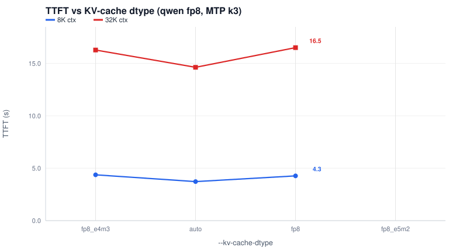
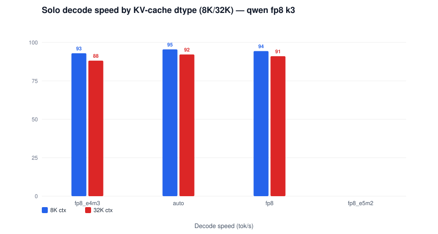
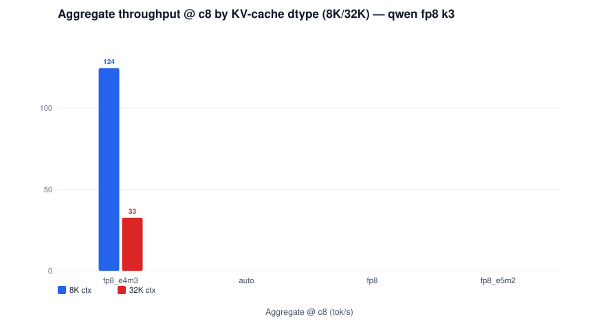
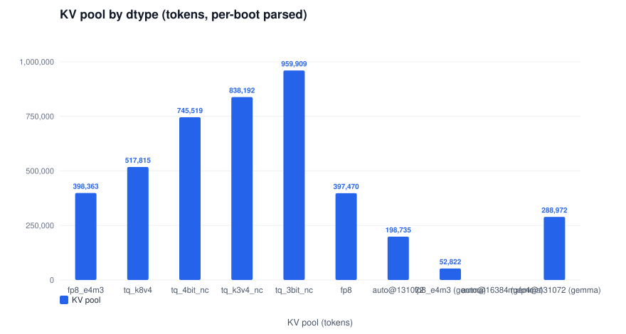
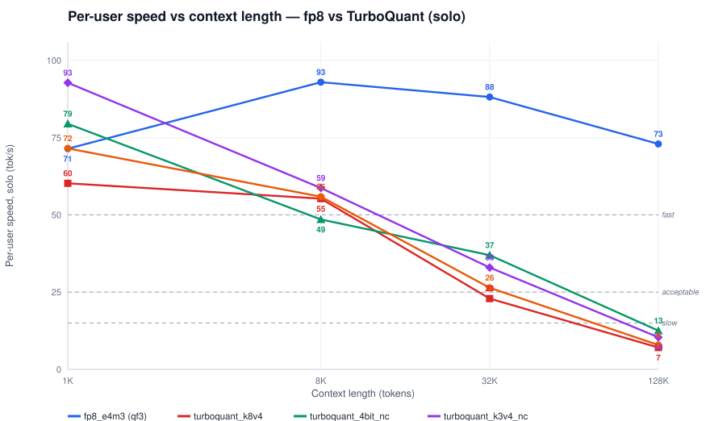
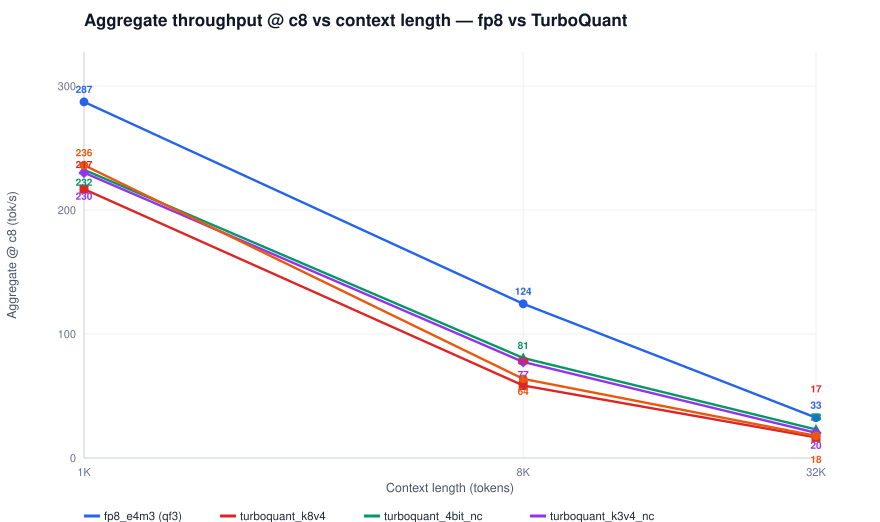
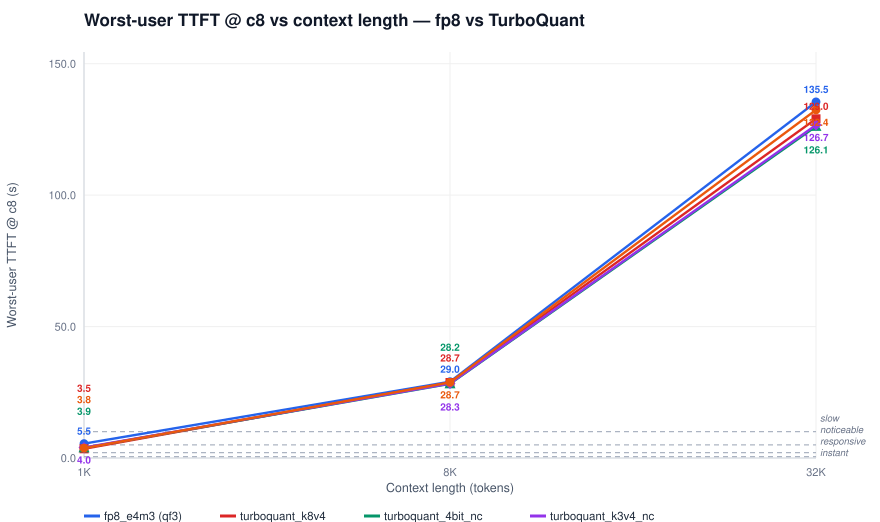

# KV-cache dtype comparison — both models, TurboQuant, capacity cliffs

| Field | Value |
|---|---|
| Models | Qwen3.8-27B FP8 + MTP k3 (certified posture); Gemma-4-31B (certified posture, no MTP) |
| Knob | `ARC_KVDTYPE` in `tools/serve_arc_b70.sh` (default `fp8_e4m3`) → `--kv-cache-dtype` |
| Menu | fp8_e4m3 · fp8 · auto (fp16 KV) · turboquant_k8v4 · turboquant_4bit_nc · turboquant_k3v4_nc · turboquant_3bit_nc (qwen); fp8_e4m3 · auto (gemma, maxlen-capped) |
| Faces | r139: conc {1,2,3,4,8} at 1K/8K/32K per dtype; r138: solo faces for fp8/auto/fp8/e5m2 |
| Engine | vLLM v0.30.0 — vllm-arc v0.30.0-b70-cert23, TP2 |
| Date | 2026-11-11 |

A dtype that refuses to boot is a valid outcome and is banked as such — two of the boundaries below are refusals.

## Qwen3.8-27B FP8 + MTP k3

`auto` (fp16 KV — 2 bytes/elem) refuses at the certified `max_model_len 262144`: one max-len request needs 8.73 GiB of KV against 6.78 GiB available at GMU 0.8 / TP2, so the engine raises at boot (cell `kvauto` holds the refusal log). Its rows below are measured at `max_model_len=131072` (cell `kvauto131`) — still covering the full 1K–128K report sweep; its pool (198,735) is **exactly half** the fp8 pool — the fp16 byte-doubling law made measurable. `fp8_e5m2` is the second refusal and a hard engine boundary, not a capacity one: `NotImplementedError: FlashAttention does not support fp8_e5m2 kv-cache on this device` (cell `kve5m2`) — the esimd FA2 backend ships no e5m2 KV dequant path on Xe2.

| --kv-cache-dtype | Context | TTFT solo (s) | Decode solo (tok/s) | Agg @ c8 (tok/s) | Per-user @ c8 (tok/s) | ITL p50 (ms) | KV pool (tok) | Note |
|---|---|---|---|---|---|---|---|---|
| fp8_e4m3 | 8K | 4.30 | 93.0 | 124 | 37.8 | 40.5 | 398,363 | the certified incumbent |
| fp8_e4m3 | 32K | 16.4 | 88.2 | 33 | 15.2 | 42.8 | 398,363 | the certified incumbent |
| auto | 8K | 3.73 | 95.5 | - | - | 39.7 | 198,735 | fp16 KV (2 bytes/elem); refuses at max_model_len 262144 (8.73 > 6.78 GiB), measured at 131072 |
| auto | 32K | 14.6 | 92.2 | - | - | 42.1 | 198,735 | fp16 KV (2 bytes/elem); refuses at max_model_len 262144 (8.73 > 6.78 GiB), measured at 131072 |
| fp8 | 8K | 4.27 | 94.4 | - | - | 40.5 | 397,470 |  |
| fp8 | 32K | 16.5 | 91.1 | - | - | 42.7 | 397,470 |  |
| fp8_e5m2 | 8K | - | - | - | - | - | - | refuses to boot - FA2 has no e5m2 KV path on Xe2 |
| fp8_e5m2 | 32K | - | - | - | - | - | - | refuses to boot - FA2 has no e5m2 KV path on Xe2 |

## TurboQuant presets (Qwen3.8-27B FP8 + MTP k3, r139 concurrency sweeps)

The wheel's four TurboQuant KV dtypes serve via the same knob; the r139 gate ran the full conc {1,2,3,4,8} sweep per preset (fresh boot per cell, `VLLM_ARC_TQ_SPEC_FIX=1` default posture):

| dtype | Context | TTFT solo (s) | Decode solo (tok/s) | Agg @ c8 (tok/s) | Per-user @ c8 (tok/s) | KV pool (tok, x vs fp8) | Note |
|---|---|---|---|---|---|---|---|
| `turboquant_k8v4` | 8K | 3.45 | 55.3 | 59 | 10.5 | 517,815 (1.98x) | 4-bit K/V, 8-level scales - the balanced preset |
| `turboquant_k8v4` | 32K | 14.3 | 22.9 | 17 | 3.0 | 517,815 (1.98x) | 4-bit K/V, 8-level scales - the balanced preset |
| `turboquant_4bit_nc` | 8K | 3.45 | 48.5 | 81 | 16.2 | 745,519 (2.86x) | cleanest identity record of the family |
| `turboquant_4bit_nc` | 32K | 14.6 | 37.0 | 23 | 4.8 | 745,519 (2.86x) | cleanest identity record of the family |
| `turboquant_k3v4_nc` | 8K | 3.42 | 58.7 | 77 | 14.4 | 838,192 (3.22x) | k3 scales + 4-bit V |
| `turboquant_k3v4_nc` | 32K | 14.6 | 33.0 | 20 | 4.1 | 838,192 (3.22x) | k3 scales + 4-bit V |
| `turboquant_3bit_nc` | 8K | 3.39 | 55.9 | 64 | 11.3 | 959,909 (3.68x) | max capacity, 3-bit precision floor |
| `turboquant_3bit_nc` | 32K | 14.6 | 26.4 | 18 | 3.3 | 959,909 (3.68x) | max capacity, 3-bit precision floor |

### `turboquant_k8v4` — 8K context

| Conc | TTFT mean (s) | TTFT max (s) | Per-user mean | Per-user worst | Aggregate (tok/s) | Scaling eff. | ITL p90 max (ms) |
|---|---|---|---|---|---|---|---|
| 1 | 3.45 | 3.45 | 55.3 | 55.3 | 42 | 100% | 72.3 |
| 2 | 5.03 | 6.69 | 32.2 | 30.9 | 49 | 58% | 107.8 |
| 3 | 7.84 | 10.5 | 24.0 | 21.0 | 51 | 41% | 144.0 |
| 4 | 9.80 | 14.1 | 19.2 | 14.6 | 54 | 32% | 179.4 |
| 8 | 18.2 | 28.7 | 10.5 | 8.5 | 59 | 17% | 322.8 |

### `turboquant_k8v4` — 32K context

| Conc | TTFT mean (s) | TTFT max (s) | Per-user mean | Per-user worst | Aggregate (tok/s) | Scaling eff. | ITL p90 max (ms) |
|---|---|---|---|---|---|---|---|
| 1 | 14.3 | 14.3 | 22.9 | 22.9 | 15 | 100% | 167.2 |
| 2 | 22.7 | 29.3 | 12.0 | 10.5 | 16 | 55% | 294.4 |
| 3 | 31.4 | 44.4 | 7.8 | 6.1 | 16 | 35% | 424.9 |
| 4 | 39.5 | 60.2 | 5.7 | 4.5 | 16 | 26% | 597.5 |
| 8 | 73.0 | 129.0 | 3.0 | 2.5 | 17 | 14% | 3795.5 |

### `turboquant_4bit_nc` — 8K context

| Conc | TTFT mean (s) | TTFT max (s) | Per-user mean | Per-user worst | Aggregate (tok/s) | Scaling eff. | ITL p90 max (ms) |
|---|---|---|---|---|---|---|---|
| 1 | 3.45 | 3.45 | 48.5 | 48.5 | 38 | 100% | 55.4 |
| 2 | 5.11 | 6.86 | 47.7 | 41.4 | 67 | 88% | 73.6 |
| 3 | 7.29 | 10.2 | 36.6 | 29.1 | 74 | 65% | 92.8 |
| 4 | 9.67 | 13.9 | 29.1 | 22.7 | 71 | 47% | 111.0 |
| 8 | 17.5 | 28.2 | 16.2 | 12.0 | 81 | 27% | 185.7 |

### `turboquant_4bit_nc` — 32K context

| Conc | TTFT mean (s) | TTFT max (s) | Per-user mean | Per-user worst | Aggregate (tok/s) | Scaling eff. | ITL p90 max (ms) |
|---|---|---|---|---|---|---|---|
| 1 | 14.6 | 14.6 | 37.0 | 37.0 | 19 | 100% | 106.0 |
| 2 | 23.4 | 29.5 | 19.4 | 15.8 | 22 | 55% | 172.5 |
| 3 | 34.9 | 54.8 | 11.3 | 8.0 | 19 | 32% | 239.0 |
| 4 | 39.2 | 60.4 | 9.5 | 7.0 | 22 | 28% | 306.3 |
| 8 | 71.5 | 126.1 | 4.8 | 3.3 | 23 | 15% | 3099.2 |

### `turboquant_k3v4_nc` — 8K context

| Conc | TTFT mean (s) | TTFT max (s) | Per-user mean | Per-user worst | Aggregate (tok/s) | Scaling eff. | ITL p90 max (ms) |
|---|---|---|---|---|---|---|---|
| 1 | 3.42 | 3.42 | 58.7 | 58.7 | 44 | 100% | 59.2 |
| 2 | 5.24 | 7.00 | 42.8 | 36.4 | 60 | 68% | 81.0 |
| 3 | 7.55 | 10.3 | 29.1 | 24.9 | 60 | 46% | 103.8 |
| 4 | 9.49 | 14.1 | 24.4 | 20.0 | 64 | 37% | 125.5 |
| 8 | 17.4 | 28.3 | 14.4 | 10.9 | 77 | 22% | 215.6 |

### `turboquant_k3v4_nc` — 32K context

| Conc | TTFT mean (s) | TTFT max (s) | Per-user mean | Per-user worst | Aggregate (tok/s) | Scaling eff. | ITL p90 max (ms) |
|---|---|---|---|---|---|---|---|
| 1 | 14.6 | 14.6 | 33.0 | 33.0 | 18 | 100% | 119.1 |
| 2 | 23.6 | 29.3 | 16.7 | 14.2 | 20 | 54% | 199.7 |
| 3 | 34.8 | 54.6 | 10.6 | 7.9 | 19 | 34% | 277.2 |
| 4 | 39.0 | 60.6 | 8.0 | 5.9 | 20 | 27% | 353.9 |
| 8 | 72.0 | 126.7 | 4.1 | 2.8 | 20 | 14% | 3381.7 |

### `turboquant_3bit_nc` — 8K context

| Conc | TTFT mean (s) | TTFT max (s) | Per-user mean | Per-user worst | Aggregate (tok/s) | Scaling eff. | ITL p90 max (ms) |
|---|---|---|---|---|---|---|---|
| 1 | 3.39 | 3.39 | 55.9 | 55.9 | 42 | 100% | 68.2 |
| 2 | 5.17 | 6.94 | 36.3 | 32.7 | 55 | 64% | 98.7 |
| 3 | 7.40 | 10.3 | 26.7 | 22.7 | 59 | 47% | 130.8 |
| 4 | 9.31 | 14.1 | 20.2 | 17.5 | 59 | 35% | 161.2 |
| 8 | 17.2 | 28.7 | 11.3 | 9.2 | 64 | 19% | 303.4 |

### `turboquant_3bit_nc` — 32K context

| Conc | TTFT mean (s) | TTFT max (s) | Per-user mean | Per-user worst | Aggregate (tok/s) | Scaling eff. | ITL p90 max (ms) |
|---|---|---|---|---|---|---|---|
| 1 | 14.6 | 14.6 | 26.4 | 26.4 | 16 | 100% | 151.4 |
| 2 | 23.6 | 30.0 | 12.3 | 10.0 | 15 | 48% | 264.7 |
| 3 | 31.7 | 45.6 | 9.0 | 7.3 | 18 | 37% | 375.5 |
| 4 | 39.8 | 61.8 | 6.8 | 5.4 | 18 | 28% | 486.0 |
| 8 | 73.9 | 132.4 | 3.3 | 2.5 | 18 | 14% | 3282.6 |

## Gemma-4-31B (no MTP)

`auto` refuses at the certified gemma posture (`ARC_MAXLEN=40960`: the fp16 KV pool cannot cover one 40K session on the 31B geometry — cell `gkv_auto` banks the refusal); it serves at `ARC_MAXLEN=16384` (cell `gkv_auto16`). The incumbent fp8_e4m3 rows are the r139 `gm8` cell.

| --kv-cache-dtype | Context | TTFT solo (s) | Decode solo (tok/s) | Agg @ c8 (tok/s) | Per-user @ c8 (tok/s) | ITL p50 (ms) | KV pool (tok) | Note |
|---|---|---|---|---|---|---|---|---|
| fp8_e4m3 | 8K | 4.10 | 26.1 | - | - | 38.5 | 52,822 | the certified gemma incumbent |
| fp8_e4m3 | 32K | 22.0 | 24.9 | - | - | 40.4 | 52,822 | the certified gemma incumbent |
| auto | 8K | - | - | - | - | - | - | fp16 KV; refuses at max_model_len 40960 (the certified gemma posture), servable at 16384 |
| auto | 32K | - | - | - | - | - | - | fp16 KV; refuses at max_model_len 40960 (the certified gemma posture), servable at 16384 |

## Gemma 128K annex (r140): 131072 maxlen needs MXFP4 weights

The certified gemma posture caps `max_model_len` at 40960. Raising it to 131072 is a KV-headroom question: the annex boots the 8-bit lane (`gm8x`) and the 4-bit lane (`gm4x`) at `ARC_MAXLEN=131072` — the MXFP4 weight savings are what buy the pool for a full 128K session.

8-bit control (`gm8x`): outcome `BOOT_FAIL` — the boot refusal banks the boundary.

| dtype (cell) | Context | TTFT solo (s) | Decode solo (tok/s) | Agg @ c8 (tok/s) | Per-user @ c8 (tok/s) | KV pool (tok) |
|---|---|---|---|---|---|---|
| MXFP4 (gm4x) | 8K | 4.16 | 37.2 | 85 | 18.4 | 288,972 |
| MXFP4 (gm4x) | 32K | 22.3 | 34.8 | 23 | 8.1 | 288,972 |
| MXFP4 (gm4x) | 128K | 175.9 | 28.4 | - | - | 288,972 |

Full lane report (main body + the 128K annex section): [gemma-4-31b-mxfp4](gemma-4-31b-mxfp4.md).

## Capacity cliffs (the whole point of the dtype menu)

Session footprint = ctx + 600 + 64 tokens; pool = per-boot parsed (`posture.txt`). Max concurrent **full-length** sessions per dtype:

| dtype (cell) | Pool (tok) | @1K | @8K | @32K | pool source |
|---|---|---|---|---|---|
| fp8_e4m3 | 398,363 | 235 | 44 | 11 | r139 posture |
| turboquant_k8v4 | 517,815 | 306 | 58 | 15 | r139 posture |
| turboquant_4bit_nc | 745,519 | 441 | 84 | 22 | r139 posture |
| turboquant_k3v4_nc | 838,192 | 496 | 94 | 25 | r139 posture |
| turboquant_3bit_nc | 959,909 | 568 | 108 | 28 | r139 posture |
| fp8 | 397,470 | 235 | 44 | 11 | P6.37 G: ~= fp8_e4m3 (boot-day free-memory variance) |
| auto@131072 | 198,735 | 117 | 22 | 5 | P6.37 G: exactly half the fp8 pool (fp16 law) |
| fp8_e4m3 (gemma) | 52,822 | 31 | 5 | 1 | r139 posture |
| auto@16384 (gemma) | - | - | - | - |  |
| mxfp4@131072 (gemma) | 288,972 | 171 | 32 | 8 | r139 posture |

Refusal boundaries: `auto` at max_model_len 262144 (qwen, fp16 capacity) and 40960 (gemma); `fp8_e5m2` at boot (kernel, not memory). Every refusal is banked with its serve log.

## Configuration (copyable deltas on the certified posture)

| dtype | cell | delta | max_model_len |
|---|---|---|---|
| fp8_e4m3 | qf3 / gm8 | (none — incumbent) | 262144 / 40960 |
| fp8 | kvfp8 | ARC_KVDTYPE=fp8 | 262144 |
| auto | kvauto131 | ARC_KVDTYPE=auto | 131072 |
| auto | kvauto | ARC_KVDTYPE=auto — refuses | 262144 |
| auto (gemma) | gkv_auto16 | ARC_KVDTYPE=auto ARC_MAXLEN=16384 | 16384 |
| auto (gemma) | gkv_auto | ARC_KVDTYPE=auto — refuses at 40960 | 40960 |
| turboquant_* | tq_* | ARC_KVDTYPE=turboquant_<preset> | 262144 |
| mxfp4 (gemma 128K) | gm4x | ARC_QUANT=mxfp4 ARC_MXFP4_MODE=w4a16 ARC_MAXLEN=131072 | 131072 |
| fp8_e5m2 | kve5m2 | ARC_KVDTYPE=fp8_e5m2 — refuses (no kernel) | - |

`ARC_MAXLEN` is what makes fp16-KV `auto` servable — the refusal is the capacity cliff itself. The full qwen3.8-27b-fp8-k3 invocation: [qwen3.8-27b-fp8-k3.md](qwen3.8-27b-fp8-k3.md).

<i>TTFT by KV-cache dtype (solo, 8K/32K) — qwen fp8 k3</i>
*Interpretation:* speed is flat across the servable dtypes — the KV dtype menu trades pool size, not per-token speed; the capacity table above is the real axis. A missing bar is a banked refusal, not a gap in measurement.

<i>Solo decode speed by KV-cache dtype (8K/32K) — qwen fp8 k3</i>
*Interpretation:* speed is flat across the servable dtypes — the KV dtype menu trades pool size, not per-token speed; the capacity table above is the real axis. A missing bar is a banked refusal, not a gap in measurement.

<i>Aggregate throughput @ c8 by KV-cache dtype (8K/32K) — qwen fp8 k3</i>
*Interpretation:* speed is flat across the servable dtypes — the KV dtype menu trades pool size, not per-token speed; the capacity table above is the real axis. A missing bar is a banked refusal, not a gap in measurement.

<i>KV pool by dtype — capacity is the dtype menu's axis</i>

<i>Per-user speed vs context length — fp8 vs TurboQuant (solo)</i>

<i>Aggregate throughput @ c8 vs context length — fp8 vs TurboQuant</i>

<i>Worst-user TTFT @ c8 vs context length — fp8 vs TurboQuant</i>

*Interpretation:* TurboQuant holds solo speed within 90% of fp8 at every measured context (worst relative delta) while multiplying the KV pool up to 3.68x — the capacity table is the payoff; a line that stops before 128K is the pool cliff reached later, not sooner.

Banks: r139 `results/2026-11-11-p637b-conc/` (conc cells + posture pools), r138 `results/2026-11-10-p637-reports/` (solo dtype cells + refusals); knob: `ARC_KVDTYPE` in `tools/serve_arc_b70.sh`. Identity records per TQ preset: CONFIGURATION-arc "KV-cache dtype".
