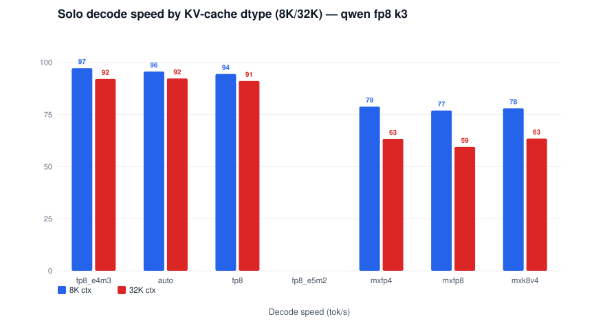
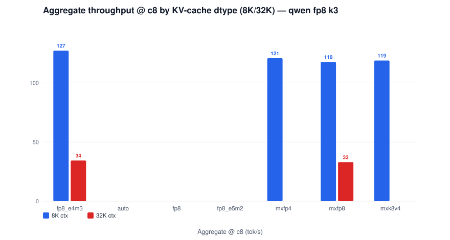
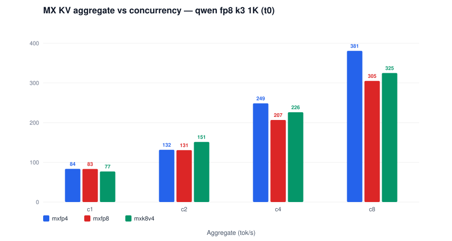
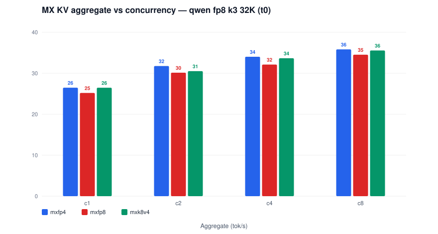
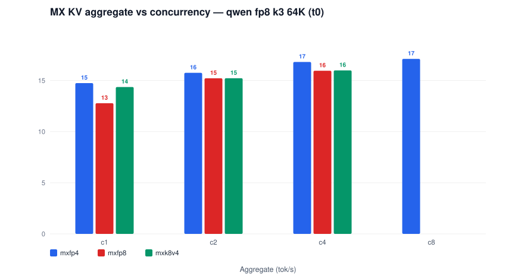
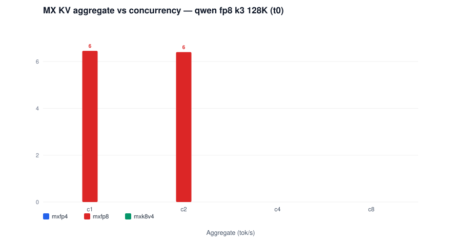
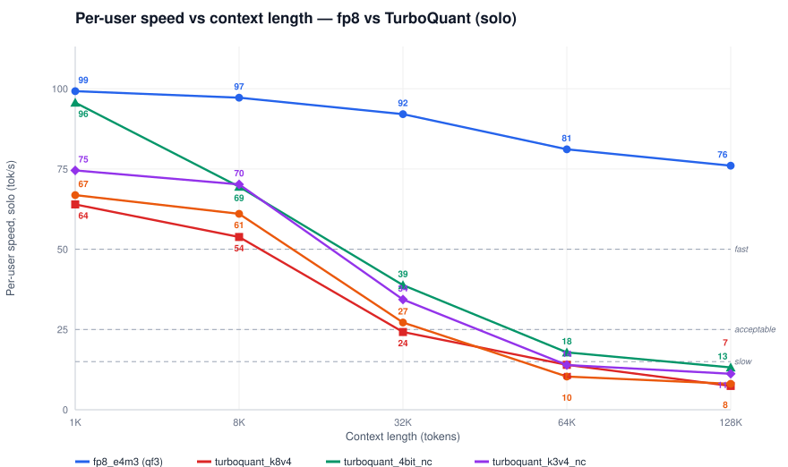
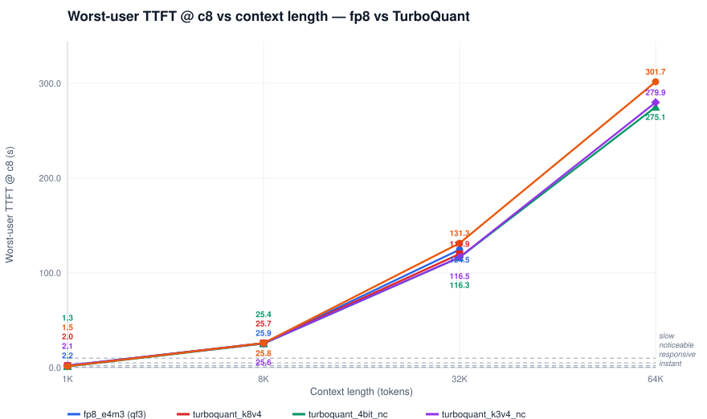

# KV-cache dtype comparison — both models, TurboQuant, capacity cliffs

| Field | Value |
|---|---|
| Models | Qwen3.8-27B FP8 + MTP k3 (certified posture); Gemma-4-31B (certified posture, no MTP) |
| Knob | `ARC_KVDTYPE` in `tools/serve_arc_b70.sh` (default `fp8_e4m3`) → `--kv-cache-dtype` |
| Menu | fp8_e4m3 · fp8 · auto (fp16 KV) · mxfp4 · mxfp8 · mxk8v4 (MX KV, native) · turboquant_k8v4 · turboquant_4bit_nc · turboquant_k3v4_nc · turboquant_3bit_nc (qwen); fp8_e4m3 · auto · mxfp4 · mxfp8 · mxk8v4 · fp8_e5m2-probe (gemma) |
| Faces | r240b: conc {1,2,3,4,8} at 1K/8K/32K per dtype (MX lanes, BOTH models: the {1,2,4,8} grid at every rung 1K/8K/32K/64K/128K + t1.0 solos); r240: solo faces for fp8/auto/fp8/e5m2 + the MX lanes (qwen) |
| Engine | vLLM v0.30.0 — vllm-arc v0.30.0-b70-cert28, TP2 |
| Date | 2026-11-24 |

A dtype that refuses to boot is a valid outcome and is banked as such — two of the boundaries below are refusals.

## Qwen3.8-27B FP8 + MTP k3

`auto` (fp16 KV — 2 bytes/elem) refuses at the certified `max_model_len 262144`: one max-len request needs 8.73 GiB of KV against 6.78 GiB available at GMU 0.8 / TP2, so the engine raises at boot (cell `kvauto` holds the refusal log). Its rows below are measured at `max_model_len=131072` (cell `kvauto131`) — still covering the full 1K–128K report sweep; its pool (198,735) is **exactly half** the fp8 pool — the fp16 byte-doubling law made measurable. `fp8_e5m2` is the second refusal and a hard engine boundary, not a capacity one: `NotImplementedError: FlashAttention does not support fp8_e5m2 kv-cache on this device` (cell `kve5m2`) — the esimd FA2 backend ships no e5m2 KV dequant path on Xe2.

The three `mxfp4`/`mxfp8`/`mxk8v4` rows are the P6.47 MX KV lane, native-certified on this image (`ARC_MXKV_NATIVE=1`; the MX postures auto-off LMC by the e2m1-V law): microscaling KV with E8M0 group scales, decoded by the native `mx_paged_decode` path. They trade a slice of decode speed for KV-token capacity per byte — the capacity table below carries the measured pools. Full lane documentation: `docs/PATCHES-arc.md` (the mx_kv family), the P6.47 record in `docs/PERFORMANCE-arc.md`.

| --kv-cache-dtype | Context | TTFT solo (s) | Decode solo (tok/s) | Agg @ c8 (tok/s) | Per-user @ c8 (tok/s) | ITL p50 (ms) | KV pool (tok) | Note |
|---|---|---|---|---|---|---|---|---|
| fp8_e4m3 | 8K | 3.06 | 97.2 | 127 | 36.5 | 40.4 | 398,363 | the certified incumbent |
| fp8_e4m3 | 32K | 15.3 | 92.1 | 34 | 14.7 | 42.5 | 398,363 | the certified incumbent |
| auto | 8K | 3.75 | 95.6 | - | - | 39.7 | 198,735 | fp16 KV (2 bytes/elem); refuses at max_model_len 262144 (8.73 > 6.78 GiB), measured at 131072 |
| auto | 32K | 14.7 | 92.3 | - | - | 42.1 | 198,735 | fp16 KV (2 bytes/elem); refuses at max_model_len 262144 (8.73 > 6.78 GiB), measured at 131072 |
| fp8 | 8K | 4.29 | 94.4 | - | - | 40.5 | 397,470 |  |
| fp8 | 32K | 16.5 | 91.1 | - | - | 42.7 | 397,470 |  |
| fp8_e5m2 | 8K | - | - | - | - | - | - | refuses to boot - FA2 has no e5m2 KV path on Xe2 |
| fp8_e5m2 | 32K | - | - | - | - | - | - | refuses to boot - FA2 has no e5m2 KV path on Xe2 |
| mxfp4 | 8K | 2.97 | 78.8 | 121 | 28.8 | 48.4 | 721,994 | MX KV: e2m1 data + E8M0 group scales; native decode, LMC off; r240b death at c32768_n4 was posture-confounded (the gate script forced ARC_LMC=1 over the lane -- LMCache storing in the death window, the r168 e2m1-V class); re-classified 2026-11-25, re-measured LMC-free in r241 |
| mxfp4 | 32K | 13.3 | 63.3 | - | - | 57.9 | 721,994 | MX KV: e2m1 data + E8M0 group scales; native decode, LMC off; r240b death at c32768_n4 was posture-confounded (the gate script forced ARC_LMC=1 over the lane -- LMCache storing in the death window, the r168 e2m1-V class); re-classified 2026-11-25, re-measured LMC-free in r241 |
| mxfp8 | 8K | 2.97 | 76.9 | 118 | 27.7 | 50.0 | 386,484 | MX KV: e4m3 data + E8M0 group scales; native decode, LMC off; the only packed lane to survive the r240b grid (e4m3-V: the r176 store-tax class, immune to the e2m1-V x LMC kill class) |
| mxfp8 | 32K | 13.9 | 59.4 | 33 | 9.6 | 64.3 | 386,484 | MX KV: e4m3 data + E8M0 group scales; native decode, LMC off; the only packed lane to survive the r240b grid (e4m3-V: the r176 store-tax class, immune to the e2m1-V x LMC kill class) |
| mxk8v4 | 8K | 3.06 | 78.0 | 119 | 27.0 | 49.2 | 504,832 | mixed MX KV: e4m3 K + e2m1 V; native decode, LMC off; r240b death at c32768_n4 (DEVICE_LOST) was posture-confounded (ARC_LMC=1 forced -- the r168 e2m1-V class); re-classified 2026-11-25, re-measured LMC-free in r241 |
| mxk8v4 | 32K | 13.3 | 63.5 | - | - | 61.8 | 504,832 | mixed MX KV: e4m3 K + e2m1 V; native decode, LMC off; r240b death at c32768_n4 (DEVICE_LOST) was posture-confounded (ARC_LMC=1 forced -- the r168 e2m1-V class); re-classified 2026-11-25, re-measured LMC-free in r241 |

## TurboQuant presets (Qwen3.8-27B FP8 + MTP k3, r240b concurrency sweeps)

The wheel's four TurboQuant KV dtypes serve via the same knob; the r240b gate ran the full conc {1,2,3,4,8} sweep per preset (fresh boot per cell, `VLLM_ARC_TQ_SPEC_FIX=1` default posture):

| dtype | Context | TTFT solo (s) | Decode solo (tok/s) | Agg @ c8 (tok/s) | Per-user @ c8 (tok/s) | KV pool (tok, x vs fp8) | Note |
|---|---|---|---|---|---|---|---|
| `turboquant_k8v4` | 8K | 3.02 | 53.8 | 69 | 11.6 | 517,815 (1.98x) | 4-bit K/V, 8-level scales - the balanced preset |
| `turboquant_k8v4` | 32K | 13.4 | 24.2 | 17 | 3.1 | 517,815 (1.98x) | 4-bit K/V, 8-level scales - the balanced preset |
| `turboquant_4bit_nc` | 8K | 3.06 | 69.5 | 90 | 17.9 | 745,519 (2.86x) | cleanest identity record of the family |
| `turboquant_4bit_nc` | 32K | 13.6 | 38.8 | 25 | 5.3 | 745,519 (2.86x) | cleanest identity record of the family |
| `turboquant_k3v4_nc` | 8K | 3.03 | 70.2 | 84 | 16.0 | 838,192 (3.22x) | k3 scales + 4-bit V |
| `turboquant_k3v4_nc` | 32K | 13.3 | 34.3 | 23 | 4.6 | 838,192 (3.22x) | k3 scales + 4-bit V |
| `turboquant_3bit_nc` | 8K | 3.05 | 61.0 | 72 | 12.7 | 959,909 (3.68x) | max capacity, 3-bit precision floor |
| `turboquant_3bit_nc` | 32K | 13.7 | 27.2 | 19 | 3.5 | 959,909 (3.68x) | max capacity, 3-bit precision floor |

### `turboquant_k8v4` — 8K context

| Conc | TTFT mean (s) | TTFT max (s) | Per-user mean | Per-user worst | Aggregate (tok/s) | Scaling eff. | ITL p90 max (ms) |
|---|---|---|---|---|---|---|---|
| 1 | 3.02 | 3.02 | 53.8 | 53.8 | 42 | 100% | 68.7 |
| 2 | 4.60 | 6.13 | 36.2 | 33.5 | 56 | 66% | 100.2 |
| 3 | 7.26 | 9.82 | 27.0 | 22.5 | 60 | 47% | 132.7 |
| 4 | 9.03 | 12.5 | 21.6 | 18.1 | 64 | 38% | 164.8 |
| 8 | 16.4 | 25.7 | 11.6 | 9.4 | 69 | 20% | 302.8 |

### `turboquant_k8v4` — 32K context

| Conc | TTFT mean (s) | TTFT max (s) | Per-user mean | Per-user worst | Aggregate (tok/s) | Scaling eff. | ITL p90 max (ms) |
|---|---|---|---|---|---|---|---|
| 1 | 13.4 | 13.4 | 24.2 | 24.2 | 16 | 100% | 158.9 |
| 2 | 21.7 | 27.1 | 11.7 | 11.2 | 16 | 50% | 278.0 |
| 3 | 29.3 | 41.5 | 8.2 | 6.2 | 16 | 34% | 401.5 |
| 4 | 36.8 | 56.2 | 6.3 | 5.3 | 17 | 27% | 573.1 |
| 8 | 67.7 | 119.9 | 3.1 | 2.5 | 17 | 14% | 3693.4 |

### `turboquant_4bit_nc` — 8K context

| Conc | TTFT mean (s) | TTFT max (s) | Per-user mean | Per-user worst | Aggregate (tok/s) | Scaling eff. | ITL p90 max (ms) |
|---|---|---|---|---|---|---|---|
| 1 | 3.06 | 3.06 | 69.5 | 69.5 | 51 | 100% | 53.5 |
| 2 | 4.70 | 6.32 | 49.9 | 43.0 | 70 | 69% | 70.0 |
| 3 | 7.13 | 9.74 | 39.6 | 31.0 | 79 | 51% | 87.1 |
| 4 | 8.99 | 12.6 | 30.5 | 22.2 | 79 | 39% | 103.6 |
| 8 | 16.0 | 25.4 | 17.9 | 12.9 | 90 | 22% | 171.5 |

### `turboquant_4bit_nc` — 32K context

| Conc | TTFT mean (s) | TTFT max (s) | Per-user mean | Per-user worst | Aggregate (tok/s) | Scaling eff. | ITL p90 max (ms) |
|---|---|---|---|---|---|---|---|
| 1 | 13.6 | 13.6 | 38.8 | 38.8 | 21 | 100% | 101.5 |
| 2 | 22.1 | 27.6 | 20.2 | 16.9 | 23 | 55% | 164.5 |
| 3 | 29.7 | 41.4 | 14.0 | 10.5 | 24 | 39% | 224.7 |
| 4 | 36.8 | 55.8 | 10.5 | 7.5 | 24 | 30% | 290.4 |
| 8 | 66.5 | 116.3 | 5.3 | 3.7 | 25 | 15% | 3032.7 |

### `turboquant_k3v4_nc` — 8K context

| Conc | TTFT mean (s) | TTFT max (s) | Per-user mean | Per-user worst | Aggregate (tok/s) | Scaling eff. | ITL p90 max (ms) |
|---|---|---|---|---|---|---|---|
| 1 | 3.03 | 3.03 | 70.2 | 70.2 | 52 | 100% | 57.0 |
| 2 | 4.66 | 6.27 | 44.2 | 36.4 | 61 | 59% | 76.5 |
| 3 | 7.35 | 9.99 | 35.9 | 27.9 | 73 | 47% | 97.2 |
| 4 | 8.98 | 12.5 | 29.2 | 22.5 | 80 | 38% | 117.2 |
| 8 | 16.3 | 25.6 | 16.0 | 12.0 | 84 | 20% | 198.1 |

### `turboquant_k3v4_nc` — 32K context

| Conc | TTFT mean (s) | TTFT max (s) | Per-user mean | Per-user worst | Aggregate (tok/s) | Scaling eff. | ITL p90 max (ms) |
|---|---|---|---|---|---|---|---|
| 1 | 13.3 | 13.3 | 34.3 | 34.3 | 19 | 100% | 113.3 |
| 2 | 27.0 | 38.2 | 16.3 | 11.9 | 18 | 46% | 187.5 |
| 3 | 29.2 | 41.2 | 12.0 | 8.5 | 21 | 36% | 261.2 |
| 4 | 36.7 | 55.6 | 9.3 | 6.9 | 23 | 29% | 334.7 |
| 8 | 66.7 | 116.5 | 4.6 | 3.3 | 23 | 15% | 3407.2 |

### `turboquant_3bit_nc` — 8K context

| Conc | TTFT mean (s) | TTFT max (s) | Per-user mean | Per-user worst | Aggregate (tok/s) | Scaling eff. | ITL p90 max (ms) |
|---|---|---|---|---|---|---|---|
| 1 | 3.05 | 3.05 | 61.0 | 61.0 | 47 | 100% | 64.9 |
| 2 | 4.70 | 6.33 | 39.5 | 35.7 | 59 | 64% | 92.4 |
| 3 | 6.99 | 9.66 | 29.2 | 24.8 | 64 | 46% | 120.9 |
| 4 | 9.12 | 12.9 | 22.6 | 19.2 | 62 | 33% | 147.9 |
| 8 | 16.2 | 25.8 | 12.7 | 9.5 | 72 | 19% | 260.5 |

### `turboquant_3bit_nc` — 32K context

| Conc | TTFT mean (s) | TTFT max (s) | Per-user mean | Per-user worst | Aggregate (tok/s) | Scaling eff. | ITL p90 max (ms) |
|---|---|---|---|---|---|---|---|
| 1 | 13.7 | 13.7 | 27.2 | 27.2 | 17 | 100% | 144.5 |
| 2 | 22.2 | 27.5 | 14.1 | 12.5 | 18 | 54% | 249.6 |
| 3 | 29.3 | 42.0 | 8.6 | 7.3 | 17 | 34% | 354.1 |
| 4 | 36.9 | 57.2 | 7.0 | 5.7 | 19 | 28% | 499.2 |
| 8 | 69.6 | 131.3 | 3.5 | 2.7 | 19 | 14% | 3203.6 |

## MX KV lanes — concurrency sweep (Qwen3.8-27B FP8 + MTP k3, r240b)

Every MX lane swept at concurrency {1,2,4,8} at every context step of the canonical ladder — 1K/8K/32K/64K/128K (fresh boot per lane; one boot serves its whole grid). Outcome: mxfp8 completes the full grid; mxfp4 and mxk8v4 died at the sustained 32K × n4 decode face — posture-confounded deaths (r240b forced ARC_LMC=1 over the MX cells against the certified posture; LMCache stored in both death windows — the r168 e2m1-V class; every clean MX reference ran LMC-free): re-classified 2026-11-25, re-measured LMC-free in r241. A `-` rung or a refusal-summary row below is a banked KV_CAP point or banked engine-death face, never unmeasured coverage; the 1K/8K grids and the 32K n1/n2 rungs are real measurements on both lanes):

### `mxfp4` — qwen fp8 k3 — 1K context

| Conc | TTFT mean (s) | TTFT max (s) | Per-user mean | Per-user worst | Aggregate (tok/s) | Scaling eff. | ITL p90 max (ms) |
|---|---|---|---|---|---|---|---|
| 1 | 0.39 | 0.39 | 88.4 | 88.4 | 84 | 100% | 50.7 |
| 2 | 0.46 | 0.59 | 69.7 | 69.2 | 131 | 79% | 53.6 |
| 4 | 0.78 | 0.89 | 70.5 | 67.4 | 245 | 73% | 58.7 |
| 8 | 1.44 | 1.56 | 60.7 | 55.5 | 388 | 58% | 68.1 |

### `mxfp4` — qwen fp8 k3 — 8K context

| Conc | TTFT mean (s) | TTFT max (s) | Per-user mean | Per-user worst | Aggregate (tok/s) | Scaling eff. | ITL p90 max (ms) |
|---|---|---|---|---|---|---|---|
| 1 | 2.97 | 2.97 | 78.8 | 78.8 | 57 | 100% | 49.5 |
| 2 | 4.49 | 5.98 | 60.3 | 51.5 | 82 | 72% | 55.3 |
| 4 | 8.91 | 12.4 | 44.0 | 30.8 | 102 | 45% | 65.9 |
| 8 | 15.9 | 24.7 | 28.8 | 17.2 | 121 | 27% | 119.4 |

### `mxfp4` — qwen fp8 k3 — 32K context

| Conc | TTFT mean (s) | TTFT max (s) | Per-user mean | Per-user worst | Aggregate (tok/s) | Scaling eff. | ITL p90 max (ms) |
|---|---|---|---|---|---|---|---|
| 1 | 13.3 | 13.3 | 63.3 | 63.3 | 26 | 100% | 58.1 |
| 2 | 21.6 | 26.9 | 40.8 | 28.1 | 32 | 60% | 72.2 |
| 4 | - | - | - | - | - | - | - |
| 8 | - | - | - | - | - | - | - |

### `mxfp8` — qwen fp8 k3 — 1K context

| Conc | TTFT mean (s) | TTFT max (s) | Per-user mean | Per-user worst | Aggregate (tok/s) | Scaling eff. | ITL p90 max (ms) |
|---|---|---|---|---|---|---|---|
| 1 | 0.29 | 0.29 | 86.4 | 86.4 | 83 | 100% | 54.6 |
| 2 | 0.46 | 0.60 | 73.5 | 70.6 | 132 | 80% | 58.3 |
| 4 | 0.78 | 0.90 | 55.3 | 47.3 | 183 | 55% | 63.5 |
| 8 | 1.91 | 2.09 | 53.1 | 44.1 | 305 | 46% | 73.2 |

### `mxfp8` — qwen fp8 k3 — 8K context

| Conc | TTFT mean (s) | TTFT max (s) | Per-user mean | Per-user worst | Aggregate (tok/s) | Scaling eff. | ITL p90 max (ms) |
|---|---|---|---|---|---|---|---|
| 1 | 2.97 | 2.97 | 76.9 | 76.9 | 56 | 100% | 51.1 |
| 2 | 4.48 | 5.97 | 59.5 | 50.9 | 81 | 73% | 58.6 |
| 4 | 8.98 | 12.3 | 44.2 | 30.5 | 101 | 46% | 71.3 |
| 8 | 16.1 | 24.9 | 27.7 | 16.7 | 118 | 26% | 98.7 |

### `mxfp8` — qwen fp8 k3 — 32K context

| Conc | TTFT mean (s) | TTFT max (s) | Per-user mean | Per-user worst | Aggregate (tok/s) | Scaling eff. | ITL p90 max (ms) |
|---|---|---|---|---|---|---|---|
| 1 | 13.9 | 13.9 | 59.4 | 59.4 | 25 | 100% | 64.4 |
| 2 | 23.0 | 27.4 | 36.8 | 28.1 | 30 | 59% | 83.2 |
| 4 | 37.3 | 54.5 | 19.6 | 11.1 | 33 | 33% | 157.9 |
| 8 | 65.3 | 110.4 | 9.6 | 5.1 | 33 | 17% | 3177.1 |

### `mxfp8` — qwen fp8 k3 — 64K context

| Conc | TTFT mean (s) | TTFT max (s) | Per-user mean | Per-user worst | Aggregate (tok/s) | Scaling eff. | ITL p90 max (ms) |
|---|---|---|---|---|---|---|---|
| 1 | 30.5 | 30.5 | 35.8 | 35.8 | 13 | 100% | 82.7 |
| 2 | 47.8 | 61.1 | 23.1 | 13.3 | 15 | 59% | 119.0 |
| 4 | 79.3 | 123.7 | 10.9 | 5.1 | 16 | 31% | 3394.2 |

### `mxfp8` — qwen fp8 k3 — 128K context

| Conc | TTFT mean (s) | TTFT max (s) | Per-user mean | Per-user worst | Aggregate (tok/s) | Scaling eff. | ITL p90 max (ms) |
|---|---|---|---|---|---|---|---|
| 1 | 74.6 | 74.6 | 32.7 | 32.7 | 6 | 100% | 119.6 |
| 2 | 114.5 | 149.7 | 11.2 | 5.5 | 6 | 50% | 191.5 |

### `mxk8v4` — qwen fp8 k3 — 1K context

| Conc | TTFT mean (s) | TTFT max (s) | Per-user mean | Per-user worst | Aggregate (tok/s) | Scaling eff. | ITL p90 max (ms) |
|---|---|---|---|---|---|---|---|
| 1 | 0.30 | 0.30 | 80.0 | 80.0 | 77 | 100% | 53.3 |
| 2 | 0.40 | 0.51 | 82.2 | 81.0 | 156 | 101% | 56.4 |
| 4 | 0.79 | 0.90 | 69.4 | 66.5 | 242 | 79% | 62.1 |
| 8 | 1.79 | 1.97 | 53.6 | 46.3 | 321 | 52% | 71.8 |

### `mxk8v4` — qwen fp8 k3 — 8K context

| Conc | TTFT mean (s) | TTFT max (s) | Per-user mean | Per-user worst | Aggregate (tok/s) | Scaling eff. | ITL p90 max (ms) |
|---|---|---|---|---|---|---|---|
| 1 | 3.06 | 3.06 | 78.0 | 78.0 | 56 | 100% | 50.4 |
| 2 | 4.74 | 6.38 | 53.6 | 40.9 | 68 | 61% | 57.3 |
| 4 | 8.96 | 12.4 | 44.1 | 29.9 | 102 | 46% | 69.5 |
| 8 | 16.0 | 25.0 | 27.0 | 16.5 | 119 | 27% | 117.2 |

### `mxk8v4` — qwen fp8 k3 — 32K context

| Conc | TTFT mean (s) | TTFT max (s) | Per-user mean | Per-user worst | Aggregate (tok/s) | Scaling eff. | ITL p90 max (ms) |
|---|---|---|---|---|---|---|---|
| 1 | 13.3 | 13.3 | 63.5 | 63.5 | 26 | 100% | 62.1 |
| 2 | 21.2 | 26.9 | 38.0 | 25.9 | 31 | 58% | 80.2 |
| 4 | - | - | - | - | - | - | - |
| 8 | - | - | - | - | - | - | - |

### Lane/ctx pairs with banked faces but zero served requests

| Lane | Context (K) | Banked faces | Outcome |
|---|---|---|---|
| mxfp4 | 64 | 5 | posture-confounded engine death mid-sweep (r240b, re-classified 2026-11-25) |
| mxfp4 | 128 | 4 | posture-confounded engine death mid-sweep (r240b, re-classified 2026-11-25) |
| mxk8v4 | 64 | 4 | posture-confounded engine death mid-sweep (r240b, re-classified 2026-11-25) |
| mxk8v4 | 128 | 3 | posture-confounded engine death mid-sweep (r240b, re-classified 2026-11-25) |

Outcome detail: posture-confounded engine death mid-sweep (r240b, re-classified 2026-11-25): the gate script forced ARC_LMC=1 over the MX cells against the certified LMC-free posture -- mxfp4/mxk8v4 died at c32768_n4 with LMCache storing in the death windows (the r168 e2m1-V class; mxfp4 at the 300 s watchdog, mxk8v4 DEVICE_LOST), while mxfp8 (e4m3-V) survived the same forced posture -- re-measured LMC-free in r241.

## Gemma-4-31B (no MTP)

`auto` refuses at the certified gemma posture (`ARC_MAXLEN=40960`: the fp16 KV pool cannot cover one 40K session on the 31B geometry — cell `gkv_auto` banks the refusal); it serves at `ARC_MAXLEN=16384` (cell `gkv_auto16`). The incumbent fp8_e4m3 rows are the r240b `gf8` cell (online-fp8 weights — the gemma KV table is weights-constant across its rows). The three MX rows ride the r240b `gkv_m*` cells (same weights, `ARC_KVDTYPE=mxfp4|mxfp8|mxk8v4` + `ARC_MXKV_NATIVE=1`) — all three boot and bank their pools, but every decode face fatals: gemma's 10 hd512 full-attention layers sit outside the arc7 compiled instantiations (`mx_paged_decode` covers head_size 128/256 only), so the native MX-KV menu does not serve gemma on this image and those rows carry no measurements (fp8_e4m3 is the only servable KV dtype for gemma; the 128K capacity story rides the weights lane — the `gm4x` cell). `gkv_e5m2` is the per-model e5m2 refusal probe (the law is engine-level, banked on qwen `kve5m2`). A `-` row is a banked boot refusal, KV_CAP point, or the banked hd512 decode refusal, never unmeasured coverage. Full gemma KV report: [gemma-4-31b-kv-cache-dtype](gemma-4-31b-kv-cache-dtype.md).

| --kv-cache-dtype | Context | TTFT solo (s) | Decode solo (tok/s) | Agg @ c8 (tok/s) | Per-user @ c8 (tok/s) | ITL p50 (ms) | KV pool (tok) | Note |
|---|---|---|---|---|---|---|---|---|
| fp8_e4m3 | 8K | 3.75 | 26.7 | - | - | 37.6 | 56,128 | the gemma incumbent: online-fp8 weights + fp8_e4m3 KV (r240b gf8 cell, full conc ladder) |
| fp8_e4m3 | 32K | 20.6 | 25.4 | - | - | 39.5 | 56,128 | the gemma incumbent: online-fp8 weights + fp8_e4m3 KV (r240b gf8 cell, full conc ladder) |
| auto | 8K | - | - | - | - | - | - | fp16 KV; refuses at max_model_len 40960 (the certified gemma posture), servable at 16384 |
| auto | 32K | - | - | - | - | - | - | fp16 KV; refuses at max_model_len 40960 (the certified gemma posture), servable at 16384 |
| mxfp4 | 8K | - | - | - | - | - | 105,669 | MX KV on gemma: e2m1 data + E8M0 scales; boots + banks the pool, but every decode face fatals on the hd512 layers (D=128/256 instantiations only) -- zero served faces (r240b) |
| mxfp4 | 32K | - | - | - | - | - | 105,669 | MX KV on gemma: e2m1 data + E8M0 scales; boots + banks the pool, but every decode face fatals on the hd512 layers (D=128/256 instantiations only) -- zero served faces (r240b) |
| mxfp8 | 8K | - | - | - | - | - | 54,426 | MX KV on gemma: e4m3 data + E8M0 scales; boots + banks the pool, but every decode face fatals on the hd512 layers (D=128/256 instantiations only) -- zero served faces (r240b) |
| mxfp8 | 32K | - | - | - | - | - | 54,426 | MX KV on gemma: e4m3 data + E8M0 scales; boots + banks the pool, but every decode face fatals on the hd512 layers (D=128/256 instantiations only) -- zero served faces (r240b) |
| mxk8v4 | 8K | - | - | - | - | - | 71,856 | mixed MX KV on gemma: e4m3 K + e2m1 V; boots + banks the pool, but every decode face fatals on the hd512 layers (D=128/256 instantiations only) -- zero served faces (r240b) |
| mxk8v4 | 32K | - | - | - | - | - | 71,856 | mixed MX KV on gemma: e4m3 K + e2m1 V; boots + banks the pool, but every decode face fatals on the hd512 layers (D=128/256 instantiations only) -- zero served faces (r240b) |
| fp8_e5m2 | 8K | - | - | - | - | - | - | refusal probe: the e5m2 law is engine-level (no e5m2 KV dequant path in esimd FA2 on Xe2, banked on qwen kve5m2) |
| fp8_e5m2 | 32K | - | - | - | - | - | - | refusal probe: the e5m2 law is engine-level (no e5m2 KV dequant path in esimd FA2 on Xe2, banked on qwen kve5m2) |

## Gemma 128K annex (r240c): 131072 maxlen needs MXFP4 weights

The certified gemma posture caps `max_model_len` at 40960. Raising it to 131072 is a KV-headroom question: the annex boots the 8-bit lane (`gm8x`) and the 4-bit lane (`gm4x`) at `ARC_MAXLEN=131072` — the MXFP4 weight savings are what buy the pool for a full 128K session.

8-bit control (`gm8x`): outcome `BOOT_FAIL` — the boot refusal banks the boundary.

| dtype (cell) | Context | TTFT solo (s) | Decode solo (tok/s) | Agg @ c8 (tok/s) | Per-user @ c8 (tok/s) | KV pool (tok) |
|---|---|---|---|---|---|---|
| MXFP4 (gm4x) | 8K | 3.71 | 37.3 | 91 | 18.2 | 288,972 |
| MXFP4 (gm4x) | 32K | 20.9 | 35.0 | 25 | 8.4 | 288,972 |
| MXFP4 (gm4x) | 128K | 175.6 | 28.3 | - | - | 288,972 |

Full lane report (main body + the 128K annex section): [gemma-4-31b-mxfp4](gemma-4-31b-mxfp4.md).

## Capacity cliffs (the whole point of the dtype menu)

Session footprint = ctx + 600 + 64 tokens; pool = per-boot parsed (`posture.txt`). Max concurrent **full-length** sessions per dtype:

| dtype (cell) | Pool (tok) | @1K | @8K | @32K | pool source |
|---|---|---|---|---|---|
| fp8_e4m3 | 398,363 | 235 | 44 | 11 | r240b posture |
| turboquant_k8v4 | 517,815 | 306 | 58 | 15 | r240b posture |
| turboquant_4bit_nc | 745,519 | 441 | 84 | 22 | r240b posture |
| turboquant_k3v4_nc | 838,192 | 496 | 94 | 25 | r240b posture |
| turboquant_3bit_nc | 959,909 | 568 | 108 | 28 | r240b posture |
| fp8 | 397,470 | 235 | 44 | 11 | P6.37 G: ~= fp8_e4m3 (boot-day free-memory variance) |
| auto@131072 | 198,735 | 117 | 22 | 5 | P6.37 G: exactly half the fp8 pool (fp16 law) |
| mxfp4 (MX KV) | 721,994 | 427 | 81 | 21 | r240b posture |
| mxfp8 (MX KV) | 386,484 | 228 | 43 | 11 | r240b posture |
| mxk8v4 (MX KV) | 504,832 | 299 | 57 | 15 | r240b posture |
| fp8_e4m3 (gemma) | 56,128 | 33 | 6 | 1 | r240b posture |
| auto@16384 (gemma) | - | - | - | - |  |
| mxfp4 MX KV (gemma) | 105,669 | 62 | 11 | 3 | r240b posture |
| mxfp8 MX KV (gemma) | 54,426 | 32 | 6 | 1 | r240b posture |
| mxk8v4 MX KV (gemma) | 71,856 | 42 | 8 | 2 | r240b posture |
| mxfp4@131072 (gemma) | 288,972 | 171 | 32 | 8 | r240c posture |

Refusal boundaries: `auto` at max_model_len 262144 (qwen, fp16 capacity) and 40960 (gemma); `fp8_e5m2` at boot (kernel, not memory). Every refusal is banked with its serve log.

## Configuration (copyable deltas on the certified posture)

| dtype | cell | delta | max_model_len |
|---|---|---|---|
| fp8_e4m3 | qf3 / gf8 | (none — incumbent) | 262144 / 40960 |
| fp8 | kvfp8 | ARC_KVDTYPE=fp8 | 262144 |
| auto | kvauto131 | ARC_KVDTYPE=auto | 131072 |
| mxfp4 | kvm4 | ARC_KVDTYPE=mxfp4 ARC_MXKV_NATIVE=1 | 262144 |
| mxfp8 | kvm8 | ARC_KVDTYPE=mxfp8 ARC_MXKV_NATIVE=1 | 262144 |
| mxk8v4 | kvmk | ARC_KVDTYPE=mxk8v4 ARC_MXKV_NATIVE=1 | 262144 |
| mxfp4 (gemma) | gkv_m4 | ARC_QUANT=fp8 ARC_KVDTYPE=mxfp4 ARC_MXKV_NATIVE=1 | 40960 |
| mxfp8 (gemma) | gkv_m8 | ARC_QUANT=fp8 ARC_KVDTYPE=mxfp8 ARC_MXKV_NATIVE=1 | 40960 |
| mxk8v4 (gemma) | gkv_mk | ARC_QUANT=fp8 ARC_KVDTYPE=mxk8v4 ARC_MXKV_NATIVE=1 | 40960 |
| fp8_e5m2 (gemma) | gkv_e5m2 | ARC_KVDTYPE=fp8_e5m2 — refusal probe | 40960 |
| auto | kvauto | ARC_KVDTYPE=auto — refuses | 262144 |
| auto (gemma) | gkv_auto16 | ARC_KVDTYPE=auto ARC_MAXLEN=16384 | 16384 |
| auto (gemma) | gkv_auto | ARC_KVDTYPE=auto — refuses at 40960 | 40960 |
| turboquant_* | tq_* | ARC_KVDTYPE=turboquant_<preset> | 262144 |
| mxfp4 (gemma 128K) | gm4x | ARC_QUANT=mxfp4 ARC_MXFP4_MODE=w4a16 ARC_MAXLEN=131072 | 131072 |
| fp8_e5m2 | kve5m2 | ARC_KVDTYPE=fp8_e5m2 — refuses (no kernel) | - |

`ARC_MAXLEN` is what makes fp16-KV `auto` servable — the refusal is the capacity cliff itself. The full qwen3.8-27b-fp8-k3 invocation: [qwen3.8-27b-fp8-k3.md](qwen3.8-27b-fp8-k3.md).

<i>TTFT by KV-cache dtype (solo, 8K/32K) — qwen fp8 k3</i>
*Interpretation:* speed is flat across the servable dtypes — the KV dtype menu trades pool size, not per-token speed; the capacity table above is the real axis. A missing bar is a banked refusal (boot or engine-death), never unmeasured coverage.

<i>Solo decode speed by KV-cache dtype (8K/32K) — qwen fp8 k3</i>
*Interpretation:* speed is flat across the servable dtypes — the KV dtype menu trades pool size, not per-token speed; the capacity table above is the real axis. A missing bar is a banked refusal (boot or engine-death), never unmeasured coverage.

<i>Aggregate throughput @ c8 by KV-cache dtype (8K/32K) — qwen fp8 k3</i>
*Interpretation:* speed is flat across the servable dtypes — the KV dtype menu trades pool size, not per-token speed; the capacity table above is the real axis. A missing bar is a banked refusal (boot or engine-death), never unmeasured coverage.

<i>MX KV aggregate vs concurrency — qwen fp8 k3 — 1K ctx (a missing bar is a banked refusal, KV_CAP point, or banked engine-death face — never unmeasured coverage)</i>

<i>MX KV aggregate vs concurrency — qwen fp8 k3 — 8K ctx (a missing bar is a banked refusal, KV_CAP point, or banked engine-death face — never unmeasured coverage)</i>

<i>MX KV aggregate vs concurrency — qwen fp8 k3 — 32K ctx (a missing bar is a banked refusal, KV_CAP point, or banked engine-death face — never unmeasured coverage)</i>

<i>MX KV aggregate vs concurrency — qwen fp8 k3 — 64K ctx (a missing bar is a banked refusal, KV_CAP point, or banked engine-death face — never unmeasured coverage)</i>

<i>MX KV aggregate vs concurrency — qwen fp8 k3 — 128K ctx (a missing bar is a banked refusal, KV_CAP point, or banked engine-death face — never unmeasured coverage)</i>

<i>KV pool by dtype — capacity is the dtype menu's axis</i>

<i>Per-user speed vs context length — fp8 vs TurboQuant (solo)</i>

<i>Aggregate throughput @ c8 vs context length — fp8 vs TurboQuant</i>

<i>Worst-user TTFT @ c8 vs context length — fp8 vs TurboQuant</i>

*Interpretation:* TurboQuant holds solo speed within 90% of fp8 at every measured context (worst relative delta) while multiplying the KV pool up to 3.68x — the capacity table is the payoff; a line that stops before 128K is the pool cliff reached later, not sooner.

Banks: r240b `results/2026-11-24-p647-r240b-conc/` (conc cells + posture pools), r240 `results/2026-11-24-p647-r240-reports/` (solo dtype cells + refusals); knob: `ARC_KVDTYPE` in `tools/serve_arc_b70.sh`. Identity records per TQ preset: CONFIGURATION-arc "KV-cache dtype".
